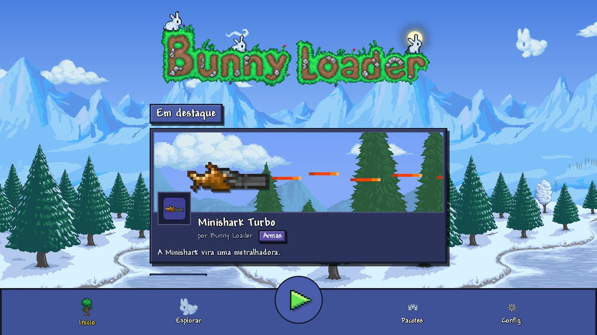
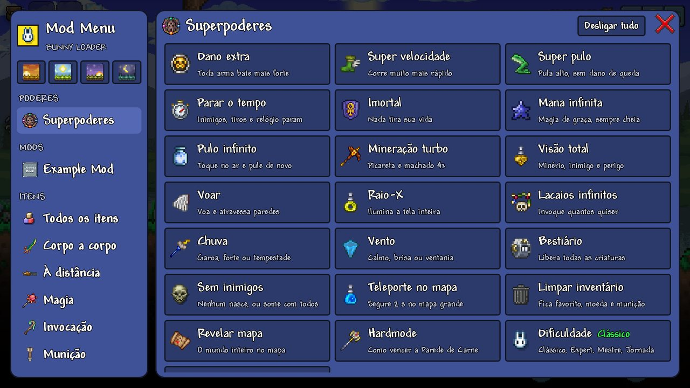
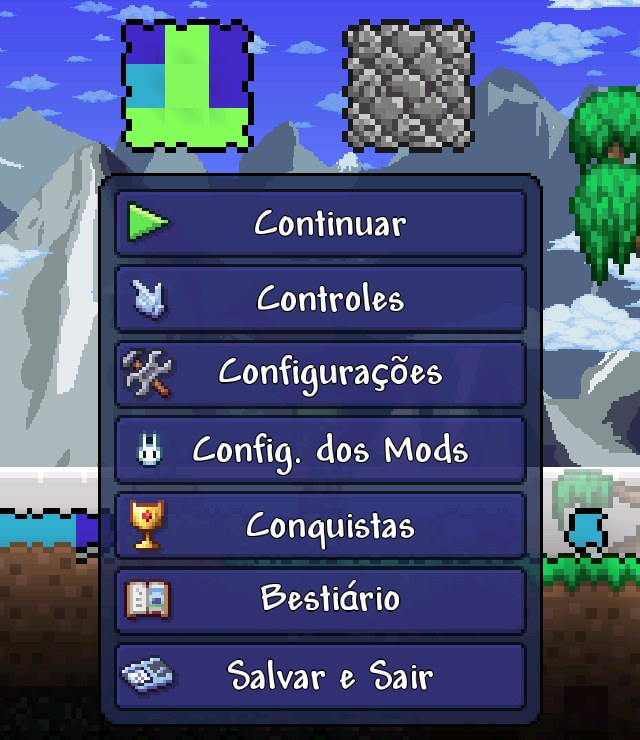
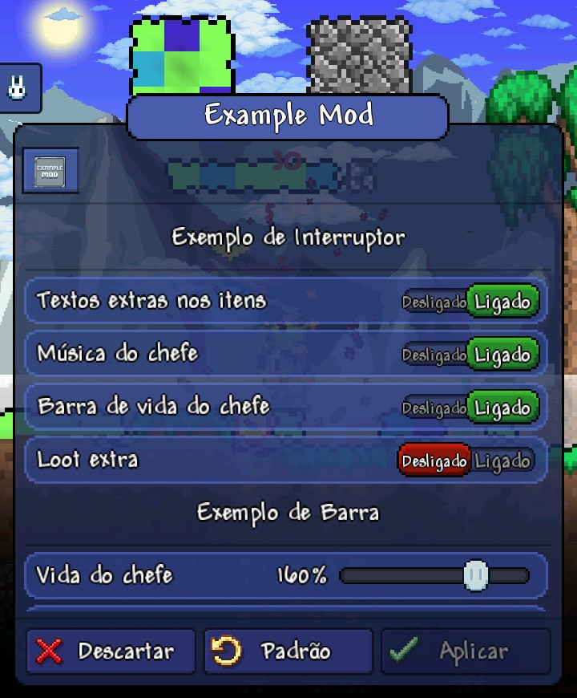

<p align="center"></p>

# Bunny Loader

A mod loader for **Terraria Mobile**. It is an Android app that boots the game
inside its own process, hooks methods of the native code generated by IL2CPP
and runs mods written in **C#**, in the tModLoader style
(`ModItem`, `ModNPC`, `ModProjectile`, `SetDefaults`, `AI`, `On_Item.SetDefaults`...).



- C# mods, on a .NET runtime (Mono) inside the game: typed access to every
  class, field and method of the game with autocomplete, tModLoader-style
  `On_` hooks and content classes. A mod can ship a compiled `.dll` or just its
  `.cs` files, which the PC tools or the phone compile.
- New content as in tModLoader: items, weapons, projectiles, pets, minions,
  enemies, town NPCs with shops, bosses with music, tiles, walls, buffs,
  recipes.
- Damage classes (`DamageClass`): "melee", "magic" or a brand-new class from
  your mod (a rogue, a bard), with per-class damage, crit, attack speed, armor
  penetration and knockback bonuses, inheritance between classes and the class
  name in the tooltip.
- Clean saves: mod content is stored next to the game's save, by name, and the
  world still opens without the mod.
- In-game Mod Menu: the items and NPCs of each mod, plus superpowers.
- Per-mod options in the pause menu, under **Mod Configuration**: toggles,
  sliders and single-choice options on the game's own Settings screen
  (tModLoader's `ModConfig`).
- Multiplayer only between Bunny Loader players: a Bunny Loader client does
  not join vanilla servers, and the host decides whether joining players may
  use the cheat menu.



<p align="center">


</p>

> This repository does **not** include Terraria's binaries or assets
> (`libil2cpp.so`, `libunity.so`, the game data), Unity's Java classes or the
> Andy font: they stay out of Git and are integrated locally, and the game only
> opens when Terraria from Google Play is installed on the device (Play is
> blocked without it).
> The dumps in `refs/` are generated locally and never published. Some UI
> textures (backgrounds, menu icons, example mod covers) are crops of Terraria's
> art, generated by `tools/ui-sprites.py` and `tools/mod-art.py`.

## Documentation

Everything lives in [`docs/`](docs/README.md) (also on the
[wiki](https://github.com/JonataOliveiraa/Bunny-Loader/wiki)). New to modding?
Start with [Making mods in C#](docs/mods-em-csharp/README.md), then read the
guides in order: each one builds on the previous. What changed in each version is in
[`changelogs/`](changelogs/), one file per version.

### Making mods in C#

| Guide | What you learn |
|---|---|
| [Overview](docs/mods-em-csharp/README.md) | How a C# mod reaches the game. |
| [1. Your first C# mod](docs/mods-em-csharp/01-primeiro-mod.md) | The tools, the project, the package, installing it and reading the log. |
| [2. Hooks](docs/mods-em-csharp/02-hooks.md) | `On_<Type>.<Method>`: before, after, replacing, skipping, overloads, getters. |
| [3. `ref`, `out` and `Nullable`](docs/mods-em-csharp/03-ref-out-e-nullable.md) | Methods that return through parameters and values that may be missing. |
| [4. Values and objects](docs/mods-em-csharp/04-valores-e-objetos.md) | `new Vector2`, `Item.New()`, fields, arrays, statics, strings, casts. |
| [5. C# × JS × tModLoader](docs/mods-em-csharp/05-comparacao.md) | The same mod in the three. |
| [6. Performance](docs/mods-em-csharp/06-desempenho.md) | Measured on a real phone, C# against JS. |
| [7. Moving to C#](docs/mods-em-csharp/07-migracao-para-csharp.md) | What exists, what is missing, what changes for you. |
| [8. Under the hood](docs/mods-em-csharp/08-por-baixo-dos-panos.md) | The runtime, the generated proxies, the calling convention, the two garbage collectors. |
| [9 to 16](docs/mods-em-csharp/README.md) | Content classes, tiles, systems, world generation, biomes, the title menu, sounds and mod configs. |

The [Example Mod C#](samples/ExampleModCSharp) is a port of tModLoader's
ExampleMod with working examples of what the guides teach.

### Working on Bunny Loader itself

- [The native core](docs/nucleo/README.md): [hooks](docs/nucleo/hooks.md),
  [new content](docs/nucleo/conteudo.md), [the C# plan](docs/nucleo/plano-csharp.md),
  [multiplayer sync](docs/nucleo/multijogador.md),
  [menu localization](docs/nucleo/localizacao-menu.md),
  [shader research](docs/nucleo/pesquisa-shaders.md) and
  [tModLoader contracts](docs/nucleo/compatibilidade-tmodloader-desenho-banners.md).
- [History](docs/historico/README.md): the decisions, investigations and
  measurements behind the design (hosting Unity, the architecture choice,
  bridge performance, crashes and freezes that were solved), and the removed
  JavaScript engine (the last version with it is the `js-final` tag).

Installed mods live in `Android/data/com.bunnyloader/bunny_packs/<uid>/`, and
the game loads them from there: you can edit a mod right on the device and just
reopen the game.

## A mod in 10 lines

```csharp
// DoubleDamage.cs: every weapon hits twice as hard
using Terraria;
using Terraria.ModLoader;

public class DoubleDamage : Mod
{
    public override void Load()
    {
        On_Item.SetDefaults += (orig, self, type, variant) =>
        {
            orig(self, type, variant);
            if (self.damage > 0) self.damage *= 2;
        };
    }
}
```

The complete example is [`ExampleModCSharp`](samples/ExampleModCSharp), the
port of tModLoader's. The other mods in [`samples/`](samples) are still in
JavaScript and wait for their C# port.

## Stack

| Layer | Technology |
|---|---|
| App and launcher | Kotlin + Jetpack Compose |
| Native core | C++20 (NDK + CMake) → `libbunny.so` |
| Hooks | [ShadowHook](https://github.com/bytedance/android-inline-hook) (inline, ARM64), with our own chain |
| IL2CPP | the embedding API (`il2cpp_*`), via `dlsym`; everything resolved by name |
| Mod engine | .NET 10 on Mono, with generated proxies of the game's types |
| C# compiler | Roslyn, for mods that ship `.cs` files |
| Game dump | Il2CppDumper |

## Layout

```
app/src/main/
  kotlin/dev/bunnyloader/   Android app: the launcher and the GameActivity that boots Unity
  cpp/                      Native core (libbunny.so); map in docs/nucleo/README.md
  csharp/                   C# API (BunnyLoader.dll), its proxy generator and the mod compiler
  res/                      Android resources
samples/                    Example mods, from the simplest to ExampleMod
docs/                       Documentation (guides, reference, core, history)
tools/                      PC tools: fast build, dump, tests, benchmark
refs/                       Local game dump (NOT versioned)
```

## Build

Open the folder in Android Studio and let **Gradle Sync** run: it downloads
Gradle and offers to install any missing SDK platform.

1. SDK Manager → **SDK Tools** tab → install **NDK (Side by side)** and
   **CMake**.
2. The game runtime (the `.so` files in `app/src/main/jniLibs/arm64-v8a/` and
   the data in `terraria1456_assets/`) is not in the repository; see the
   [folder's README](app/src/main/jniLibs/arm64-v8a/README.md). Without it the
   app builds and installs, and `GameActivity` reports that the runtime is
   missing.
3. Unity's classes (`app/libs/unity-classes.jar`) and the Andy font
   (`app/src/main/res/font/bunny.ttf`) also stay out of Git, since they belong
   to third parties. Without the jar the game does not boot ([`app/libs/README.md`](app/libs/README.md));
   without the font the app uses Comic Neue ([`app/src/fontFallback`](app/src/fontFallback/README.md)).
4. Mods need the **.NET 10 SDK** on the `PATH` (`dotnet`): the build
   compiles `BunnyLoader.dll` and downloads the Mono runtime from nuget.org
   once. Without the SDK, build with `-Pbl.csharp=false` (no mods load).

Shortcuts:

| | |
|---|---|
| `-Pbl.nativeBuild=false` | Launcher only, no NDK or CMake. |
| `-Pbl.uiOnly=true` | Without the game's assets and `.so` files: the UI cycle drops to ~6 s ([`tools/ui.sh`](tools/ui.sh)). |
| `-Pbl.csharp=false` | Without mods: no .NET SDK needed, and the APK loses the Mono runtime and the compiler. |

### Release APK

`assembleRelease` signs with the key from `keystore.properties` at the root
(copy [`keystore.properties.example`](keystore.properties.example), which also
has the `keytool` command to create the key). The variables
`BL_RELEASE_STORE_FILE`, `BL_RELEASE_STORE_PASSWORD`, `BL_RELEASE_KEY_ALIAS` and
`BL_RELEASE_KEY_PASSWORD` work too. The key and the file stay out of Git.
Without them, the release APK comes out unsigned.

When that key is set, the debug APK is signed with it too. Without it, Gradle
falls back to the debug key of the machine running the build.

Keep the key safe: Android only updates the app in place with the same
signature. The official APKs on the Releases page are signed with this
certificate:

```
SHA-256: DB:68:1B:9C:95:91:58:E8:AF:08:65:EC:2F:F1:A0:A1:B5:EB:6C:41:41:2D:86:FD:29:E6:AA:91:9B:E3:A6:90
```

An APK built on another machine has a different signature: installing it over
the official one (or the other way around) fails with "App not installed".
Back up `Android/data/com.bunnyloader` (players, worlds, mods) and uninstall
first. `apksigner verify --print-certs bunny-loader.apk` shows which key an APK
carries.

`versionCode` is the number of commits on the branch, so each new build can
update the previous one.

### Game dump

```bash
tools/dump.sh
```

Generates `refs/` (the `dump.cs` with every class, field and method of the
game) from the installed Terraria. See [`refs/README.md`](refs/README.md).

### Tests

The tests are mods in [`tools/tests/`](tools/tests), run on the emulator by
[`tools/tests/run-cs.sh`](tools/tests/run-cs.sh) (and
[`run-mp.sh`](tools/tests/run-mp.sh) on two devices). See
[`tools/README.md`](tools/README.md).
Development happens on MuMu Player (which runs the game's ARM code through
translation, and where hooks work) and is checked on a real ARM device.

## Acknowledgments

- The **tModLoader Team**, for the design of the mod classes and the original
  ExampleMod that our [`ExampleModCSharp`](samples/ExampleModCSharp) ports.
- **GST378** and **Animatak_**, authors of ExMod, the community port of
  tModLoader's ExampleMod to mobile, which helped shape our first examples.
- **TL Pro**, whose publicly documented JavaScript API (`NativeClass`,
  signature strings, `hook((original, self, ...args) => ...)`, the global `tl`
  object, later renamed `bl`) Bunny Loader's first bridge, the JavaScript one
  removed since, was modeled on. Inspecting
  the manifest, class names and file layout of TL Pro's Android package
  (version 1.64.0) informed our choice of hosting Unity in our own process. No
  TL Pro code or assets are part of Bunny Loader, and Bunny Loader is not
  affiliated with or endorsed by TL Pro.

## License

Bunny Loader is **source-available for noncommercial use** under the
[PolyForm Noncommercial License 1.0.0](LICENSE.md): use it, study it, modify it
and share it for free, but not to make money. Selling it, putting ads in it, or
locking features behind payment needs written permission.

- [LICENSING.md](LICENSING.md): what applies to each part, what counts as
  commercial use, and the clause that keeps mods under their authors' own
  licenses.
- [TRADEMARKS.md](TRADEMARKS.md): forks need their own name, icon and
  `applicationId`.
- [THIRD_PARTY_NOTICES.md](THIRD_PARTY_NOTICES.md): ShadowHook,
  the .NET runtime (Mono), Roslyn, tModLoader, AndroidX and the parts this license does not cover (Terraria,
  Unity, the Andy font).
- [CONTRIBUTING.md](CONTRIBUTING.md) and [SECURITY.md](SECURITY.md).

The only official builds are the ones in this repository's
[Releases](https://github.com/JonataOliveiraa/Bunny-Loader/releases).
