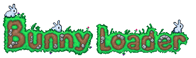
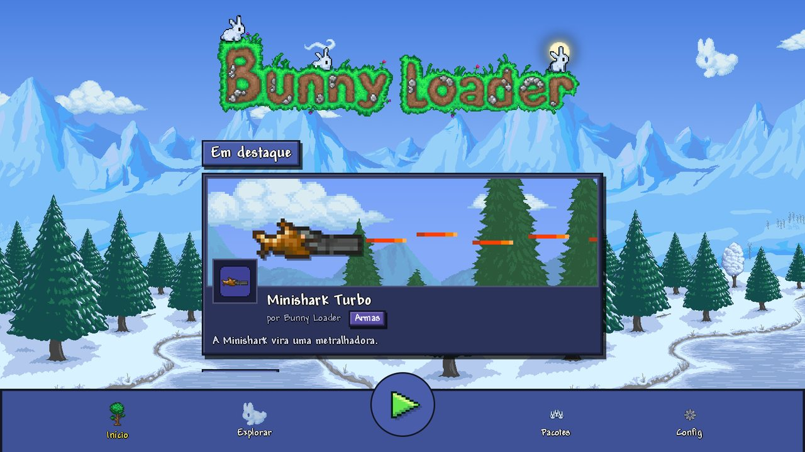
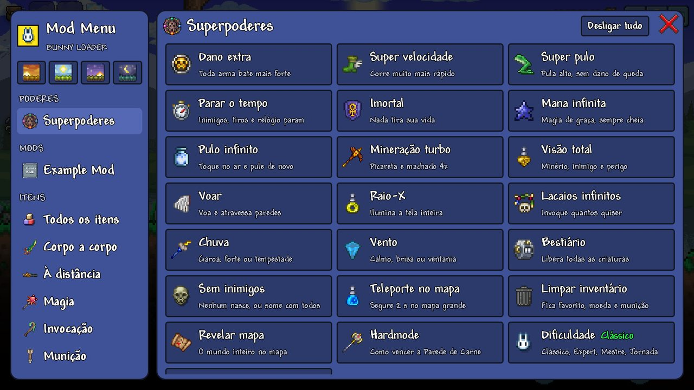
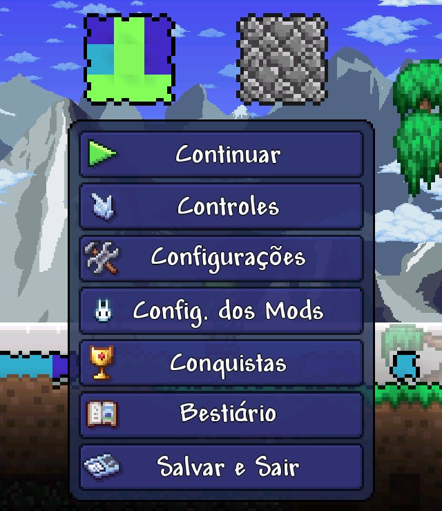
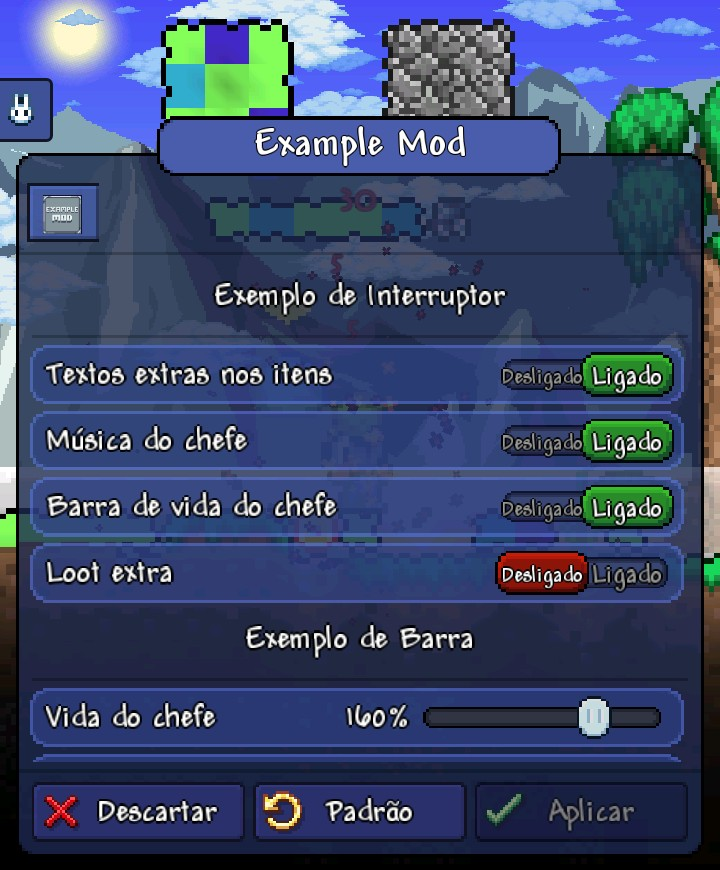

<p align="center"></p>

# Bunny Loader

A mod loader for **Terraria Mobile**. It is an Android app that boots the game
inside its own process, hooks methods of the native code generated by IL2CPP
and runs mods written in **JavaScript**, in the tModLoader style
(`ModItem`, `ModNPC`, `ModProjectile`, `SetDefaults`, `AI`...).



- JavaScript mods (the [QuickJS](https://github.com/quickjs-ng/quickjs) engine,
  no JIT), with direct access to the game's classes and `hook()` on any method.
- New content as in tModLoader: items, weapons, projectiles, pets, minions,
  enemies, town NPCs with shops, bosses with music, tiles, walls, buffs,
  recipes.
- Damage classes (`DamageClass`): "melee", "magic" or a brand-new class from
  your mod (a rogue, a bard), with per-class damage, crit, attack speed, armor
  penetration and knockback bonuses, inheritance between classes and the class
  name in the tooltip.
- Clean saves: mod content is stored next to the game's save, by name, and the
  world still opens without the mod.
- In-game Mod Menu: the items and NPCs of each mod, plus superpowers.
- Per-mod options in the pause menu, under **Mod Configuration**: toggles,
  sliders and single-choice options on the game's own Settings screen
  (tModLoader's `ModConfig`).
- Online catalog: the launcher's **Explore** tab lists published mods and
  downloads and updates them with one tap, with no account and no token in the
  app.



<p align="center">


</p>

> This repository does **not** include Terraria's binaries or assets
> (`libil2cpp.so`, `libunity.so`, the game data), Unity's Java classes or the
> Andy font: they stay out of Git and are integrated locally, and the game only
> opens for people who have the official Terraria from Google Play installed.
> The dumps in `refs/` are generated locally and never published. Some UI
> textures (backgrounds, menu icons, example mod covers) are crops of Terraria's
> art, generated by `tools/ui-sprites.py` and `tools/mod-art.py`.

## Documentation

Everything lives in [`docs/`](docs/README.md) (also on the
[wiki](https://github.com/JonataOliveiraa/Bunny-Loader/wiki)). New to modding?
Start with [Making mods](docs/mods/README.md), then read the guides in order:
each one builds on the previous.

### Making mods

| Guide | What you learn |
|---|---|
| **The bridge to the game** | |
| [0. How it works](docs/mods/00-como-funciona.md) | The whole flow, from boot to `UseItem`: what is C++, what is JS. Optional. |
| [1. Hooks](docs/mods/01-hooks-do-zero.md) | Your first mod: classes, fields, methods, structs and hooks on anything in the game. |
| [2. `ref` and `out`](docs/mods/02-ref-e-out.md) | Calling and hooking methods that return through parameters. |
| [3. Cost and performance](docs/mods/03-custo-e-desempenho.md) | What each thing costs and how to keep a mod light. |
| **New content** | |
| [4. New content: the ideas](docs/mods/04-conteudo-novo.md) | Template and instance, `ModContent`, textures, localization, saves. |
| [5. Items](docs/mods/05-itens.md) | `ModItem`: weapons, accessories, tooltips, recipes, prefixes. |
| [6. Projectiles](docs/mods/06-projeteis.md) | `ModProjectile`: AI, collision, drawing, pets, minions. |
| [7. NPCs](docs/mods/07-npcs.md) | `ModNPC`: enemies, drops, spawning, Bestiary, town NPCs, bosses. |
| [8. Player and buffs](docs/mods/08-jogador-e-buffs.md) | `ModPlayer` (dash, saved data) and `ModBuff`. |
| [9. Tiles](docs/mods/09-blocos.md) | `ModTile` and `ModWall`: blocks, furniture, and worlds that open without the mod. |
| [10. Sounds and music](docs/mods/10-sons-e-musica.md) | `SoundStyle`, `SoundEngine.PlaySound`, boss music. |
| [15. Damage classes](docs/mods/15-classes-de-dano.md) | `DamageClass`, per-class bonuses and new classes. |
| [16. Hits](docs/mods/16-golpes.md) | `CanHit`, `ModifyHit`, `OnHit`; `HitModifiers` and `HurtModifiers`. |
| [17. Screen effects](docs/mods/17-efeitos-de-tela.md) | Post-processing with GLSL: 18 presets, `ModScreenEffect`, `/fx` and hot reload. |
| [18. Touch buttons](docs/mods/18-botoes-de-toque.md) | `ModTouchButton` (tModLoader's `ModKeybind`): your own buttons in the game's controls. |
| [19. Dust](docs/mods/19-poeiras.md) | `ModDust`: your own particles, with `Update`, `UpdateType`, `GetAlpha` and `PreDraw`. |
| [20. Interface](docs/mods/20-interface.md) | `UIState`, `UserInterface`, panels, buttons, lists, `ModifyInterfaceLayers`, resource bars and `ModResourceOverlay`. |
| **Between mods and the world** | |
| [11. Talking between mods](docs/mods/11-conversa-entre-mods.md) | `ModLoader.TryGetMod` and `Call`. |
| [12. Globals and the world](docs/mods/12-globais-e-mundo.md) | `GlobalItem`/`GlobalNPC`/`GlobalProjectile`, `ModSystem`, world data, networking. |
| **Publishing** | |
| [13. The package page](docs/mods/13-pagina-do-pacote.md) | Description, changelog, license and authors with photos. |
| [14. Mod options](docs/mods/14-opcoes-do-mod.md) | `ModConfig` and the "Mod Configuration" screen. |
| [Texture packs](docs/mods/14-pacotes-de-textura.md) | Replacing sprites with PNGs, no code. |

The [Example Mod](samples/ExampleMod) is a port of tModLoader's ExampleMod
with working examples of what the guides teach.

### Reference

| Page | What it has |
|---|---|
| [Methods by class](docs/referencia/metodos.md) | Every method of the JavaScript API, also as an [Excel spreadsheet](docs/referencia/metodos.xlsx) and a [CSV](docs/referencia/metodos.csv). |
| [What each class has today](docs/referencia/classes.md) | `ModItem`, `ModNPC`, `ModPlayer`... field by field, and what is still missing from tModLoader. |
| [The bridge and `bl`](docs/referencia/ponte-e-bl.md) | The syntax for talking to the game and every `bl.*` function. |
| [ModPlayer hooks](docs/referencia/modplayer-hooks.md) · [ModSystem hooks](docs/referencia/modsystem-hooks.md) | When each hook runs, for combat, items, drawing, saving, world generation and networking. |
| [ModItem: use and ammo](docs/referencia/moditem-uso-municao.md) · [healing](docs/referencia/moditem-cura.md) · [combat](docs/referencia/moditem-combate.md) | The detailed contracts and how the mobile game differs. |
| [PlayerDrawLayer](docs/referencia/playerdrawlayers.md) | Custom layers on the player. |

### Working on Bunny Loader itself

- [The native core](docs/nucleo/README.md): [hooks](docs/nucleo/hooks.md),
  [threads and the JS engine](docs/nucleo/threads-e-motor-js.md),
  [the bridge](docs/nucleo/ponte.md), [new content](docs/nucleo/conteudo.md),
  [multiplayer sync](docs/nucleo/multijogador.md),
  [menu localization](docs/nucleo/localizacao-menu.md),
  [shader research](docs/nucleo/pesquisa-shaders.md) and
  [tModLoader contracts](docs/nucleo/compatibilidade-tmodloader-desenho-banners.md).
- [History](docs/historico/README.md): the decisions, investigations and
  measurements behind the design (hosting Unity, the architecture choice,
  bridge performance, crashes and freezes that were solved).

Installed mods live in `Android/data/com.bunnyloader/bunny_packs/<uid>/`, and
the game loads them from there: you can edit a mod right on the device and just
reopen the game.

## A mod in 10 lines

```js
// content/main.js: every weapon hits twice as hard
Terraria.Item['void SetDefaults(int Type, ItemVariant variant)'].hook((original, self, type, variant) => {
    original(self, type, variant);
    if (self.damage > 0) self.damage *= 2;
});

bl.log('Double Damage: active');
```

The complete examples are in [`samples/`](samples), from the smallest
([`DobroDeDano`](samples/DobroDeDano)) to [`ExampleMod`](samples/ExampleMod),
the port of tModLoader's.

## Stack

| Layer | Technology |
|---|---|
| App and launcher | Kotlin + Jetpack Compose |
| Native core | C++20 (NDK + CMake) → `libbunny.so` |
| Hooks | [ShadowHook](https://github.com/bytedance/android-inline-hook) (inline, ARM64), with our own chain |
| IL2CPP | the embedding API (`il2cpp_*`), via `dlsym`; everything resolved by name |
| Mod engine | QuickJS (quickjs-ng) |
| Game dump | Il2CppDumper |

## Layout

```
app/src/main/
  kotlin/dev/bunnyloader/   Android app: the launcher and the GameActivity that boots Unity
  cpp/                      Native core (libbunny.so); map in docs/nucleo/README.md
  res/                      Android resources
samples/                    Example mods, from the simplest to ExampleMod
docs/                       Documentation (guides, reference, core, history)
tools/                      PC tools: fast build, dump, tests, benchmark
refs/                       Local game dump (NOT versioned)
```

## Build

Open the folder in Android Studio and let **Gradle Sync** run: it downloads
Gradle and offers to install any missing SDK platform.

1. SDK Manager → **SDK Tools** tab → install **NDK (Side by side)** and
   **CMake**.
2. Clone QuickJS into `app/src/main/cpp/third_party/quickjs/` (see the
   [README there](app/src/main/cpp/third_party/README.md)). Without it the
   build passes and the mod engine runs in stub mode.
3. The game runtime (the `.so` files in `app/src/main/jniLibs/arm64-v8a/` and
   the data in `terraria1456_assets/`) is not in the repository; see the
   [folder's README](app/src/main/jniLibs/arm64-v8a/README.md). Without it the
   app builds and installs, and `GameActivity` reports that the runtime is
   missing.
4. Unity's classes (`app/libs/unity-classes.jar`) and the Andy font
   (`app/src/main/res/font/bunny.ttf`) also stay out of Git, since they belong
   to third parties. Without the jar the game does not boot ([`app/libs/README.md`](app/libs/README.md));
   without the font the app uses Comic Neue ([`app/src/fontFallback`](app/src/fontFallback/README.md)).

Shortcuts:

| | |
|---|---|
| `-Pbl.nativeBuild=false` | Launcher only, no NDK or CMake. |
| `-Pbl.uiOnly=true` | Without the game's assets and `.so` files: the UI cycle drops to ~6 s ([`tools/ui.sh`](tools/ui.sh)). |

### Release APK

`assembleRelease` signs with the key from `keystore.properties` at the root
(copy [`keystore.properties.example`](keystore.properties.example), which also
has the `keytool` command to create the key). The variables
`BL_RELEASE_STORE_FILE`, `BL_RELEASE_STORE_PASSWORD`, `BL_RELEASE_KEY_ALIAS` and
`BL_RELEASE_KEY_PASSWORD` work too. The key and the file stay out of Git.
Without them, the release APK comes out unsigned.

Keep the key safe: Android only updates the app in place with the same
signature. Anyone who installed a debug APK has to uninstall it before moving
to the release one.

### Game dump

```bash
tools/dump.sh
```

Generates `refs/` (the `dump.cs` with every class, field and method of the
game) from the installed Terraria. See [`refs/README.md`](refs/README.md).

### Tests

The tests are mods in [`tools/tests/`](tools/tests), run on the emulator by
[`tools/bench/run.sh`](tools/bench/run.sh). See [`tools/README.md`](tools/README.md).
Development happens on MuMu Player (which runs the game's ARM code through
translation, and where hooks work) and is checked on a real ARM device.

## Acknowledgments

- The **tModLoader Team**, for the design of the mod classes and the original
  ExampleMod that our [`ExampleMod`](samples/ExampleMod) ports.
- **GST378** and **Animatak_**, authors of ExMod, the community port of
  tModLoader's ExampleMod to mobile, which helped shape our first examples.
- **TL Pro**, whose publicly documented JavaScript API (`NativeClass`,
  signature strings, `hook((original, self, ...args) => ...)`, the global `tl`
  object, later renamed `bl`) Bunny Loader's bridge was modeled on. Inspecting
  the manifest, class names and file layout of TL Pro's Android package
  (version 1.64.0) informed our choice of hosting Unity in our own process. No
  TL Pro code or assets are part of Bunny Loader, and Bunny Loader is not
  affiliated with or endorsed by TL Pro.

## License

Bunny Loader is **source-available for noncommercial use** under the
[PolyForm Noncommercial License 1.0.0](LICENSE.md): use it, study it, modify it
and share it for free, but not to make money. Selling it, putting ads in it, or
locking features behind payment needs written permission.

- [LICENSING.md](LICENSING.md): what applies to each part, what counts as
  commercial use, and the clause that keeps mods under their authors' own
  licenses.
- [TRADEMARKS.md](TRADEMARKS.md): forks need their own name, icon and
  `applicationId`.
- [THIRD_PARTY_NOTICES.md](THIRD_PARTY_NOTICES.md): QuickJS-ng, ShadowHook,
  tModLoader, AndroidX and the parts this license does not cover (Terraria,
  Unity, the Andy font).
- [CONTRIBUTING.md](CONTRIBUTING.md) and [SECURITY.md](SECURITY.md).

The only official builds are the ones in this repository's
[Releases](https://github.com/JonataOliveiraa/Bunny-Loader/releases).
