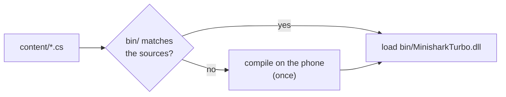
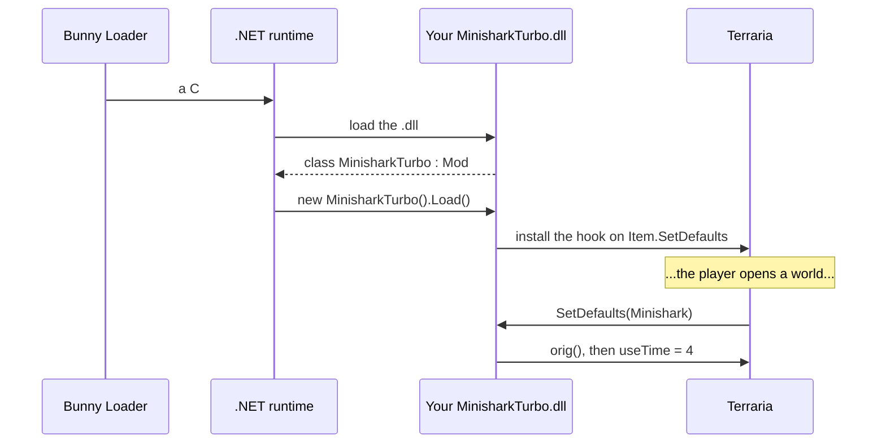

# 1. Your first C# mod

> [Overview](README.md) · **1. First mod** · [2. Hooks](02-hooks.md) · [3. `ref`, `out`, `Nullable`](03-ref-out-e-nullable.md) · [4. Values and objects](04-valores-e-objetos.md) · [5. C# × JS × tModLoader](05-comparacao.md) · [6. Performance](06-desempenho.md) · [7. Moving to C#](07-migracao-para-csharp.md) · [8. Under the hood](08-por-baixo-dos-panos.md) · [9. Damage classes](09-classes-de-dano.md)

By the end of this page you will have a mod that turns the Minishark into a
machine gun, built on your PC and running on your phone. Every step is here,
including the ones that usually go wrong.

## Step 1: the tools

1. Install the **.NET 10 SDK** from <https://dotnet.microsoft.com/download>.
   Check it in a terminal:

   ```bash
   dotnet --version
   ```

   It must print `10.` something. C# mods need 10: older SDKs do not
   understand some of the syntax the hooks use.
2. Install an editor: **VS Code** with the *C# Dev Kit* extension is free and
   enough. Visual Studio and Rider work too.

## Step 2: get `BunnyLoader.dll`

Your code talks to the game through `BunnyLoader.dll`. It is the C# version of
the game: every class (`Player`, `Item`, `NPC`, `Main`...), every field, every
method and every hook, generated from Terraria itself. It ships **inside the
Bunny Loader APK**:

1. Copy `bunny-loader.apk` to your PC and rename it to `bunny-loader.zip`.
2. Open it and take `assets/dotnet/BunnyLoader.dll`.

> The `.dll` belongs to that version of Bunny Loader. When you update the
> app, take it again: new versions may add types and hooks.

It is only a **reference** for the compiler. You never ship it with your mod:
the phone already has it.

## Step 3: the project

Make this folder layout. `src/` is your code, `package/` is what goes to the
phone:

```
MinisharkTurbo/
  lib/
    BunnyLoader.dll          ← from step 2 (not shipped)
  src/
    MinisharkTurbo.csproj
    MinisharkTurbo.cs
  package/                   ← this folder becomes the mod
    manifest.json
    content/
      MinisharkTurbo.dll     ← dotnet build puts it here
```

### `src/MinisharkTurbo.csproj`

```xml
<Project Sdk="Microsoft.NET.Sdk">

  <PropertyGroup>
    <TargetFramework>net10.0</TargetFramework>
    <Nullable>enable</Nullable>
    <!-- the .dll goes straight into the package -->
    <OutDir>../package/content/</OutDir>
    <AppendTargetFrameworkToOutputPath>false</AppendTargetFrameworkToOutputPath>
    <GenerateDependencyFile>false</GenerateDependencyFile>
  </PropertyGroup>

  <ItemGroup>
    <Reference Include="BunnyLoader">
      <HintPath>../lib/BunnyLoader.dll</HintPath>
      <!-- reference only: do not copy it into the package -->
      <Private>false</Private>
    </Reference>
  </ItemGroup>

</Project>
```

The two lines that matter: `net10.0` (the .NET version Bunny Loader runs) and
`<Private>false</Private>` (so `BunnyLoader.dll` does not end up in your
package).

### `src/MinisharkTurbo.cs`

```csharp
using BunnyLoader;
using Terraria;
using Terraria.ID;

public class MinisharkTurbo : Mod
{
    public override void Load()
    {
        On_Item.SetDefaults += (orig, self, type, variant) =>
        {
            orig(self, type, variant);
            if (type == ItemID.Minishark)
            {
                self.useTime = 4;
                self.useAnimation = 4;
            }
        };
        Log.Info("Minishark Turbo: active");
    }
}
```

Line by line:

| Line | What it means |
|---|---|
| `using BunnyLoader;` | Brings `Mod` and `Log`. |
| `using Terraria;` | Brings the game's classes: `Item`, `Player`, `Main`... and their hooks (`On_Item`, `On_Player`...). |
| `using Terraria.ID;` | Brings the ID tables: `ItemID.Minishark` is `98`. |
| `public class MinisharkTurbo : Mod` | Your **mod class**. Bunny Loader finds every class that extends `Mod` in your `.dll` and creates it on its own. Have exactly one. |
| `public override void Load()` | Runs **once**, when the game opens. It is where you install hooks. |
| `On_Item.SetDefaults += ...` | A **hook**: from now on, every time the game fills in an item (`Item.SetDefaults`), your function runs. [Guide 2](02-hooks.md) is all about this. |
| `orig(self, type, variant);` | Lets the game do its normal work first. |
| `self.useTime = 4;` | Then changes the item. `self` is the item being filled in. |
| `Log.Info(...)` | Writes to the mod log (see step 6). |

### `package/manifest.json`

The same manifest as a JS mod (all fields are explained in the
[JS guide](../mods/README.md#manifestjson)). The only difference is the
`entry`: it points to your `.dll`.

```json
{
  "uid": "5d0e8f3a-1b2c-4d5e-8f90-a1b2c3d4e5f6",
  "id": "minisharkturbo",
  "name": "Minishark Turbo (C#)",
  "version": "1.0.0",
  "authors": [{ "name": "You" }],
  "category": "Armas",
  "summary": "The Minishark becomes a machine gun.",
  "blVersion": 2,
  "entry": "MinisharkTurbo.dll"
}
```

Generate your **own** `uid` once and never change it:

```bash
python -c "import uuid; print(uuid.uuid4())"
```

## Step 4: build

```bash
cd MinisharkTurbo/src
dotnet build -c Release
```

`package/content/MinisharkTurbo.dll` appears. If the build fails, the error
names the file and line: that is the first big gift of C#. A typo like
`self.useTiem` never reaches the phone.

## Step 5: install

Zip the **contents** of `package/` (so the zip has `manifest.json` and
`content/` at its root) and import it on the phone: *Packages* tab →
*Import package*. Copying the folder or using adb works too: see
[Installing](../mods/README.md#installing).

## Step 6: run and read the log

Open the game and pick up a Minishark (or spawn one with the Mod Menu): it
fires like crazy. Your `Log.Info` line goes to:

- the session log, `Android/data/com.bunnyloader/logs/bunny_<date>.txt`;
- the **Mod Menu console**, live;
- *Settings → Diagnostics → View report*, in the section "última partida:
  linhas dos mods" (last session: mod lines), with a *Copy* button;
- `adb logcat -s BunnyLoader`, if you have a PC connected.

```
16:52:04.340 I [mod] Minishark Turbo: active
```

`Log.Warn` and `Log.Error` exist too. `Log.Error` also opens the error panel
inside the game (unless the player turned it off in Settings).

## The other way: ship the `.cs` files

You do not have to build anything. A mod can carry its **source files**, and
Bunny Loader compiles them itself. Point `entry` at a `.cs` file:

```json
{
  "uid": "5d0e8f3a-1b2c-4d5e-8f90-a1b2c3d4e5f6",
  "id": "minisharkturbo",
  "name": "Minishark Turbo (C#)",
  "version": "1.0.0",
  "blVersion": 2,
  "entry": "MinisharkTurbo.cs"
}
```

and put the code in `content/`, in as many files and folders as you like:

```
package/
  manifest.json
  content/
    MinisharkTurbo.cs        ← the entry: the class that extends Mod
    Items/
      Tuning.cs              ← every .cs here is part of the mod
```

The rules:

- **Every `.cs` file** in the entry's folder and its subfolders is compiled
  into one assembly named after the entry (`MinisharkTurbo.dll`). Folders
  named `bin/` and `obj/` are skipped.
- **A `.dll` next to the sources** (a library you ship) is a reference, and
  is found at run time too.
- **The options are those of the `.csproj` above**: the newest C#, nullable
  on, `unsafe` allowed, no implicit `using`s. You compile against
  `BunnyLoader.dll` and the
  [.NET libraries on the phone](08-por-baixo-dos-panos.md#the-net-libraries-on-the-phone).

### Who compiles it, and when



- **When you publish it to the catalog**, the catalog compiles it (the
  catalog app and `tools/mods/publish.py` alike). The package gets
  `content/bin/MinisharkTurbo.dll` and a stamp,
  `content/bin/MinisharkTurbo.build.json`. Players who download it never
  wait: Bunny Loader checks the stamp and loads the `.dll`.
- **When the stamp does not match**, Bunny Loader compiles on the phone the
  first time the game loads the mod, writes `bin/`, and from then on only
  checks the stamp (a few milliseconds). That happens when the package has no
  `bin/` (you imported a folder you just edited), when a source file changed,
  or when an update of Bunny Loader changed the API version.
- **Compiling on the phone is slow** the first time: the compiler itself has
  to warm up. Expect from several seconds for a small mod to minutes for one
  with hundreds of files, while the game is still loading.

The stamp holds a SHA-256 of every source file and shipped library, the API
version and the hash of the `.dll`. The compiler is deterministic: the same
sources give the same `.dll`, byte for byte, on the phone, in the catalog and
on a PC.

If the code does not compile, the mod stays off and the log names each error:

```
E [mod] mod 5d0e8f3a-...: Items/Tuning.cs(14,23): CS0103: The name 'Damag' does not exist in the current context
E [mod] mod 5d0e8f3a-...: MinisharkTurbo.cs did not compile (1 error(s))
```

The catalog refuses to publish a mod with errors, with the same messages.

**Which way?** Sources are the easiest way to share: anyone can read and
change the mod on the phone. A `.dll` built on your PC (steps 3 and 4) is
what you want while you write code: the IDE checks it as you type, and NuGet
packages are one line in the `.csproj`. You can keep the project from step 3
and still publish sources: the catalog only compiles what is in the package.

## What happens when the game opens



Things worth knowing:

- **The runtime only starts if a C# mod is enabled.** Without one, Bunny
  Loader costs exactly what it cost before.
- **`Load()` runs before any world exists**, on a background thread. Install
  hooks there; do not read `Main.player` there (there is no player yet).
- **To load a new build of your `.dll`, restart the game** (the Mod Menu has a
  *Restart* button). .NET cannot unload an assembly from a running game.
- **JS mods keep working** next to yours. *Settings → Developer → QuickJS*
  turns the JavaScript engine off entirely, if you want only C# mods.

## When something goes wrong

Everything below shows up in the log and in the error panel.

| The log says | What it means | What to do |
|---|---|---|
| `mod <uid>: no class extends BunnyLoader.Mod` | The `.dll` has no `: Mod` class. | Add one. |
| `mod <uid>: X.cs did not compile (N error(s))` | A mod with sources has errors (listed just above, with file and line). | Fix them; the next load compiles again. |
| `mod <uid>: compiling X.cs (the sources changed)` | Not an error: the stamp in `bin/` did not match, so the phone compiled. | Publish through the catalog so players get it compiled. |
| `mod <uid>: the .NET runtime did not start` | The APK has no C# runtime. | Update Bunny Loader. |
| `FileNotFoundException: Could not load file or assembly 'X'` | Your mod uses a library the phone does not have. | A library of your own (a NuGet package): put its `.dll` next to yours in `content/`. A `System.*` one outside [the list](08-por-baixo-dos-panos.md#the-net-libraries-on-the-phone): not available yet. |
| `game class Terraria.X not found` | A type that does not exist in this game version. | Check the name in the game's dump. |
| `MissingMethodException: Terraria.Item: 'void Foo(int x)' not found` | The method changed or does not exist in this game version. | Update `BunnyLoader.dll` and rebuild. |
| `struct layout ... differs from the game` | Your `BunnyLoader.dll` was made for another game version. | Use the `.dll` from the APK you have installed. |
| `NullReferenceException` | You used a game object that is null (often `new Item()`, see [guide 4](04-valores-e-objetos.md#objects-new-not-new)). | Check `IsNull` before using it. |

Next: [2. Hooks](02-hooks.md).
