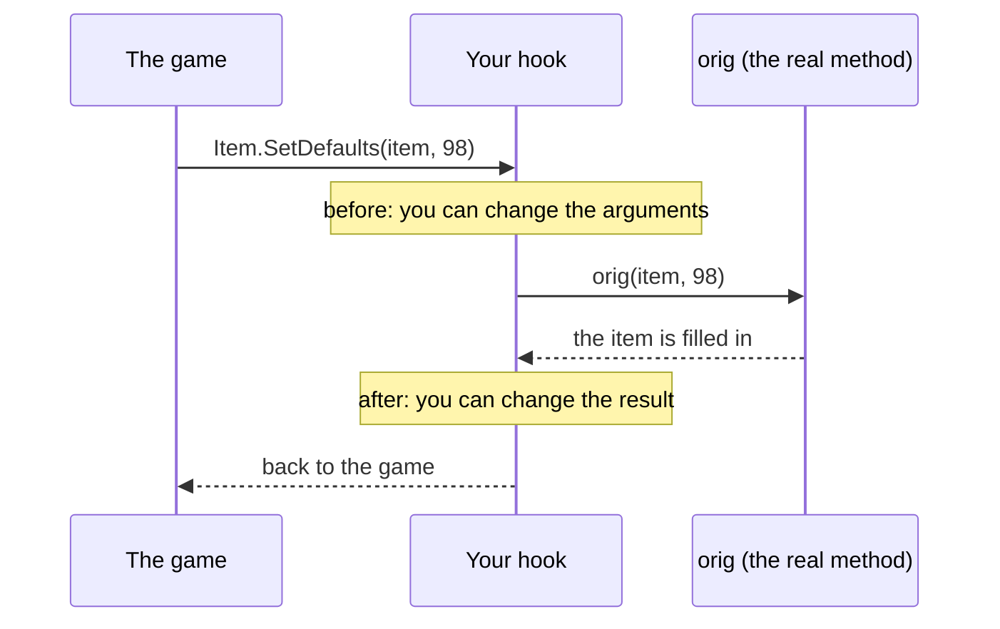
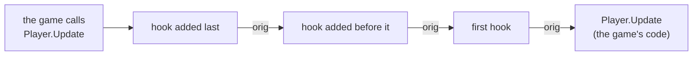

# 2. Hooks

> [Overview](README.md) · [1. First mod](01-primeiro-mod.md) · **2. Hooks** · [3. `ref`, `out`, `Nullable`](03-ref-out-e-nullable.md) · [4. Values and objects](04-valores-e-objetos.md) · [5. C# × JS × tModLoader](05-comparacao.md) · [6. Performance](06-desempenho.md) · [7. Moving to C#](07-migracao-para-csharp.md) · [8. Under the hood](08-por-baixo-dos-panos.md)

A hook is how a C# mod changes Terraria. This page teaches hooks from zero,
one idea at a time, with an example for each.

## The idea

Terraria is made of methods. `Item.SetDefaults` fills in a new item,
`Player.Update` runs the player every frame, `Lang.GetItemNameValue` gives an
item's name. A **hook** puts *you* between the game and one of those methods:



Think of it as a **receptionist**: every call to the method passes through
your desk first. You can let it through untouched, change what it carries,
answer it yourself, or not let it in at all.

The hook catches **every** call: from the game, from another mod, from your
own code.

## Anatomy of a hook

```csharp
On_Item.SetDefaults += (orig, self, type, variant) =>
{
    orig(self, type, variant);
    self.useTime = 4;
};
```

| Piece | What it is |
|---|---|
| `On_Item` | The hooks of the `Item` class. Every game type in `BunnyLoader.dll` has its `On_<Type>`: `On_Player`, `On_NPC`, `On_Main`, `On_WorldGen`, `On_Vector2`... |
| `.SetDefaults` | One event per method. Your editor's autocomplete lists them all. |
| `+=` | Adds your hook. `-=` removes it. |
| `orig` | "Do what you would have done": the rest of the chain and, at the end, the game's method. |
| `self` | The object the method runs on (here, the item). Only exists for **instance** methods. |
| `type, variant` | The method's own parameters, in the same order as in the game. |

The parameter names are yours to choose: `(orig, item, id, v)` works the
same. The **order** is what counts.

## The four things a hook can do

### 1. Change the result (call `orig` first)

The most common pattern. The game does its work, then you adjust:

```csharp
// Every weapon hits twice as hard.
On_Item.SetDefaults += (orig, self, type, variant) =>
{
    orig(self, type, variant);
    if (self.damage > 0) self.damage *= 2;
};
```

```csharp
// The player never loses life (every frame, refill it).
On_Player.Update += (orig, self, i) =>
{
    orig(self, i);
    self.statLife = self.statLifeMax2;
};
```

### 2. Change the input (call `orig` with other arguments)

```csharp
// Every chat message gets a prefix.
On_Main.NewText_string_byte_byte_byte_bool += (orig, text, r, g, b, onlyLocal) =>
    orig("[BL] " + text, r, g, b, onlyLocal);
```

### 3. Replace the return value

When the method returns something, your hook returns it too. You decide
what:

```csharp
// The Minishark gets a new name; every other item keeps its own.
On_Lang.GetItemNameValue += (orig, id) =>
    id == ItemID.Minishark ? "Turbo Shark" : orig(id);
```

### 4. Skip the game's method

If you never call `orig`, the game's method **does not run**:

```csharp
// It never starts raining.
On_Main.StartRain += (orig, instant, strength, coinRain) => { };
```

Use this one carefully: whatever the method did (and whatever other mods'
hooks after yours did) does not happen.

## Static methods have no `self`

`Main.StartRain`, `Lang.GetItemNameValue` and `WorldGen.InWorld` are
`static`: they do not belong to an object. Their hooks go straight from `orig`
to the parameters, as you saw above.

How do you know? Autocomplete shows the delegate. `On_Lang.hook_GetItemNameValue`
is `(orig, int id) → string?`, with no `self`.

## Overloads: when one name has several methods

Some methods exist in several versions (overloads). `WorldGen.InWorld`, for
example:

```
bool InWorld(int x, int y, int fluff = 0)
bool InWorld(Point p, int fluff = 0)
bool InWorld(Rectangle rect, int fluff = 0)
```

Each one is a different method, so each one has its own hook. Their names
get the parameter types appended:

| Method in the game | Hook |
|---|---|
| `InWorld(int x, int y, int fluff)` | `On_WorldGen.InWorld_int_int_int` |
| `InWorld(Point p, int fluff)` | `On_WorldGen.InWorld_Point_int` |
| `Dot(ref Vector2 a, ref Vector2 b, out float r)` | `On_Vector2.Dot_refVector2_refVector2_outfloat` |
| `NewText(string, byte, byte, byte, bool)` | `On_Main.NewText_string_byte_byte_byte_bool` |
| `SetDefaults(int, ItemVariant)` (the only `SetDefaults`) | `On_Item.SetDefaults` |

The rule:

- a method with **one** version: just its name;
- with several: name + `_` + each parameter's type, with `ref`, `out` or `in`
  in front when it has one. Primitive types use the C# keyword (`int`,
  `float`, `bool`), other types their short name (`Point`, `Vector2`), arrays
  end in `Array`.

You rarely need to build the name yourself: type `On_WorldGen.InWorld` and
the editor shows the options.

> tModLoader names some overloads slightly differently (`refInt32` instead of
> `outint`). See [the comparison](05-comparacao.md#c-on-bunny-loader-vs-tmodloader).

## Properties: `get_` and `set_`

A C# property is two methods underneath, and each one can be hooked:

```csharp
// Player.HandPosition is a property: its getter is get_HandPosition.
On_Player.get_HandPosition += (orig, self) =>
{
    var hand = orig(self);
    return hand;
};
```

## A named method instead of a lambda (the tModLoader style)

Everything above used lambdas, but a hook can be a normal method. The
delegate types are `On_<Type>.orig_<Method>` and `On_<Type>.hook_<Method>`:

```csharp
public class NoFallDamage : Mod
{
    public override void Load()
    {
        On_Player.Update += KeepFallStart;
    }

    // Terraria measures a fall from fallStart. Moving it to where the player
    // is, every frame, makes every fall zero tiles long.
    static void KeepFallStart(On_Player.orig_Update orig, Player self, int i)
    {
        orig(self, i);
        int tileY = (int)(self.position.Y / 16);
        self.fallStart = tileY;
        self.fallStart2 = tileY;
    }
}
```

This is exactly how tModLoader's ExampleMod writes its hooks.

## Removing a hook

`-=` needs the **same** delegate you added, so keep it in a variable:

```csharp
static On_MathHelper.hook_Clamp? clampHook;

public override void Load()
{
    clampHook = (orig, value, min, max) => orig(value, min, max);
    On_MathHelper.Clamp += clampHook;
}

void Later()
{
    On_MathHelper.Clamp -= clampHook;
}
```

Good to know: the first hook on a method patches the game's code once, and
that patch stays until the game closes. After you remove every hook, calls
still pass through it and go straight to the game, which costs a little.
Hook only what you need ([Performance](06-desempenho.md)).

## Several hooks on the same method

Your mod, another C# mod and a JS mod can all hook `Player.Update`. They form
a **chain**: each one's `orig` is the next one, and the last `orig` is the
game.



The hook added **last runs first** (outermost), as in tModLoader. That is why
calling `orig` matters: if a hook in the middle skips it, the ones after it
and the game's method do not run.

## Where and when to install

- **In `Load()`**: the normal place. It runs once, when the game opens.
- **Later**, in another hook, is allowed too. The first hook on a method
  takes a moment (it patches the game), so avoid installing them every frame.
- Hooks run **on the thread that called the method**. Almost everything runs
  on the game's main thread, but world generation and saving have their own.
  Keep shared state simple.

## When something throws

| What happens | Result |
|---|---|
| **Your hook** throws an exception | It goes to the error log (and the error panel). The game method still runs: if your hook had not called `orig` yet, Bunny Loader calls it for you. The game does not crash. |
| **The game** throws inside `orig` | You receive a `GameException` with the game's message. Catch it if you want; otherwise it goes to the log like any other. |

```csharp
// Collision.CanHit with a null entity throws inside the game.
On_Collision.CanHit_Entity_Entity += (orig, source, target) =>
{
    try { return orig(source, target); }
    catch (GameException e)
    {
        Log.Warn($"CanHit failed: {e.Message}");
        return false;
    }
};
```

## Common mistakes

| Mistake | What happens | Fix |
|---|---|---|
| Forgetting `orig` | The game's method (and every hook after yours) never runs. | Call `orig` unless skipping is the point. |
| Calling `orig` twice | The game does the work twice: two items, two hits. | Once. |
| Calling the hooked method itself inside its hook (`Lang.GetItemNameValue(id)` inside `On_Lang.GetItemNameValue`) | It passes through your hook again: infinite recursion. | Call `orig(id)`. |
| Heavy work in a hook the game calls hundreds of times per frame | Frame drops. | Filter first (`if (type != ...) return`), cache, see [Performance](06-desempenho.md). |
| `new Item()` | A null item and a `NullReferenceException`. | `Item.New()`, see [guide 4](04-valores-e-objetos.md#objects-new-not-new). |

## Cheat sheet

```csharp
On_T.M += (orig, self, a, b) => { orig(self, a, b); };          // instance, void
On_T.M += (orig, a, b) => orig(a, b);                           // static, returns
On_T.M += (orig, self, a) => { /* no orig: skips the game */ };
On_T.M_int_float += ...;                                         // an overload
On_T.get_P += (orig, self) => orig(self);                        // property getter
On_T.M += Handler;  static R Handler(On_T.orig_M orig, T self, A a) { ... }
On_T.M -= handler;                                               // remove
```

Next: [3. `ref`, `out` and `Nullable`](03-ref-out-e-nullable.md).
