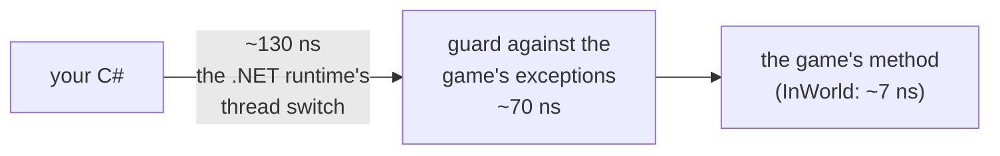

# 6. Performance

> [Overview](README.md) · [1. First mod](01-primeiro-mod.md) · [2. Hooks](02-hooks.md) · [3. `ref`, `out`, `Nullable`](03-ref-out-e-nullable.md) · [4. Values and objects](04-valores-e-objetos.md) · [5. C# × JS × tModLoader](05-comparacao.md) · **6. Performance** · [7. Moving to C#](07-migracao-para-csharp.md) · [8. Under the hood](08-por-baixo-dos-panos.md) · [9. Content classes](09-conteudo.md)

Measured, not guessed: the same cases written in C# and in JavaScript, run in
the same game session on a **Samsung Galaxy A15 (SM-A156M, Android 16)**.
Each case runs three rounds; the table shows the median, minus the cost of an
empty loop.

## The numbers

**Your own code (no game involved):**

| Case | C# | JavaScript | C# is |
|---|---:|---:|---:|
| Integer loop, 1 million iterations | 2.3 ms | 67.8 ms | **29× faster** |
| `fib(20)`, recursive | 82 µs | 1,488 µs | **18×** |
| Allocate 100,000 small objects | 2.1 ms | 25.1 ms | **12×** |
| `sin` + `sqrt`, 100,000 times | 4.9 ms | 19.9 ms | **4×** |
| Map/Dictionary, 10,000 set + get | 1.2 ms | 4.7 ms | **4×** |
| String building, 1,000 parts | 85 µs | 330 µs | **4×** |
| Sort 10,000 integers | 1.1 ms | 3.9 ms | **3.6×** |

**Reading and writing the game:**

| Case | C# | JavaScript | C# is |
|---|---:|---:|---:|
| `new Vector2(1, 2)` | 2.9 ns | 1,320 ns | **457×** |
| `new Color(1, 2, 3)` | 26 ns | 3,235 ns | **123×** |
| `p.position.X` (a struct field in an object) | 5.4 ns | 265 ns | **49×** |
| `p.head` (an `int` field) | 5.0 ns | 73 ns | **15×** |
| `p.statLife = p.statLife` (write) | 11 ns | 152 ns | **13×** |
| `p.inventory[p.selectedItem].type` | 103 ns | 734 ns | **7×** |
| `ItemID.Sets.Deprecated[5]` (static array) | 6.9 ns | 44 ns | **6×** |
| `Main.player[Main.myPlayer]` | 106 ns | 545 ns | **5×** |
| `Main.myPlayer` (a static property) | 94 ns | 136 ns | 1.4× |

**Calling the game's methods:**

| Case | C# | JavaScript | C# is |
|---|---:|---:|---:|
| `Vector2.Distance(a, b)` | 106 ns | 572 ns | **5.4×** |
| `p.Center` (property, returns a `Vector2`) | 82 ns | 427 ns | **5.2×** |
| `MathHelper.Clamp(x, 0, 10)` | 74 ns | 165 ns | **2.2×** |
| `Matrix.Add(a, b)` (64-byte struct) | 141 ns | not possible in JS | |
| `WorldGen.InWorld(x, y, 0)` | 211 ns | 254 ns | 1.2× |
| `Lang.GetItemNameValue(98)` (returns a string) | 314 ns | 343 ns | 1.1× |
| `p.CountBuffs()` | 339 ns | 261 ns | 0.8× (JS wins) |

**Hooks:**

| Case | C# | JavaScript | C# is |
|---|---:|---:|---:|
| Cost a pass-through hook adds to each call | **397 ns** | 609 ns | 1.5× |
| The same, on a method with `ref`/`out` | 384 ns | | |

The same 43 correctness checks (calls, hooks, `ref`, `out`, `Nullable`,
structs, strings, exceptions) pass on this phone and on the emulator.

## Why C# is so much faster at most things

- **JavaScript is interpreted.** QuickJS reads your code instruction by
  instruction. The .NET runtime compiles your C# to ARM machine code the first
  time a method runs; after that it is the processor running it directly.
- **A game field, in C#, is one memory read.** `p.head` becomes "read 4 bytes
  at the player's address + 0x634". In JS the same line goes through the
  bridge: find the member, check the type, convert the value.
- **A `Vector2` in C# is just two floats on the stack.** In JS it is an object
  that the bridge has to create, track and convert.

## Why calling the game is not much faster

Every C# call into the game crosses from the .NET world into the game's
native code. The crossing has two parts:



1. **The runtime's switch (~130 ns).** Before running non-.NET code, the
   .NET runtime marks the thread as "outside .NET", so its garbage collector
   does not wait for it. That is what keeps a long game method from freezing
   the runtime.
2. **The guard (~70 ns).** Arguments go into registers, and the call runs
   inside a guard that turns a game exception into a `GameException` instead
   of a crash.

For **XNA math** (`Vector2`, `Matrix`, `Color`, `MathHelper`...) and
**property getters** (`p.Center`, `Main.myPlayer`), Bunny Loader skips part 1:
they are short, never wait for anything, and never call mod code. That is why
`p.Center` costs 82 ns and `p.CountBuffs()` 339 ns.

## Making a fast mod

**Do the work in C#, cross into the game less.** Reading fields is nearly
free; calling methods is not.

```csharp
// Slower: one game call per NPC (Entity.Distance), ~300 ns each.
for (int i = 0; i < Main.npc.Length; i++)
{
    NPC npc = Main.npc[i];
    if (npc.active && npc.Distance(target) < 400f) near++;
}

// Faster: only fields (~5 ns each) and the math in C#.
for (int i = 0; i < Main.npc.Length; i++)
{
    NPC npc = Main.npc[i];
    if (!npc.active) continue;
    Vector2 center = npc.position + new Vector2(npc.width, npc.height) / 2f;
    Vector2 d = center - target;
    if (d.X * d.X + d.Y * d.Y < 400f * 400f) near++;
}
```

**Filter early in hooks.** A hook on a method the game calls hundreds of times
per frame costs ~0.4 µs per call even if it does nothing:

```csharp
On_Item.SetDefaults += (orig, self, type, variant) =>
{
    orig(self, type, variant);
    if (type != ItemID.Minishark) return;   // the common case leaves at once
    ...
};
```

**Budget it.** A frame at 60 fps has 16,600 µs. 1,000 hook calls per frame
are about 400 µs, 2.4% of it. 20,000 would be half the frame.

**Hook only what you need.** The first hook on a method patches the game, and
the patch stays even after you remove the hook: the calls keep passing
through it.

**Allocate little every frame.** C# objects are cheap (21 ns each above), but
each one is work for the .NET garbage collector later. Prefer structs
(`Vector2`, your own `struct`s) and reuse lists.

**Cache what you look up.** `ItemID.Minishark` is a constant (free).
`Lang.GetItemNameValue(98)` is a game call: if you need it every frame, keep
the string.

## Measuring your own mod

```csharp
using System.Diagnostics;

long t0 = Stopwatch.GetTimestamp();
// ...the code you want to measure, many times...
double us = Stopwatch.GetElapsedTime(t0).TotalMicroseconds;
Logger.Info($"took {us:0.0} µs");
```

The benchmark above is in the repository: `tools/tests/benchcs` and
`tools/tests/benchjs`, plus `tools/bench/compare_cs_js.py`, which turns the
log into the tables on this page. The *Bunny Loader Bench* app (a build with
`-Pbl.bench=true`) runs both on any phone and puts the results in *Settings →
Diagnostics → View report*.

Next tab: [7. Moving to C#](07-migracao-para-csharp.md).
