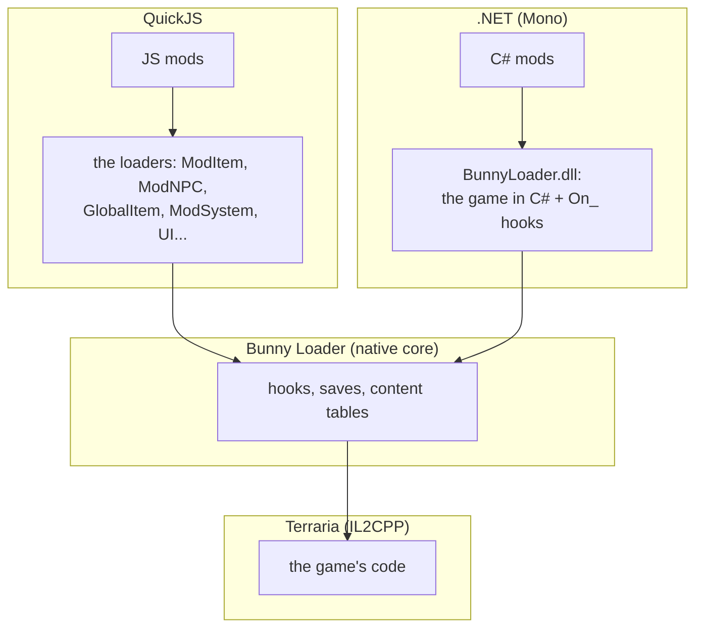

# 7. Moving to C#

> [Overview](README.md) · [1. First mod](01-primeiro-mod.md) · [2. Hooks](02-hooks.md) · [3. `ref`, `out`, `Nullable`](03-ref-out-e-nullable.md) · [4. Values and objects](04-valores-e-objetos.md) · [5. C# × JS × tModLoader](05-comparacao.md) · [6. Performance](06-desempenho.md) · **7. Moving to C#** · [8. Under the hood](08-por-baixo-dos-panos.md) · [9. Content classes](09-conteudo.md)

Bunny Loader started as a JavaScript mod loader. C# arrived next to it, and
the measurements in [Performance](06-desempenho.md) raise an obvious
question: **could Bunny Loader become C# only?** This page says where things
stand, what a full move would take, and what it would mean for you.

## Where things stand today



| Piece | Status |
|---|---|
| .NET runtime inside the game | ✅ done, tested on a real phone |
| The whole game as typed C# (classes, fields, methods, structs) | ✅ done, generated from the game |
| `On_` hooks with `ref`, `out`, `Nullable`, structs | ✅ done, 43/43 checks |
| Fast calls for XNA math and getters | ✅ done |
| Turning QuickJS off (*Settings → Developer → QuickJS*) | ✅ done: JS mods stop loading, C# mods keep working |
| **C# loaders**: the load order, `ModItem` ([guide 9](09-conteudo.md)) | ⚠️ started: items have defaults, texture, name and tooltip |
| **C# loaders**: `ModNPC`, `ModProjectile`, `ModTile`, `ModBuff`, `ModPlayer`, `ModSystem`, `Global*` | ❌ not started |
| Textures, sounds, music, localization, config and UI for C# mods | ❌ come with the loaders |
| A ready template / NuGet package for C# mods | ❌ for now, the `.dll` comes from the APK |
| C# mods in the online catalog | ⚠️ they install like any package; the catalog has not been tested with them |
| A JS mod calling a C# mod (and back) | ❌ |

The missing piece is the big one: the **loaders**. In JS they are about
32,000 lines: everything that turns "a class that extends `ModItem`" into an
item the game knows, saves, syncs in multiplayer and draws.

## What "full C#" would look like

The plan is to write the loaders **in C#**, following tModLoader's own C#
loaders. Then a content mod would look like this:

```csharp
// ⚠️ PLANNED — this does not exist yet.
public class TurboShark : ModItem
{
    public override void SetDefaults()
    {
        Item.CloneDefaults(ItemID.Minishark);
        Item.useTime = 4;
        Item.useAnimation = 4;
    }

    public override void AddRecipes()
    {
        CreateRecipe().AddIngredient(ItemID.Minishark).AddTile(TileID.Anvils).Register();
    }
}
```

That is tModLoader's code. Porting a tModLoader mod would mostly become
copying it, plus the [mobile differences](05-comparacao.md#c-on-bunny-loader-vs-tmodloader).

### Two ways it could go

| | **C# core, JS on top** | **C# only** |
|---|---|---|
| Loaders written in | C# | C# |
| JS mods | keep working: JS becomes a thin layer that calls the C# loaders | stop working (or are converted) |
| QuickJS | still there, off by default for players without JS mods | removed |
| For players | nothing breaks | old JS mods need a C# version |
| For the app | two engines to maintain | one |

Both start the same way: loaders in C#. The second step is a later decision.

### What changes for you, the modder

- **You build on a PC.** C# needs `dotnet build`. Editing code on the phone,
  as with the JS editor, would not exist for C# (unless an on-device compiler
  comes later, which is heavy on a phone).
- **Your mod gets faster** where it does work of its own (see the tables).
- **Errors move to compile time**: wrong names and types never reach the
  phone.
- **tModLoader knowledge transfers directly.**

### The costs, honestly

| Cost | Size |
|---|---|
| App size | about +10 MB in the APK, ~25 MB once installed (runtime, libraries and the generated game API) |
| Startup | about half a second to start the .NET runtime, only when a C# mod is enabled |
| Calling the game | 70–340 ns per call, similar to JS for normal methods ([why](06-desempenho.md#why-calling-the-game-is-not-much-faster)) |
| Game updates | the generated API is regenerated for each game version, and mods built against an old one may need a rebuild if a method they use changed |
| Two garbage collectors | the game's and .NET's; game objects kept across frames need `GameHandle` |

## What to do today

- **Hooks and game logic:** write them in C# now. Everything in the first four
  guides is stable.
- **New content:** keep it in JS for now. Your C# hooks and your JS content
  can be two packages installed together, and hooks on the same method share
  one chain.
- **Coming from tModLoader:** start by porting the `On_` hooks; the content
  waits for the loaders.

Next tab: [8. Under the hood](08-por-baixo-dos-panos.md).
