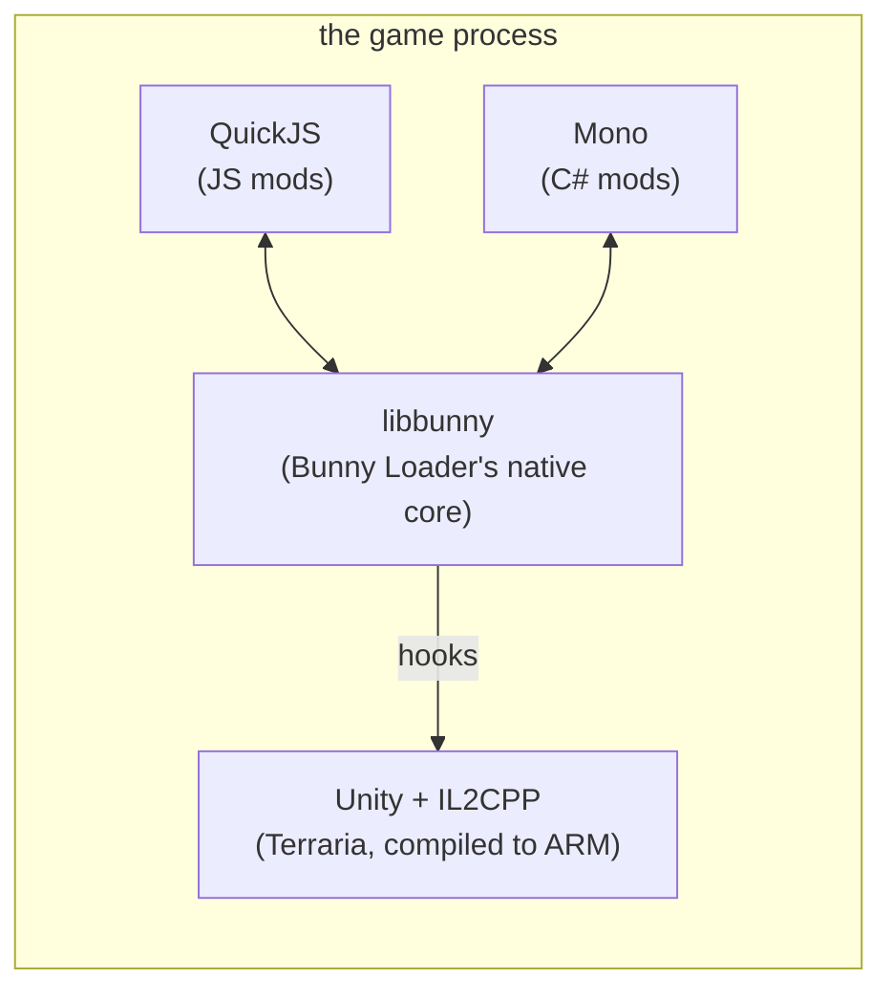
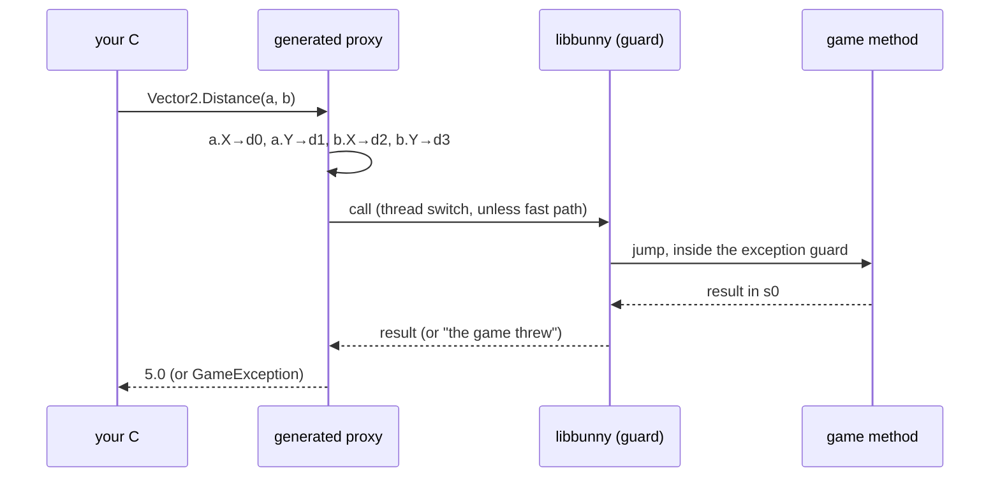
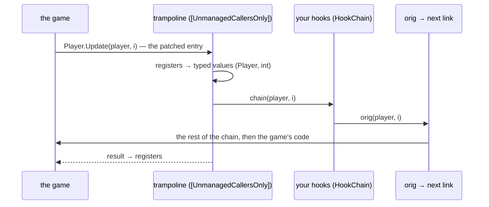

# 8. Under the hood

> [Overview](README.md) · [1. First mod](01-primeiro-mod.md) · [2. Hooks](02-hooks.md) · [3. `ref`, `out`, `Nullable`](03-ref-out-e-nullable.md) · [4. Values and objects](04-valores-e-objetos.md) · [5. C# × JS × tModLoader](05-comparacao.md) · [6. Performance](06-desempenho.md) · [7. Moving to C#](07-migracao-para-csharp.md) · **8. Under the hood** · [9. Content classes](09-conteudo.md)

You do not need this page to write mods. It explains how C# mods work inside
the game, for the curious and for whoever works on Bunny Loader itself.

## Three runtimes in one process



Terraria Mobile is C# compiled to native ARM code by Unity's **IL2CPP**:
there is no .NET runtime in the game. Bunny Loader brings its own: the
official **Mono** runtime for Android (the one .NET for Android uses), in the
same process as the game. It starts only when an enabled mod's entry is a
`.dll`.

## `BunnyLoader.dll`: the game, generated

A generator (`app/src/main/csharp/ProxyGen`) reads the game's metadata (the
types and signatures that IL2CPP keeps) and writes C# for each game type:

- **Classes** (`Player`, `Item`...) become small structs holding the object's
  address. Each field is a property that reads or writes at the field's
  offset; each method builds the call and enters the game.
- **Structs** (`Vector2`, `Matrix`...) become C# structs with **the same
  memory layout** as the game's, so they can be passed by value.
- **Enums** and **constants** (`ItemID.Minishark`) are copied as they are.
- **Hooks**: one `On_<Type>` class with one event per method.

Names are resolved **at runtime, by name**: field offsets and methods are
looked up the first time they are used and cached. A game update that moves a
field does not break a mod; only one that renames or removes it does. At
startup, the size of every mirrored struct is checked against the game, and a
mismatch is logged instead of silently reading the wrong bytes.

## A call into the game

The game's methods are native functions with the ARM64 calling convention
(AAPCS64): integers and pointers in registers `x0`–`x7`, floats in `d0`–`d7`,
small structs split across registers, big structs passed by address, big
returns through `x8`. The generator decides where each argument goes **when
it generates the code**, so at runtime a call is: fill a register frame, enter
the game.



**The exception guard.** A C# exception in IL2CPP is a native C++ exception.
If one crossed the .NET frames on its way up, the process would die. The
guard stops it right at the boundary and hands its message to C#, which
throws a `GameException`.

**The fast path.** Normally .NET marks the thread as "outside .NET" during the
call, so its garbage collector does not have to wait for it (~130 ns on a
phone). For XNA math and property getters, which are short and never call mod
code, that step is skipped.

## A hook



1. The first `+=` on a method patches the game's entry point (the same hook
   engine the JS mods use, so hooks of both languages form one chain).
2. The patch jumps into a generated **trampoline**: a C# method the native
   code can call directly, with the exact native signature.
3. The trampoline turns registers into typed values (`ref` parameters become
   real C# references to the game's variables) and calls your hooks.
4. `orig` calls the next link: another hook (C# or JS) or the game.
5. If your hook throws, the trampoline logs it and makes sure the game's
   method still ran.

## Two garbage collectors

The game has its collector (Boehm, from IL2CPP) and .NET has its own (SGen).
Two consequences shape the API:

- **They used the same signals** to pause threads. Bunny Loader pauses the
  game's collector while .NET starts, gives the signals back to the game, and
  runs .NET in *cooperative* mode, where it never sends them.
- **Neither sees the other's memory.** A game object referenced only from a
  C# field can be collected by the game. That is what `GameHandle` is for.
  Inside one call or one frame, the object is on the stack, where the game's
  collector does look, so nothing is needed.

## The .NET libraries on the phone

To keep the app small, it ships part of the .NET libraries: the ones a mod
commonly uses, plus the ones the compiler of mods with sources needs.

`System.Private.CoreLib` (the base: strings, collections like `List` and
`Dictionary`, `Math`, `Stopwatch`, threads, `StringBuilder`...),
`System.Runtime`, `System.Runtime.Extensions`, `System.Runtime.InteropServices`,
`System.Runtime.Loader`, `System.Runtime.Intrinsics`, `System.Runtime.Numerics`,
`System.Collections` (and `.Concurrent`, `.Immutable`, `.NonGeneric`,
`.Specialized`), `System.Linq`, `System.Linq.Expressions`, `System.Console`,
`System.Memory`, `System.Threading` (and `.Thread`, `.ThreadPool`,
`.Channels`, `.Tasks.Parallel`), `System.Text.RegularExpressions`,
`System.Text.Encoding.Extensions`, `System.Text.Encoding.CodePages`,
`System.Numerics.Vectors`, `System.ObjectModel`, `System.ComponentModel`,
`System.Security.Cryptography`, `System.IO.Compression`,
`System.IO.MemoryMappedFiles`, `System.Reflection.Metadata`,
`System.Reflection.Emit`, `System.Private.Xml` and `System.Xml.*`,
`System.Diagnostics.*`, `System.Private.Uri`.

The exact list is `assets/dotnet/references.txt` in the APK: it is also what a
mod with sources compiles against. A mod that needs another one
(`System.Text.Json`...) fails to load with `FileNotFoundException`.

**Libraries of your own** are fine: a `.dll` you ship next to your mod's in
`content/` (a NuGet package, a shared library of yours) is found when your
code first uses it. It must target .NET 10 or .NET Standard, and its own
dependencies must be there too. In the `.csproj`,
`<CopyLocalLockFileAssemblies>true</CopyLocalLockFileAssemblies>` makes
`dotnet build` copy your NuGet packages into the output.

## Mods with sources: one compiler, three places

A mod whose `entry` is a `.cs` file (see
[guide 1](01-primeiro-mod.md#the-other-way-ship-the-cs-files)) is compiled by
`BunnyLoader.Compiler` (`app/src/main/csharp/BunnyLoader.Compiler`), a small
library over Roslyn, the C# compiler. The same library runs:

| Where | When | How it starts |
|---|---|---|
| Bunny Loader | loading a mod whose `bin/` stamp does not match | `Host.LoadMod`, in the game's Mono |
| The catalog app | uploading the package, before publishing | its own Mono (`catalog/src/main/cpp/CompilerHost.cpp`) |
| A PC | `tools/mods/publish.py` and the manager site | `tools/mods/csbuild` on the PC's .NET |

All three compile against the same `references.txt` with the same options,
and Roslyn's deterministic mode makes the output identical, so a stamp
written in one place is valid in the others.

The check costs no compiler: `ModBuild.IsCurrent` hashes the sources and
reads the stamp, and Roslyn's assemblies are only loaded when something has to
be compiled. The stamp (`bin/<Name>.build.json`):

```json
{
  "format": 1,
  "api": "1.0.0.0",
  "compiler": "roslyn 5.6.0.0",
  "fingerprint": "bd644d18…",
  "dll": "e16145d6…"
}
```

`api` is the version of `BunnyLoader.dll`; it changes only when the API
breaks, so a normal app update does not make every mod compile again.
`fingerprint` covers the relative path and the bytes of every source file and
shipped library; `dll` is the hash of the compiled file.

On Android, .NET's cryptography (the SHA-256 of the stamp, the SHA-1 Roslyn
computes for every strong-named reference) goes through Java: Bunny Loader
loads `libSystem.Security.Cryptography.Native.Android.so` from Java, so its
`JNI_OnLoad` runs and finds its Java classes.

## Limits of the generated API today

- Only the types listed in `ProxyGen/types.txt` have members and hooks; the
  others are handles (see [guide 4](04-valores-e-objetos.md#what-is-in-bunnyloaderdll-today)).
- Generic types (`Asset<T>`, `List<T>`) and generic methods (`T Get<T>()`)
  are not generated: a generic type is a plain handle. `Asset<T>` is written by
  hand for now ([guide 9](09-conteudo.md#textures-and-files)).
- Methods with more than eight `float`/`double` arguments are skipped.
- A struct with a field the generator cannot describe is not mirrored, and
  methods that use it are skipped.
- Every type and member the generator leaves out is in
  `app/build/generated/csharp/skipped.txt`, one per line with the reason
  (`type X: not found in Assembly-CSharp`, `Player.Foo: parameter 'bar': ...
  has no C# mapping`, `generic methods are not generated yet`...).

### Growing `types.txt`

`types.txt` lists the types that get members and hooks. A listed type that is
not in the game is skipped (and written to `skipped.txt`); the build only
fails if none is found, which means the dump is wrong. A nested type can be
written with a dot (`Terraria.NPC.Spawner`) or a slash (`Terraria.NPC/Spawner`).

`tools/proxygen/js_types.py` writes `ProxyGen/types-js.txt`: the game types the
JS loaders call by signature (`Type['void Foo(int a)']`, `Type.new(...)`,
`bl.classOf`) that are not in `types.txt` yet. A name that reads like a type
but is a member (`Terraria.Main.ItemDropsDB`) is left out by checking
`refs/dump.cs`; without the dump the script guesses by the name and says
which ones it left out. To try them, with the dump in `refs/DummyDll`:

```bash
python3 tools/proxygen/js_types.py
dotnet build app/src/main/csharp/ProxyGen/ProxyGen.csproj -c Release
dotnet app/src/main/csharp/ProxyGen/bin/Release/net10.0/ProxyGen.dll --dummy refs/DummyDll --types app/src/main/csharp/ProxyGen/types.txt --types app/src/main/csharp/ProxyGen/types-js.txt --out /tmp/proxies
```

Then read `/tmp/proxies/skipped.txt`, move to `types.txt` the types that
generate, and build `BunnyLoader.dll` to see that the generated code
compiles. A member whose type is not generated (a type nested in one that is
not listed, a struct without a layout) is left out and written to
`skipped.txt` as `type X is not generated`, so the generated code always
compiles; a listed nested type brings the types around it along.
- .NET cannot unload an assembly: a new build of your mod needs a game
  restart.

## Where the code is

| Part | Path |
|---|---|
| The runtime host (start, load mods, signals) | `app/src/main/cpp/script/dotnet/DotnetHost.cpp` |
| The calls into the game and the guard | `app/src/main/cpp/script/dotnet/DotnetCall.cpp` |
| What C# can ask the native side | `app/src/main/cpp/script/dotnet/NativeApi.cpp` |
| The C# runtime library | `app/src/main/csharp/BunnyLoader/` |
| The generator | `app/src/main/csharp/ProxyGen/` |
| The compiler of mods with sources | `app/src/main/csharp/BunnyLoader.Compiler/` |
| The compiler in the catalog app | `catalog/src/main/cpp/CompilerHost.cpp`, `CompilerRuntime.kt`, `CSharpBuild.kt` |
| The compiler on a PC | `tools/mods/csbuild/`, `tools/mods/csharp_build.py` |
| Tests and benchmarks | `tools/tests/hookcs`, `benchcs`, `benchjs`, `cssource`, `compilebench`, `csitems`, `csload`, `csassets`, `csmodtarget`, `csmodref`, `cssourceref`, `csloc`, `csinstances`, `csglobals`, `cssave`, `csnet`, `csuse`, `csheal`, `cspickup` |
