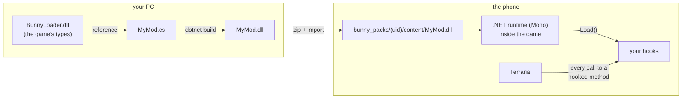

# Making mods in C#

> **Overview** · [1. First mod](01-primeiro-mod.md) · [2. Hooks](02-hooks.md) · [3. `ref`, `out`, `Nullable`](03-ref-out-e-nullable.md) · [4. Values and objects](04-valores-e-objetos.md) · [5. C# × JS × tModLoader](05-comparacao.md) · [6. Performance](06-desempenho.md) · [7. Moving to C#](07-migracao-para-csharp.md) · [8. Under the hood](08-por-baixo-dos-panos.md) · [9. Damage classes](09-classes-de-dano.md)

Bunny Loader runs mods in **two languages**, side by side, inside the same
game:

- **JavaScript** ([the JS guides](../mods/README.md)), the original engine. It
  has everything: hooks, `ModItem`, `ModNPC`, tiles, UI, screen effects.
- **C#**, the new one. It is the language of Terraria and of tModLoader, it is
  compiled ahead of time (on your PC, by the catalog when you publish, or by
  the phone itself), and it is **much faster**. Today it
  gives you **hooks** and **full access to the game**: every field, method and
  struct, with real types and autocomplete. The content classes (`ModItem`,
  `ModNPC`, `ModSystem`...) are not there yet (see
  [Moving to C#](07-migracao-para-csharp.md)).

Here is a whole C# mod. If you have ever seen a tModLoader hook, you already
know how to read it:

```csharp
using BunnyLoader;
using Terraria;
using Terraria.ID;

public class MinisharkTurbo : Mod
{
    public override void Load()
    {
        On_Item.SetDefaults += (orig, self, type, variant) =>
        {
            orig(self, type, variant);       // the game fills in the item
            if (type == ItemID.Minishark)
                self.useTime = 4;            // then we make it shoot faster
        };
    }
}
```

## How it works, in one picture



1. On your PC you write C# against `BunnyLoader.dll`, which describes the
   whole game in C#: `Terraria.Player`, `Terraria.Item`,
   `Microsoft.Xna.Framework.Vector2`, the `On_` hooks...
2. `dotnet build` turns it into a `.dll`. That `.dll` **is** your mod.
3. On the phone, when a C# mod is enabled, Bunny Loader starts a .NET runtime
   inside the game, loads your `.dll` and calls your `Load()`.
4. From then on, the game calls your hooks.

## The guides

Read the first four in order. The other four are reference "tabs": open them
when you need them.

| Guide | What you learn |
|---|---|
| **Learn** | |
| [1. Your first C# mod](01-primeiro-mod.md) | The tools, the project, the package, installing it and reading the log. |
| [2. Hooks](02-hooks.md) | Everything about `On_<Type>.<Method>`: before, after, replacing, skipping, overloads, getters, several hooks, errors. |
| [3. `ref`, `out` and `Nullable`](03-ref-out-e-nullable.md) | Methods that return through parameters and values that may be missing. |
| [4. Values and objects](04-valores-e-objetos.md) | `new Vector2`, `Item.New()`, fields, arrays, statics, strings, casts, keeping objects alive. |
| **Tabs** | |
| [5. C# × JS × tModLoader](05-comparacao.md) | The same mod in the three, and what is equal and different. |
| [6. Performance](06-desempenho.md) | Measured on a real phone: where C# is 5× to 450× faster, and the one thing that still costs. |
| [7. Moving to C#](07-migracao-para-csharp.md) | Can Bunny Loader become C# only? What exists, what is missing, what changes for you. |
| [8. Under the hood](08-por-baixo-dos-panos.md) | The runtime, the generated proxies, the calling convention and the two garbage collectors. |

## C# or JavaScript?

| You want to... | Use |
|---|---|
| Change something the game already has (stats, rules, spawns, drops) | **C#** (faster, typed) or JS |
| Run heavy logic every frame (AI, math over many entities) | **C#** |
| Create new items, NPCs, projectiles, tiles, UI | **JS** for now (C# has no `ModItem` yet) |
| Edit code on the phone, without a PC | **JS** (the in-game editor) |
| Port code from tModLoader | **C#**: the hooks have the same shape |

Both can be installed together, and their hooks on the same method share one
chain.

## What you need

- A PC with the **.NET 10 SDK** (`dotnet --version` prints `10.x`), to build
  the `.dll` yourself. Optional: a mod can ship its `.cs` files instead, and
  the catalog (or the phone) compiles them (see
  [guide 1](01-primeiro-mod.md#the-other-way-ship-the-cs-files)).
- A Bunny Loader **with C# support** on the phone (the first version after
  0.3.3).
- An editor that understands C#: VS Code with *C# Dev Kit*, Visual Studio or
  Rider. Autocomplete matters here: it is how you discover the game.
