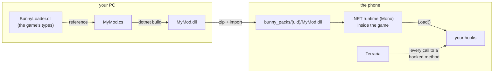

# Making mods in C#

> **Overview** · [1. First mod](01-primeiro-mod.md) · [2. Hooks](02-hooks.md) · [3. `ref`, `out`, `Nullable`](03-ref-out-e-nullable.md) · [4. Values and objects](04-valores-e-objetos.md) · [5. Bunny Loader × tModLoader](05-comparacao.md) · [6. Performance](06-desempenho.md) · [7. Migration to C#](07-migracao-para-csharp.md) · [8. Under the hood](08-por-baixo-dos-panos.md) · [9. Content classes](09-conteudo.md) · [10. Tiles](10-tiles.md) · [11. Systems](11-sistemas.md) · [12. World generation](12-worldgen.md) · [13. Biomes and scenes](13-biomas.md) · [14. Title menu](14-menu.md) · [15. Sounds](15-sons.md) · [16. Mod configs](16-configs.md) · [17. Chat commands](17-comandos.md) · [18. Achievements](18-conquistas.md) · [19. Touch buttons](19-botoes-de-toque.md) · [20. Interface](20-interface.md) · [21. Screen effects](21-efeitos-de-tela.md) · [22. Fonts and texture packs](22-fontes-e-pacotes.md) · [23. Invasions](23-invasoes.md) · [API reference](referencia/README.md)

Bunny Loader runs mods in **C#**, the language of Terraria and of tModLoader.
A mod is compiled ahead of time (on your PC or by the phone itself), it gets
**full access to the game** (every field, method and struct, with real types
and autocomplete) and the tModLoader content classes: `ModItem`, `ModNPC`,
`ModProjectile`, `ModTile`, `ModSystem`, `ModConfig` and the others in guides
9 to 23. What the phone does differently from tModLoader is in
[Bunny Loader × tModLoader](05-comparacao.md).

Here is a whole C# mod. If you have ever seen a tModLoader hook, you already
know how to read it:

```csharp
using Terraria;
using Terraria.ID;
using Terraria.ModLoader;

public class MinisharkTurbo : Mod
{
    public override void Load()
    {
        On_Item.SetDefaults += (orig, self, type, variant) =>
        {
            orig(self, type, variant);       // the game fills in the item
            if (type == ItemID.Minishark)
                self.useTime = 4;            // then we make it shoot faster
        };
    }
}
```

## How it works, in one picture



1. On your PC you write C# against `BunnyLoader.dll`, which describes the
   whole game in C#: `Terraria.Player`, `Terraria.Item`,
   `Microsoft.Xna.Framework.Vector2`, the `On_` hooks...
2. `dotnet build` turns it into a `.dll`. That `.dll` **is** your mod.
3. On the phone, Bunny Loader starts a .NET runtime inside the game, loads your `.dll` and calls your `Load()`.
4. From then on, the game calls your hooks.

## The guides

Read the first four in order, then guide 9 to add content. The other four are
reference "tabs": open them when you need them.

| Guide | What you learn |
|---|---|
| **Learn** | |
| [1. Your first C# mod](01-primeiro-mod.md) | The tools, the project, the package, installing it and reading the log. |
| [2. Hooks](02-hooks.md) | Everything about `On_<Type>.<Method>`: before, after, replacing, skipping, overloads, getters, several hooks, errors. |
| [3. `ref`, `out` and `Nullable`](03-ref-out-e-nullable.md) | Methods that return through parameters and values that may be missing. |
| [4. Values and objects](04-valores-e-objetos.md) | `new Vector2`, `Item.New()`, fields, arrays, statics, strings, casts, keeping objects alive. |
| **Content** | |
| [9. Content classes](09-conteudo.md) | `ModItem`, what gets loaded (`[Autoload]`, `IsLoadingEnabled`, `AddContent`), the load order up to `AddRecipes`, templates and instances, `Find`, textures and files, other mods (`ModLoader`, `Call`, dependencies), translations (hjson, `Language`, `GetLocalization`), `Item.ModItem`, `GlobalItem`, saving (`SaveData`, `TagCompound`), multiplayer (`ModPacket`). |
| [10. Tiles](10-tiles.md) | `ModTile`, `GlobalTile`, object data, mining, drops, touch, drawing and world persistence. |
| [11. Systems](11-sistemas.md) | `ModSystem`: load, world entry and exit, world data and header, the update hooks and their order, time rate, tile counts. |
| [12. World generation](12-worldgen.md) | `GenPass`, `PassLegacy`, progress, generation and Hardmode task editing, mod chest cleanup. |
| [13. Biomes and scenes](13-biomas.md) | `ModBiome`, `ModSceneEffect`, music and music boxes, water and waterfalls, backgrounds, map background, clouds, Bestiary. |
| [14. Title menu](14-menu.md) | `ModMenu`: theme choice in the settings, logo, sun and moon, background and music. |
| [15. Sounds](15-sons.md) | `SoundStyle` (volume, pitch, instances, variants), `SoundEngine.PlaySound`, sounds in items, NPCs and tiles. |
| **Tabs** | |
| [5. Bunny Loader × tModLoader](05-comparacao.md) | The same API on PC and on the phone: what is equal and what differs. |
| [6. Performance](06-desempenho.md) | Measured on a real phone: what reading the game, calling it and hooking it cost, and how to write a fast mod. |
| [7. Migration to C#](07-migracao-para-csharp.md) | For mods made for Bunny Loader 0.3 and older: why the engine changed, the measured comparison, porting and saves. |
| [8. Under the hood](08-por-baixo-dos-panos.md) | The runtime, the generated proxies, the calling convention and the two garbage collectors. |
| **Reference** | |
| [API reference](referencia/README.md) | Every public class and member, side by side with tModLoader: what is the same, what differs, what exists only here and what is missing. |

## What you need

- A PC with the **.NET 10 SDK** (`dotnet --version` prints `10.x`), to build
  the `.dll` yourself. Optional: a mod can ship its `.cs` files instead, and
  the catalog (or the phone) compiles them (see
  [guide 1](01-primeiro-mod.md#the-other-way-ship-the-cs-files)).
- Bunny Loader **0.4.0 or later** on the phone.
- An editor that understands C#: VS Code with *C# Dev Kit*, Visual Studio or
  Rider. Autocomplete matters here: it is how you discover the game.
