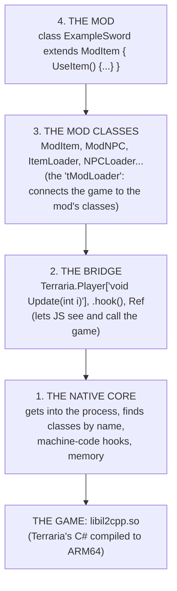
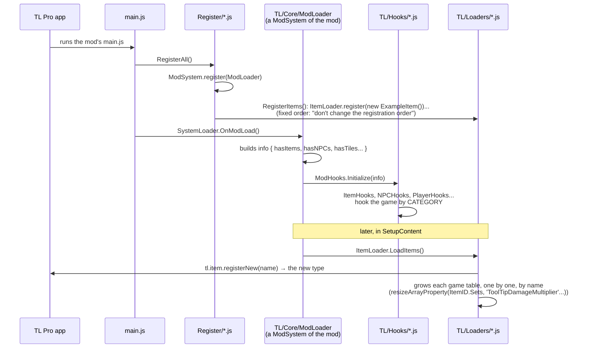
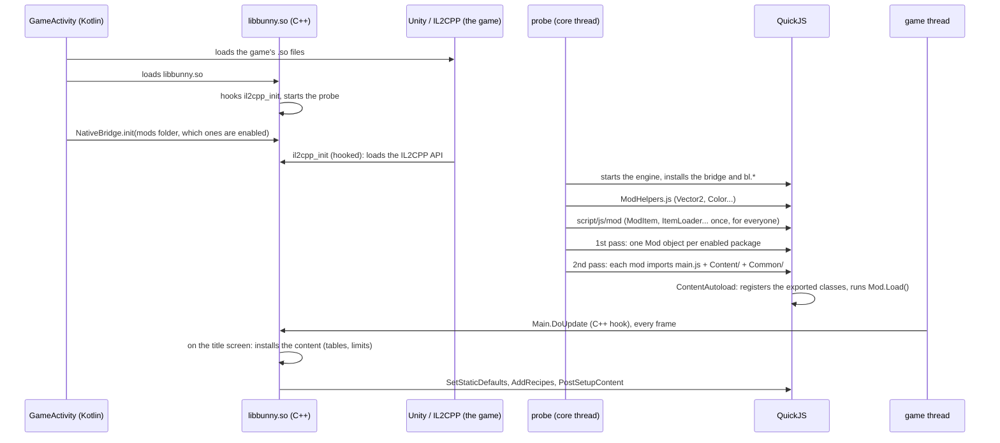
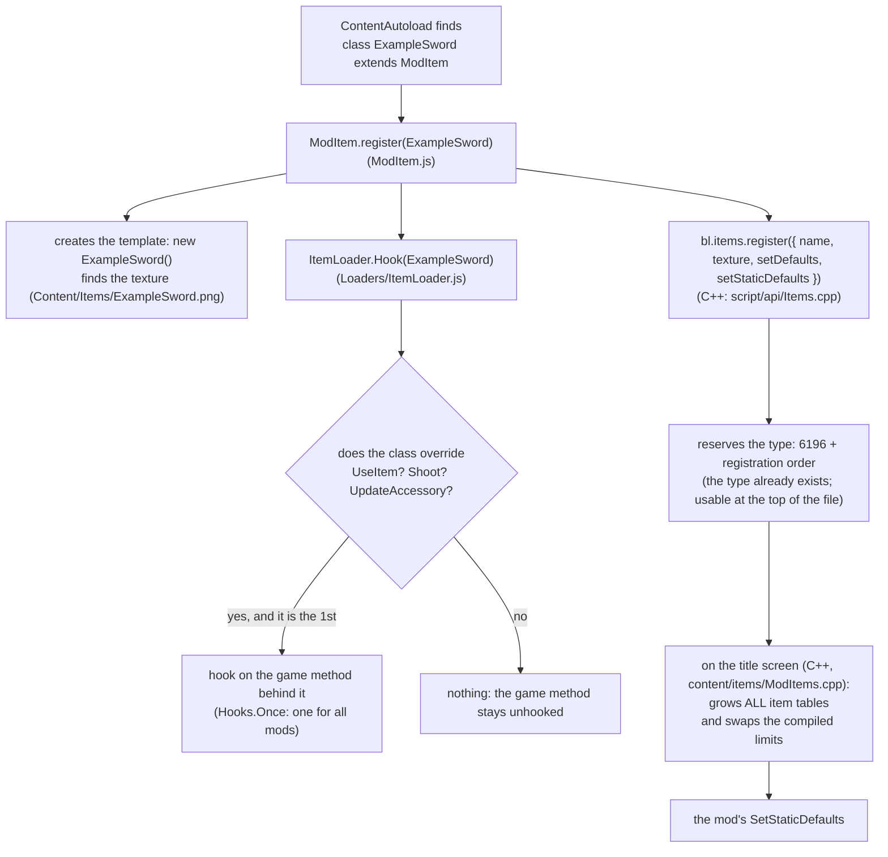
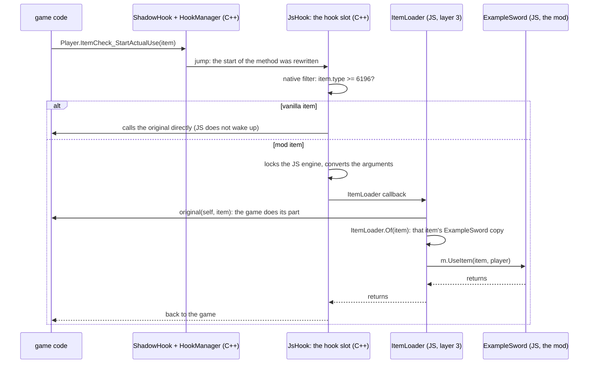

# 0. How it works: from TL Pro to Bunny Loader

If you come from TL Pro, you write mods the same way here: `class X extends ModItem`,
`SetDefaults`, `Terraria.Item['void SetDefaults(int Type, ItemVariant variant)'].hook(...)`.
What changes is **who does what underneath**. This guide walks through the
whole flow in both: TL Pro's, through its Example Mod (ExMod v1.7.1, by GST378
and Animatak_), and Bunny Loader's, from boot to a sword's `UseItem`.

You do not need to read it to make a mod (guides 1 to 12 are enough). It is for
understanding where each thing comes from, and why Bunny Loader has both C++
and JS.

## The four layers

Every Terraria Mobile mod loader has the same pieces. The difference is where
each one lives.



| Layer | What it does | In TL Pro | In Bunny Loader |
|---|---|---|---|
| 1. Core | Boots with the game, inline hooks, memory | The TL Pro app | `libbunny.so` (C++) |
| 2. Bridge | `Terraria.*`, `.hook()`, `new Ref()` | The TL Pro app (`tl.*`, `NativeClass`) | `libbunny.so` (`script/bridge/`) + `bl.*` |
| 3. Mod classes | `ModItem`, `ItemLoader`, the game hooks | **Inside each mod** (the `TL/` folder) | **Inside the loader** (`script/js/mod/`), once for everyone |
| 4. Content | The author's classes, textures, texts | The mod | The mod |

Row 3 is the difference that matters. The rest of this guide is that row in
detail.

### Why there is C++

Terraria on mobile has no C#. IL2CPP turned the game into machine code
(`libil2cpp.so`) before it shipped to the store. There is no .NET virtual
machine to load a DLL, and no reflection to swap a method. A method is just a
stretch of ARM64, and its callers jump straight to its address.

So only native code can:

- **intercept** a method: rewrite its first instructions with a jump (inline
  hook, [ShadowHook](https://github.com/bytedance/android-inline-hook));
- **find** classes and methods by name, through the IL2CPP API
  (`il2cpp_class_from_name`...);
- **touch memory** safely: grow an array of 754 slots, swap a `cmp #752`
  compiled inside a method, write files next to the save;
- run what has to be **fast**: what happens for every item, every tile on
  screen, every frame.

### Why there is JS

The mod is JavaScript (the engine is [QuickJS](https://github.com/quickjs-ng/quickjs),
inside the game). For a `ModItem` class with `UseItem()` to work, someone has
to connect "the player used an item" to "call that class's `UseItem`". That
someone is layer 3. It talks to the mod's JS classes all the time, so it makes
sense for it to be JS too.

## The flow in TL Pro (ExMod v1.7.1)

### The package

```
ExMod_v1.7.1/
├── Settings.json            title, guid, authors, version
└── Modified/
    ├── 1.json
    └── 1.mod/
        ├── main.js          the entry point
        ├── Register/        RegisterAll.js, RegisterItems.js, RegisterNPCs.js... (18 files)
        ├── Content/         the mod's classes (ExampleItem.js, ExampleSword.js...)
        ├── Textures/, Localization/
        └── TL/              ← the framework: 104 files, ~16.7 thousand lines
            ├── Core/        ModLoader.js, FileManager.js, Prototypes.js...
            ├── Loaders/     ItemLoader.js, NPCLoader.js, TileLoader.js... (21)
            ├── Hooks/       Item.js, NPC.js, Player.js, Main.js... (14)
            ├── Modules/     Vector2.js, Color.js, Rand.js...
            └── ModItem.js, ModNPC.js, ModSystem.js, GlobalItem.js...
```

The `TL/` folder is ExMod's "tModLoader", and it ships **inside the mod**. A
second mod built from ExMod carries its own copy.

### Loading



In order:

1. The TL Pro app runs `main.js`, which calls `RegisterAll()` and then
   `SystemLoader.OnModLoad()`.
2. `RegisterAll()` registers **by hand**, file by file: first the `ModLoader`
   (which in ExMod is a `ModSystem` of the mod itself), then
   `RegisterBackgrounds()`, `RegisterBuffs()`, `RegisterNPCs()`,
   `RegisterItems()`... in an order the author must not change. Each
   `RegisterX.js` imports each class and registers it (`new ExampleItem()`).
   A new class in the mod = a new line in `Register`.
3. `OnModLoad` builds a summary (`hasItems`, `hasNPCs`...) and calls
   `ModHooks.Initialize(info)`: each file in `TL/Hooks/` hooks the game
   methods of the **category** the mod uses. A mod with items gets every item
   hook, even the ones none of its items use.
4. In `SetupContent`, each `Loader` creates the content:
   `tl.item.registerNew(name)` (TL Pro's native function) returns the new
   type, and the **mod's JS** grows the game's tables one by one, by name.
   ExMod's `ItemLoader` alone has about 120 lines like this
   (`resizeArrayProperty(Terraria.ID.ItemID.Sets, 'CanGetPrefixes', nextItem, true)`...).
   A table that is not on the list stays short.
5. For several mods to coexist, ExMod's `ModLoader` counts the names that
   already exist (`ItemID.Search.Names.Count`) before and after, and shifts its
   own types by that difference (`ModData`).

### In game

ExMod's `Item.SetDefaults` hook (`TL/Hooks/Item.js`) is the typical example:

```js
Terraria.Item['void SetDefaults(int Type, ItemVariant variant)'].hook((original, self, type, variant) => {
    const flag = ItemLoader.isModType(type);
    if (!flag) original(self, type, variant);
    ...
});
```

**Every** item the game creates (each drop, each shop item, each inventory
slot) enters JS, and only in there does the mod find out it was not one of
its own.

### What this leads to

- **Each mod carries the whole framework** (~16.7 thousand lines). Fixing a
  bug in `ItemLoader` means updating every mod that copied it.
- **Two mods = two frameworks.** Each one hooks `Item.SetDefaults`, each one
  grows the tables, each one counts the other's types to avoid collisions.
- **The cost is per category, not per use.** The hooks enter JS for every
  entity in the game, and the "is it mine?" filter happens in JS.
- **The author maintains `Register/`** by hand and in the right order.
- **The tables are a hand-written list.** A new game version with a new table
  (or one the author forgot) breaks silently: the game reads past the end.

## The flow in Bunny Loader

### The package

```
MyMod/
├── manifest.json        uid, id, name, version, game version
└── content/
    ├── main.js          export default class MyMod extends Mod { }
    ├── Content/         the classes (Items/ExampleSword.js...)
    ├── Common/          ModPlayer, ModSystem, Global*
    ├── Assets/          Textures/, Sounds/, Music/
    └── Localization/    en-US.json, pt-BR.json...
```

There is no `TL/` and no `Register/`. Layer 3 lives in the loader, and
registration is automatic: every class exported in `Content/` and `Common/`
that extends a mod class registers itself (`static Autoload = false` leaves one
out).

### Where each layer lives

| Layer | Where | What it has |
|---|---|---|
| Kotlin | `app/src/main/kotlin/` | The launcher (mod list, import) and `GameActivity`, which boots the game. |
| 1. Core (C++) | `app/src/main/cpp/` (`boot/`, `hook/`, `il2cpp/`, `content/`) | Boot, inline hooks, tables, compiled limits, saves, Mod Menu. |
| 2. Bridge (C++) | `app/src/main/cpp/script/bridge/`, `script/api/` | `Terraria.*`, `.hook()`, `Ref`, and the `bl.*` functions (`bl.items.register`...). |
| Helpers (JS) | `app/src/main/cpp/script/js/ModHelpers.js` | `Vector2`, `Color`, `MathHelper`, `Rand`, `ItemRarityID`. |
| 3. Mod classes (JS) | `app/src/main/cpp/script/js/mod/` | At the root, the API (`ModItem.js`, `ModTile.js`...); in `Loaders/`, the game hooks (`ItemLoader`, `TileLoader`...); in `Core/`, the shared pieces (`Safe`, `Hooks`, `Ready`, `ModNet`, `ContentAutoload`); in `Enums/`, the constants. |
| 4. The mod (JS) | `Android/data/com.bunnyloader/bunny_packs/<uid>/` | The package above. |

The JS of layers 2 and 3 is **embedded in `libbunny.so`** at build time (CMake
joins the files into a single function, in the order of the
`BL_MOD_CLASSES_PARTS` list in `CMakeLists.txt`). No mod sees the internal
classes (`ItemLoader`, `Safe`...): only the exported ones (`ModItem`,
`ModContent`, `SoundStyle`...).

### Boot



1. **Kotlin.** `GameActivity` loads the game and `libbunny.so`, and passes the
   configuration (`boot/jni_entry.cpp`).
2. **`il2cpp_init`.** `libbunny` waits for IL2CPP to finish and loads its API
   (`boot/LibWatcher.cpp`, `il2cpp/Api.cpp`).
3. **The probe** (`boot/Probe.cpp`), a core thread, waits for the game to
   settle and starts QuickJS: first the bridge, then `ModHelpers.js`, then the
   mod classes (`script/js/mod`). All of this runs **once**, before any mod.
4. **The mods, in two passes** (`mods/ModLoader.cpp`). In the first, every
   enabled mod gets its `Mod` object (which is why `ModLoader.TryGetMod` finds
   a mod that has not loaded yet). In the second, each mod is imported as an
   **ES module** (its own scope: two mods with a `const x` do not collide), and
   `ContentAutoload` (`Core/ContentAutoload.js`) registers the exported
   classes in a fixed order by kind (buffs, player, NPCs, projectiles, items,
   tiles, systems, globals) and runs `Load()` on the `Mod` class.
5. **The game thread.** A C++ hook on `Main.DoUpdate` runs every frame. On the
   title screen it **installs** the registered content (the tables, the
   limits, the names) and calls each class's `SetStaticDefaults`; after that,
   `onContentReady` runs `AddRecipes` and `PostSetupContent`.

### Registering an item

What happens when `ContentAutoload` finds `export class ExampleSword extends ModItem`:



Three differences from TL Pro:

- **The type comes from the core, one sequence for everyone.**
  `bl.items.register` reserves every mod's types in a single sequence. Nobody
  has to count the other mods' types.
- **The tables are found, not listed.** The core (`content/common/TypeTables.cpp`)
  searches the game's classes for **every** static array with exactly
  `ItemID.Count` slots (~127 for items, ~220 for tiles) and grows all of them.
  The class list was checked against every allocation of that size in
  `libil2cpp.so`. The mod author maintains no list at all.
- **The compiled limits are swapped.** Part of the game has the number written
  into the machine code (`if (type > 752) return false` in `PlaceTile`). The
  core finds those comparisons (`hook/CodePatch.cpp`) and swaps the number for
  the new total. That does not exist in JS.

### Who installs the hooks

Three sources. All of them end up in the same C++ mechanism.

| Who | Where | When | Example |
|---|---|---|---|
| **The core** | C++, `hook::install` (or a slot with a C++ callback) | Always | The `Main.DoUpdate` tick, saving the world and the character, `Item.SetDefaults` for mod items (`script/api/Items.cpp`), drawing furniture. |
| **The mod classes** | JS, `script/js/mod/Loaders/` | Only if **some** class overrides the method, and **once** for all mods | `ItemLoader` hooks `Player.ItemCheck_StartActualUse` if someone has `UseItem`. |
| **The mod itself** | JS, `.hook()` in `Load()` or at the top level | Whenever the author wants | `Terraria.Player['void Update(int i)'].hook(...)`, as in TL Pro. |

Each typed JS hook uses a **native filter**: C++ reads the object's `type`
before waking JS up. A vanilla item goes straight to the original, and JS is
not even called:

```js
// Loaders/ItemLoader.js: only mod items (type >= 6196) enter JS.
P['void ItemCheck_StartActualUse(Item sItem)'].hook((original, self, item) => { ... }, { minType: FIRST_ITEM, on: 0 });
```

Mods can use the filters too (`minType`, `on`, `tile`, `tileAt`); see
[guide 3](03-custo-e-desempenho.md#native-filters).

### One call, from the game to `UseItem`

The player uses the `ExampleSword`:



- **ShadowHook** rewrote the start of the method and keeps the original
  instructions in a trampoline, which is `original()`.
- **HookManager** allows several hooks on the same method, chained (the
  `ItemLoader` one, a `GlobalItem` one, a mod's).
- **JsHook** has one ready-made function per hook (the slots). It checks the
  filter, locks the JS engine (which is shared by all mods), converts `Item`
  into a JS object and calls the callback.
- **`ItemLoader.Of(item)`** finds that item's `ExampleSword` instance: each
  mod `Item` has its own copy of the template (the `Clone`), kept next to the
  game object.
- An error in the mod's `UseItem` becomes a log line (`Safe.Run`): the game
  carries on.

The details of each piece are in [hooks under the hood](../nucleo/hooks.md) and
[threads and the JS engine](../nucleo/threads-e-motor-js.md).

### Saving

The game's world and character **never** carry mod content. Mod content goes
into files next to them, by name (`<mod uid>/<Class>`), not by number:

| File | What it holds |
|---|---|
| `<character>.plr.bl` | Mod items in the inventory, equipment, dyes and personal chests, and active mod buffs. The trash slot is not saved. |
| `<character>.plr.bl.json` | Each `ModPlayer`'s `SaveData`. |
| `<world>.wld.bl` | Mod items in the world's chests. |
| `<world>.wld.tiles.bl` | Mod tiles (position, frame). |
| `<world>.wld.bl.json` | Each `ModSystem`'s `SaveWorldData`. |

Without the mod, the world and the character open in the plain game, and the
side files keep the content for when the mod comes back. The mod order can
change: the content comes back by name.

## Side by side

| | TL Pro (ExMod v1.7.1) | Bunny Loader |
|---|---|---|
| Where the framework lives (`ModItem`, `ItemLoader`, hooks) | In each mod (`TL/`, ~16.7 thousand lines) | In the loader (`script/js/mod/`), one for everyone |
| Registration | By hand, in `Register/`, in a fixed order | Automatic: every class exported in `Content/` and `Common/` |
| Entry point | `main.js` calls `RegisterAll()` | `main.js` exports `class X extends Mod` |
| New type | `tl.item.registerNew`, and the mod counts the others' types | `bl.items.register`, a single sequence for everyone |
| Game tables | Listed by hand in the `Loader` (~120 for items alone) | Found by size (~127 for items, ~220 for tiles) |
| Compiled limits (`type > 752`) | No | Swapped in the machine code |
| When a hook is installed | By category (has items → every item hook) | By method (only if some class overrides it) |
| "Is it mine?" filter | In JS, inside the hook | Native, before JS |
| Two mods on the same method | Two frameworks, two hooks | One layer-3 hook, chained with the mods' |
| Saving | Through the mod's framework (`TL/WorldDB.js`, `TL/PlayerDB.js`) | Through the core, next to the `.plr`/`.wld`, by name; the game opens without the mod |
| Scope of each file | ES module | ES module |
| Bridge syntax | `Terraria.X['signature'].hook(...)` | The same, with the exact parameter names ([bridge](../referencia/ponte-e-bl.md)) |

## Bringing over a TL Pro mod

The content code (`SetDefaults`, `AI`, `UseItem`...) barely changes. What goes
away:

- the **whole `TL/` folder**: `ModItem`, `ModNPC`, `ModContent`, `Vector2`,
  `Color`... are already globals;
- the **`Register/`** folder: export the classes (`export class ExampleSword extends ModItem`);
- **`main.js`** becomes the mod class (`export default class MyMod extends Mod {}`),
  with your own hooks in `Load()`;
- `tl.*` becomes `bl.*` ([the bridge and `bl`](../referencia/ponte-e-bl.md));
- imports between the mod's files keep working (`import { X } from './Y.js'`).

The list of what each class has today, and what is still missing compared to
tModLoader, is in the [reference](../referencia/classes.md).
