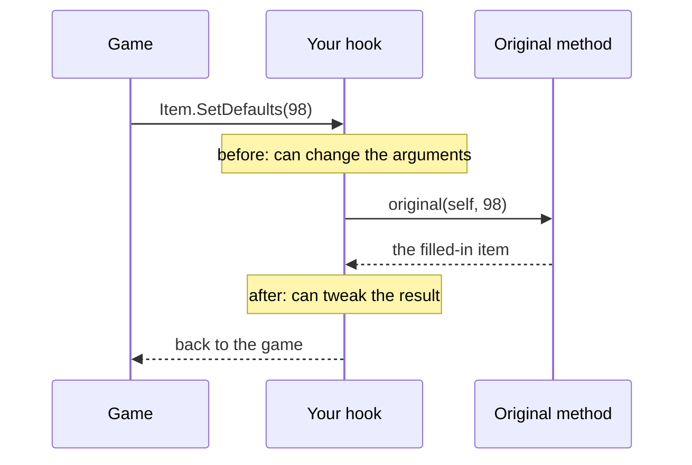
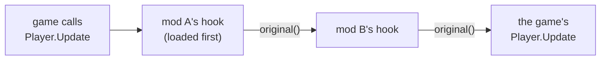

# 1. Hooks: changing what the game already has

This guide builds a mod from scratch and, along the way, shows everything the
**bridge** between JavaScript and Terraria offers: finding classes, reading and
writing fields, calling methods and, above all, **intercepting** methods with
hooks.

It is the base guide. The new-content guides (items, NPCs...) use everything
from here.

## What a hook is

Terraria is made of methods: `Player.Update` updates the player every frame,
`Item.SetDefaults` fills in a new item's stats, `NPC.AI` moves each enemy. A
**hook** is a detour in one of those methods: every time the game calls the
method, it first calls a function of **yours**. Inside it, you decide:

- let the game do what it already did (call the **original**), and tweak the
  result afterwards;
- change what goes in (the arguments) before the game processes it;
- swap what comes out (the return value);
- or not let the game's method run at all.



The hook catches **every** call to the method, wherever it comes from: the
game, another mod or your own code. It is Bunny Loader's most powerful tool,
and also the easiest to misuse (see the [cost guide](03-custo-e-desempenho.md)).

**Hook or mod class?** To change what the game **already has** (the
Minishark, every weapon's damage, fall damage), use a hook. To **create**
something new (an item, an enemy), use the mod classes from
[guide 4](04-conteudo-novo.md): they install the right hooks for you, already
filtered.

## The first mod: double damage

Create this folder:

```
DoubleDamage/
  manifest.json
  content/
    main.js
```

`manifest.json` (generate your own `uid`, see the [README](README.md#manifestjson)):

```json
{
  "uid": "0b8f2a64-3c1d-4e7a-9f50-6d2e8c1b4a73",
  "id": "doubledamage",
  "name": "Double Damage",
  "version": "1.0.0",
  "author": "You",
  "category": "Armas",
  "summary": "Every weapon hits twice as hard.",
  "blVersion": 2,
  "entry": "main.js"
}
```

`content/main.js`:

```js
const SetDefaults = Terraria.Item['void SetDefaults(int Type, ItemVariant variant)'];

export default class DoubleDamage extends Mod {
    Load() {
        SetDefaults.hook((original, self, type, variant) => {
            original(self, type, variant);   // the game fills in the item first
            if (self.damage > 0) {
                self.damage = self.damage * 2;
            }
        });
        bl.log('Double Damage: active');
    }
}
```

Install it (see the [README](README.md#installing)), open the game, and every
weapon spawns with double damage. The log (`Android/data/com.bunnyloader/logs/`,
or `adb logcat -s BunnyLoader`) shows `Double Damage: active`.

### The anatomy

The `DoubleDamage` class is the **mod class**: every mod exports one, with
`export default`, in the entry file (like tModLoader's
`public class ... : Mod`). Bunny Loader creates it on its own and runs its
`Load()` once, when the game opens; the hooks installed there last for the
whole game. Without it, the mod does not load.

The hook lines are the skeleton of almost every mod:

1. **get the method** from the game, by class and signature
   (`Terraria.Item['void SetDefaults(...)']`);
2. **attach a hook** to it (`.hook(callback)`);
3. **call the original**, so the game does what it already did;
4. **tweak** the result.

`Item.SetDefaults` is where Terraria fills in a new item: damage, use time,
max stack. It runs once for each item created, so changing it here applies
to everything: what you craft, what enemies drop, what is already in a chest
when the world loads.

## Finding classes and methods

The game is C# compiled to native code (IL2CPP). Class, field and method
names are the C# ones, and you find them in the game's **dump**:
`refs/dump.cs`, generated by [`tools/dump.sh`](../../tools/dump.sh) from the
installed game (see [`refs/README.md`](../../refs/README.md)). To read a whole
class:

```bash
tools/dumpgrep.sh Player Terraria
```

In JS, classes sit in the C# namespace tree, with nothing to declare:

```js
Terraria.Player
Terraria.Item
Terraria.ID.ItemID
Microsoft.Xna.Framework.Vector2
Terraria.GameContent.ItemDropRules.ItemDropRule
System.Threading.Thread
```

- A class **without a namespace** (the mobile UI: `GUIBuffs`, `GUIInstance`,
  `GUIChest`...) is global, by name: `GUIBuffs['void Draw()']`.
- A **nested** class is a property of the outer one: `SpriteFont.Glyph`,
  `Terraria.Player.Hooks`.
- When the tree does not reach a class (a compiler-generated name), use
  `bl.classOf('Terraria', 'Player')` (without a namespace:
  `bl.classOf('', 'GUIBuffs')`).

A path that leads nowhere throws on the final access, with the full path in
the message.

## Fields

A field is a JS property. Static on the class, instance on the object:

```js
Terraria.Main.dayTime                  // static: true during the day
Terraria.ID.ItemID.Minishark           // constant: 98

const p = Terraria.Main.player[Terraria.Main.myPlayer];
p.statLife = p.statLifeMax2;           // instance: full health
```

- A **C# property** (`get_X`/`set_X`) also becomes a property:
  `Terraria.Main.myPlayer` calls `get_myPlayer()` underneath.
- **The field's type decides the write.** `item.shootSpeed = 10` writes a
  `float`, `item.useTime = 4` an `int`. A value of the wrong type (text where a
  number is expected) throws `TypeError`; it never silently becomes 0.
- An **enum** is a number: `Terraria.PartyHatColor.Pink` is `2`.
- An **array** is an array: `Terraria.Main.player[0]`, `Terraria.Main.npc.length`.
  Where the game expects an array (`int[]`, `string[]`), a JS array works too.
- An **object** is a JS object wrapping the game's, and the same game object
  is always the same JS object: `Main.player[0] === self` is `true`.
- `bl.log(object)` shows the class: `[Player]`.

### A wrong name is an error

Names are the C# ones, with the same case: `player.whoAmI`, not
`player.whoami`. Reading or writing a name the game class does not have
throws right away, with the similar name when there is one:

```
TypeError: Member with name 'whoami' is not found in Terraria.Player. Did you mean 'whoAmI'?
```

This applies to objects, classes (`Terraria.Main.dayTme`), structs (`pos.Z`)
and arrays (`Main.player.foo`: a game array only has `[i]`, `length` and
`cloneResized`). Without this, the read would silently return `undefined`, and
the error would only show up far away: a `NaN`, an `if` that never runs.

To **ask** whether a member exists, without an error, use `in`:

```js
const item = 'Item' in source ? source.Item : null;   // not every IEntitySource has Item
'whoAmI' in player                                    // true
```

The fields mods add to game classes (`item.ModItem`, `npc.ModNPC`,
`proj.ModProjectile`) always exist and are `undefined` on non-mod content.
These also throw, with the reason: writing to a read-only property
(`player.HeldItem = x`), assigning to a method and reading by name a method
with several overloads (the message lists the signatures).

### Structs are views, not copies

`Vector2`, `Color`, `Rectangle` are **structs**: values stored inside the
object, not separate objects. Read from a field, they are a **view** into the
owner. Writing to the view changes the game:

```js
npc.position.X = 100;          // moves the NPC
item.color.R = 255;
npc.position = otherVector2;   // swaps the whole struct
bl.log(npc.position);          // Vector2(X=100, Y=42)
```

Two exceptions, which are C#'s value semantics: the struct a **method
returns** and the one that arrives as a **hook argument** are **copies**.
Writing to them changes nothing in the game.

Structs of identical numbers (`proj.ai`, `proj.localAI`, `proj.oldPos`)
accept indexes like an array: `proj.ai[0]++`, `proj.oldPos[3].X`. Out of
range, it is a `RangeError`.

### NaN and infinity

Writing `NaN` or infinity to a numeric game field throws `RangeError` right
away. It is JS's `undefined * 2`, which in the game makes the entity vanish
without any error.

The exception is a field that **already** holds `NaN` or infinity: it accepts
another one, as in C#. This happens with the phantom dust, `Main.dust[6000]`:
`NewDust` returns that index when the dust would spawn off screen, and nobody
resets it. Every `dust.velocity *= ...` keeps accumulating there until the
`float` overflows. A `_v.X *= 0.5` on it goes through, as it would in
tModLoader.

`float` method arguments are not checked.

## Methods

By **signature**, copied from the dump as it appears there:

```js
const Update = Terraria.Player['void Update(int i)'];
Terraria.Main['int get_myPlayer()']();
item['void SetDefaults(int Type, ItemVariant variant)'](98, null);
```

- The signature is **the game's, exactly**: the types and **each parameter's
  name, with the same case**. `PlayerDrawSet drawinfo` matches;
  `PlayerDrawSet drawInfo`, or just the type without the name, does not. A
  different name means the signature came from somewhere else (another game
  version, another method), and the error shows the right one, ready to copy:

  ```
  assinatura 'void DrawPlayer_UseNormalLayers(PlayerDrawSet drawInfo)' em Terraria.Graphics.Renderers.LegacyPlayerRenderer:
  o parametro 1 se chama 'drawinfo', nao 'drawInfo'. No jogo: void DrawPlayer_UseNormalLayers(PlayerDrawSet drawinfo)
  ```

  Types accept the dump's spelling (`int`, `ItemVariant`) or the full one
  (`System.Int32`), and the return type can be left out.
- The object is `this`, as in any JS method: `item['...'](98, null)`.
  Calling through a variable, the object goes as the first argument:
  `Update(player, 0)`.
- If the method has **a single** overload, the name is enough:
  `Terraria.Recipe.UpdateWhichItemsAreCrafted()`, `entry.Info.Add(x)`. With
  more than one, the bare name is **refused**, with the list of overloads in
  the message. One is never picked at random.
- `null` works for any object. A **nullable** (`float?`, `Rectangle?`) is
  `null` or the value, and in the signature any spelling works (`float?`,
  `Nullable<float>`, ``Nullable`1``):

  ```js
  Terraria.Main['void StartRain(bool instant, float? strengthOverride, bool garenteeCoinRain)'](true, null, false);
  ```

- A game method that throws becomes a JS exception (`InternalError`), which
  you can catch with `try`/`catch`.

### Creating objects

C#'s `new Item()` is `.new()` followed by the constructor, by signature:

```js
const it = Terraria.Item.new();
it['void .ctor()']();

const v = Microsoft.Xna.Framework.Vector2.new();
v['void .ctor(float x, float y)'](5, 10);
```

The most common structs have global shortcuts: `Vector2.new(5, 10)`,
`Color.new(255, 0, 0)`, `Rectangle.new(0, 0, 16, 16)` (see the
[helpers](04-conteudo-novo.md#helpers)).

## Hooks

### The callback

`.hook(callback)` installs the hook. The callback receives, in order:

1. `original`: the function that runs the game's method;
2. `self`: the object (only for **instance** methods);
3. the method's arguments, in signature order.

```js
// instance method: self comes before the arguments
Terraria.Player['void Update(int i)'].hook((original, self, i) => {
    original(self, i);
});

// static method: there is no self
Terraria.Main['int DamageVar(float dmg, float luck)'].hook((original, dmg, luck) => {
    return original(dmg, luck);
});
```

### Calling the original or not

It is the central decision of every hook:

```js
// AFTER: the game does its part, you adjust. The most common.
Update.hook((original, self, i) => {
    original(self, i);
    self.moveSpeed *= 1.5;
});

// BEFORE: you prepare the input, the game processes it.
const Hurt = Terraria.Player['double Hurt(PlayerDeathReason damageSource, int Damage, int hitDirection, bool pvp, bool quiet, bool Crit, int cooldownCounter, bool dodgeable)'];
Hurt.hook((original, self, source, damage) => {
    return original(self, source, Math.floor(damage / 2));   // half the damage; the rest as it came
});

// INSTEAD: the game's method does not run.
Terraria.Player['void DropTombstone(long coinsOwned, NetworkText deathText, int hitDirection)']
    .hook(() => {});   // dying leaves no tombstone
```

**`original` accepts new arguments.** Each one replaces its counterpart, in
order (`self` first, if there is one); whatever you leave out stays as it
came. `original()` with nothing reruns with the exact arguments that arrived.

```js
Damage.hook((original, self, damage) => original(self, damage * 2));
```

**What the callback returns becomes the method's return value**: a number,
bool, object or small struct. If it returns nothing (`undefined`) and called
the original, the original's return value applies.

```js
Distance.hook((original, a, b) => original(a, b) * 10);
```

`original` is only valid **inside its own hook, during the call**. Stored in
a variable and called later, it throws `TypeError`.

### Hooks run for everyone

`Player.Update(int i)` is called for **each** player in the world. In single
player, there is only you; in multiplayer, the others pass through there too.
To change only your character:

```js
Terraria.Player['void Update(int i)'].hook((original, self, i) => {
    original(self, i);
    if (i !== Terraria.Main.myPlayer) return;
    if (self.statLife < self.statLifeMax2) self.statLife = self.statLifeMax2;
});
```

The same goes for NPCs, projectiles and items: the hook catches **all** of
them, not just yours. Check the `type` (or `whoAmI`, `owner`) before changing
anything. When only mod content matters, the `minType` native filter avoids
even entering JS (see [cost](03-custo-e-desempenho.md#native-filters)).

### `self` can be `null`

A method that does not use its own object can be called by the game without
it: the game's compiler notices `this` is never read and does not bother
passing it. That is the case of `GUINPCDialogue.Option1Clicked` (the "Shop"
button in the NPC dialogue). That hook's `self` arrives as `null`, or, rarely,
as an invalid object. Pass it on to `original` as it came
(`original(self, ...)`), and Bunny Loader gives the game back the value it
sent; do not read anything from it.

### The hook sees the mod's own calls

A hook also catches the calls **your** code makes to the method, outside the
callback. With the double-damage hook installed, an `item.SetDefaults(98)`
made by the mod also comes out doubled.

**Inside** the callback it is different: calling the **same** hooked method
(creating another item with `SetDefaults` inside the `SetDefaults` hook, for
example) does **not** fire your callback again. The inner call goes straight
to the game's method. Without this rule, a method that calls itself would fire
the callback in a cascade until the stack overflows.

### Errors inside a hook

An error inside the callback does not crash the game:

- it goes to the log with the method name and the JS stack
  (`hook Item.SetDefaults: exception in callback: ...`), **on every call**, so
  an error in a per-frame hook fills the log fast;
- if the callback broke **before** calling `original`, Bunny Loader calls the
  original for you, and the game carries on as if the hook did not exist.

A callback that finishes without an error and without calling `original` is
suppressing the method on purpose, and that is respected.

### Several hooks on the same method

Two mods (or the same mod twice) can hook the same method. They are
**chained**: the `original` of the first hook installed calls the second, and
so on down to the game's method.



- The mod loaded **first** sees the call first, and whatever it passes to
  `original()` is what the next one receives.
- Mods load in the order of the Packages tab, which the player changes: do not
  count on an order between mods, except your `dependencies`
  ([guide 11](11-conversa-entre-mods.md#dependencies)).
- Each hook in the chain is nested inside the previous one and uses JS engine
  stack. In the test ([`tools/tests/hookslots`](../../tools/tests/hookslots)),
  **55** chained hooks on the same method fit; those beyond that log an error
  and the original runs in their place.

### Hook options

`.hook(callback, options)` accepts filters that decide **before** JS. They are
the subject of the [cost guide](03-custo-e-desempenho.md#native-filters):

| Option | The callback only runs when... |
|---|---|
| `{ minType: N }` | `self`'s `type` is ≥ `N` (only mod content, for example). |
| `{ minType: N, on: i }` | the `type` of **parameter** `i` is ≥ `N`. |
| `{ minType: N, on: i, field: 'shoot' }` | the `shoot` field of parameter `i` is ≥ `N`. |
| `{ minType: N, tile: i }` / `tileAt: [i, j]` | the world tile (by `Tile` or by position) has a type ≥ `N`. |
| `{ whileIn: otherMethod }` | the thread is inside the JS hook (or the `scope()`) of `otherMethod`. |
| `{ ifBusy: 'original' \| 'skip' }` | (does not filter) what to do if the JS engine is busy with another thread. |

To know **who** called without paying for JS on every call, use the scope:
`method.scope()` marks, natively, that the game is inside the method and keeps
the object; `method.scopeSelf()` returns that object (or `null` outside it).
`Damage_PVE` runs for every projectile on every update: with `scope()` on it,
a hook on `StrikeNPC` (which only runs on a hit) knows which projectile hit.

```js
const damage = Terraria.Projectile['void Damage_PVE(ref Rectangle projRectangle, float projectileSpecificDamageMultiplier)'];
damage.scope();
Terraria.NPC['int StrikeNPC(int Damage, float knockBack, int hitDirection, bool crit, bool fromNet, int owner)'].hook((original, npc, ...args) => {
    const projectile = damage.scopeSelf();   // null: it did not come from a projectile
    return original(npc, ...args);
});
```

### `ref` and `out`

A `ref`/`out` parameter arrives in the hook as a `Ref`, bound to the caller's
variable: `.value` reads and writes the game's variable. It is the equivalent
of tModLoader's `ref int damage`:

```js
Terraria.Main['bool TryGetBuffTime(int buffSlotOnPlayer, out int buffTimeValue)'].hook((original, slot, time) => {
    const r = original(slot, time);
    time.value += 60;   // whoever asked sees one second more
    return r;
});
```

[Guide 2](02-ref-e-out.md) covers this in depth: calling with `ref`/`out`,
structs by `ref`, and why a `Ref` "comes loose" after the hook.

### How many hooks fit

Each `.hook()` takes a **slot**, and slots are split by the shape of the
method's return value:

| Return | Slots |
|---|---:|
| `void`, `int`, `bool`, object, string | 1024 |
| `float` | 64 |
| `double` | 64 |
| small struct (`Vector2`, `Color`, `Rectangle`...) | 32 per shape |

The mod classes' hooks (`ModItem`, `ModTile`...) are installed once and serve
every mod; what uses slots is each `.hook()` written directly in a mod. With
the Example Mod and all the test mods together, it is about 80.

An installed hook **costs nothing** while the method is not called. What
costs is JS running on every call (see the [cost guide](03-custo-e-desempenho.md)).

### What cannot be hooked yet

- A method with more than **16 integer arguments** (8 in registers and 8 on
  the stack, counting `this` and each `ref`/`out`) or more than **8 floating
  point** ones. It is refused, with a message. `Player.Hurt`, with 10, works.
- A method that returns a **large** struct (more than 16 bytes, or more than
  4 floats): also refused, stating the type and size.

How all of this works inside (the slots, the chain, the dispatcher) is in
[hooks under the hood](../nucleo/hooks.md).

## Textures and drawing

`bl.loadTexture('path.png')` loads a PNG or JPG from the mod as a game
`Texture2D`. The path is relative to `content/`; the mod's textures live in
`Assets/Textures/`. Two rules, which come from Unity:

1. it only works with the game running, **on the game thread**: load inside a
   hook, on the first call, never at the top of `main.js` or in `Load()`
   (which run during loading, on another thread);
2. drawing requires an open `SpriteBatch`.

```js
let tex = null;
Terraria.Main['void DrawInterface(GameTime gameTime)'].hook((original, self, gt) => {
    original(self, gt);
    if (!tex) tex = bl.loadTexture('Assets/Textures/mine.png');
    const sb = Terraria.Main.spriteBatch;
    sb['void Begin(SpriteSortMode sortMode, bool defferedBatch)'](0, true);
    sb['void Draw(Texture2D texture, Vector2 position, Color color)'](tex, Vector2.new(100, 100), Color.White);
    sb['void End()']();
});
```

For what the game keeps as `Asset<Texture2D>` (the `TextureAssets` tables),
use `bl.loadTextureAsset(path)`, or `ModContent.Request` from
[guide 4](04-conteudo-novo.md#modcontent), which loads only once.

## Several files

A mod can be split into files with `import`/`export`, always with a
**relative** path and inside the mod itself:

```js
// content/Common/Util.js
export function double(item) { item.damage *= 2; }

// content/main.js
import { double } from './Common/Util.js';
```

Files in `Content/` and `Common/` do not even need an `import`: Bunny Loader
loads them on its own and registers the content classes they export
([README](README.md#automatic-registration)).

Each file is a **module**: what one mod declares (`const Update = ...`) does
not collide with another mod's. `bl.readJson('config.json')` reads a JSON from
the mod (or `undefined`, if it does not exist).

## Files and data

A relative path is relative to `main.js`'s folder; an absolute one is used as
is.

```js
bl.mod.name            // "Double Damage" (from manifest.json)
bl.mod.id              // "doubledamage"
bl.mod.version         // "1.0.0"
bl.mod.uuid            // the uid
bl.mod.path            // main.js's folder (content/)
bl.mod.root            // the package folder (manifest.json's)
bl.mod.dataDirectory   // Android/data/com.bunnyloader/mod_data/<uid>

bl.info.appDirectory   // Android/data/com.bunnyloader (Players/, Worlds/...)
bl.info.logsDirectory
bl.info.terrariaVersionCode

bl.file.exists('config.json')
bl.file.read('config.json')              // text, or undefined
bl.file.readBytes('data.bin')            // Uint8Array, or undefined
bl.file.write(path, 'text')              // or Uint8Array; creates the folders
bl.file.append(path, 'more text')
bl.file.delete(path)                     // true if it deleted

bl.directory.exists('Assets/Textures')
bl.directory.create(path)                // including the intermediate folders
bl.directory.delete(path)                // and everything inside
bl.directory.listFiles('Assets/Textures/Bg')   // ['Assets/Textures/Bg/a.png', ...]
bl.directory.listDirectories('Assets/Textures')

bl.path.join('a', 'b', 'c.png')          // 'a/b/c.png'
bl.path.getName('x/y/z.png')             // 'z.png'
bl.path.getParentPath('x/y/z.png')       // 'x/y'
bl.path.getExtension('z.png')            // '.png'
```

To store mod data (settings, progress), use `bl.mod.dataDirectory`: the
package folder is replaced entirely when the mod is updated.

## Next steps

- [Guide 2: `ref` and `out`](02-ref-e-out.md), for methods that return
  through parameters (fishing, spawning, collision).
- [Guide 3: cost and performance](03-custo-e-desempenho.md), before hooking
  any per-frame method.
- [Bridge and `bl` reference](../referencia/ponte-e-bl.md): everything in
  this guide in a table.
- The comment at the top of [`samples/HelloMod/content/main.js`](../../samples/HelloMod/content/main.js)
  has this same API with more examples, including the edge cases.
