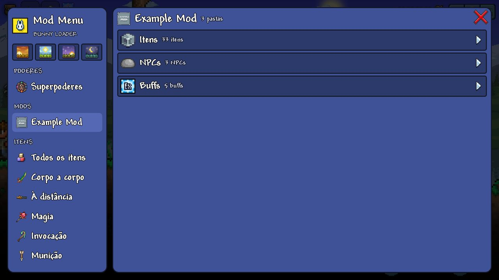
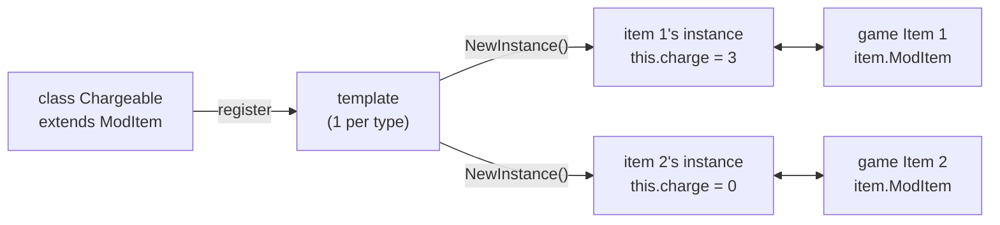
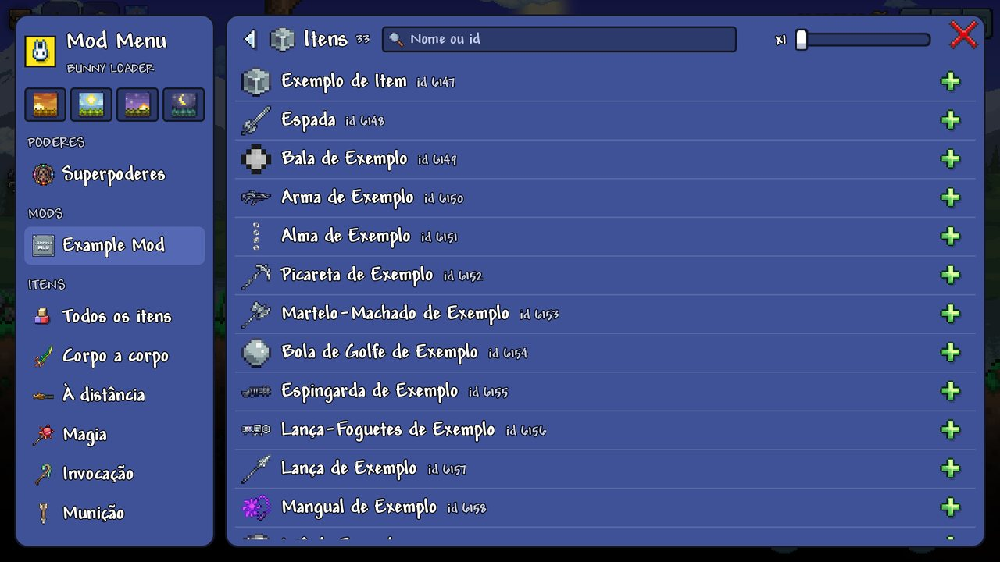

# 4. New content: the ideas

To **create** what the game does not have (an item, a weapon that shoots your
own projectile, an enemy with drops and natural spawning, a boss, a town NPC,
a tile), Bunny Loader provides classes in the **tModLoader** style: the mod
**extends** the class, fills in what it wants and **registers** it. Bunny
Loader gives the new type a number, puts the texture and the name into the
game, and installs the hooks for you.

This guide explains the ideas that apply to every class. The following ones
cover each class:

| Guide | Classes |
|---|---|
| [5. Items](05-itens.md) | `ModItem`, `ModPrefix`, `ModRecipe`, `ModSystem`, tooltips, fishing rods. |
| [6. Projectiles](06-projeteis.md) | `ModProjectile`; pets, minions and sentries. |
| [7. NPCs](07-npcs.md) | `ModNPC`: enemies, drops, spawning, Bestiary, town NPCs, bosses. |
| [8. Player and buffs](08-jogador-e-buffs.md) | `ModPlayer`, `ModBuff`. |
| [9. Tiles](09-blocos.md) | `ModTile`. |
| [10. Sounds and music](10-sons-e-musica.md) | `SoundStyle`, `SoundEngine`, `MusicLoader`. |

The full list of what each class offers is in the
[class reference](../referencia/classes.md).

Prerequisite: [guide 1](01-hooks-do-zero.md). Everything from there (fields,
methods, structs) applies inside the classes.

## The Example Mod

The guides use [`samples/ExampleMod`](../../samples/ExampleMod) from start to
finish: keep it open alongside. It is tModLoader's `ExampleMod` ported to
Bunny Loader, with items, weapons, ammo, projectiles, pets, minions, NPCs, a
town NPC with a shop, a boss with music, tiles, buffs and recipes.



## The layout

The same as tModLoader's:

```
ExampleMod/
  manifest.json
  icon.png
  content/
    main.js                      the mod class: export default class ExampleMod extends Mod
    Assets/
      Textures/
        Items/ExampleItem.png    textures, in the same tree as the code
        Projectiles/ExampleBulletProjectile.png
        NPCs/ExampleSlimeNPC.png
      Sounds/, Music/            audio (guide 10)
    Common/
      Players/ExampleDashPlayer.js     what is not new stuff: ModPlayer,
      Systems/DownedBossSystem.js      ModSystem, Global*
    Content/
      Items/ExampleItem.js       what is new, one class per file
      Items/Weapons/Melee/ExampleMeleeWeapon.js
      Projectiles/ExampleBulletProjectile.js
      NPCs/ExampleSlimeNPC.js
    Localization/
      pt-BR.json                 names and descriptions, per language
      en-US.json
```

`main.js` only has the mod class. Every class exported in `Content/` and
`Common/` is registered on its own, and its texture sits **next to the
file**, with the same name, as in tModLoader ([README](README.md#automatic-registration)).

## Extending and registering

A content class is a JS class that extends the base and overrides the methods
it cares about:

```js
// content/Content/Items/ExampleItem.js  (texture: Content/Items/ExampleItem.png)
export class ExampleItem extends ModItem {
    SetDefaults() {
        this.Item.maxStack = ModItem.CommonMaxStack;
        this.Item.value = Terraria.Item.buyPrice(0, 0, 1, 0);
    }
}
```

Exporting is enough: Bunny Loader loads the file and **registers** the class.
`main.js` keeps only the mod class:

```js
// content/main.js
export default class ExampleMod extends Mod {}
```

To register by hand (a class with `static Autoload = false`, or one that only
exists if another mod is installed), call `register` in the mod's `Load()`:
`ModItem.register(Class)`.

The base classes are **globals**: `ModItem`, `ModProjectile`, `ModNPC`,
`ModBuff`, `ModTile`, `ModPlayer`, `ModSystem`, `ModRecipe`... No `import`
for them, nor for the [helpers](#helpers).

### Your mod's base classes (tModLoader's `abstract` ones)

Big mods often have an intermediate class that only serves as a base for
others: in Thorium, `abstract class BardItem : ModItem`, and every instrument
extends it. C# has `abstract`, and tModLoader skips abstract classes on its
own. JavaScript has no `abstract`: for Bunny Loader, an exported class that
extends `ModItem` is an item, and an exported base would become one more item
in the game, with no texture, named after the class.

Mark the base with **`static Autoload = false`**:

```js
// content/Content/Items/Bard/BardItem.js
// Base for the instruments: not an item.
export class BardItem extends ModItem {
    static Autoload = false;

    // What every instrument has; a subclass changes what it needs.
    InspirationCost = 1;

    SetDefaults() {
        this.Item.useStyle = 5;
        this.Item.useTime = this.Item.useAnimation = 20;
        this.Item.noMelee = true;
        this.Item.rare = ItemRarityID.Green;
    }

    // A method written only here applies to every subclass.
    ModifyTooltips(item, tooltips) {
        tooltips.push(new TooltipLine(this.Mod, 'Inspiration', 'Costs ' + this.InspirationCost + ' inspiration'));
    }
}
```

```js
// content/Content/Items/Bard/GrandPiano.js
import { BardItem } from './BardItem.js';

// This one is registered: an item, with the GrandPiano.png texture next to it.
export class GrandPiano extends BardItem {
    InspirationCost = 3;

    SetDefaults() {
        super.SetDefaults();          // the shared part, from the base
        this.Item.damage = 40;        // this instrument's own
        this.Item.width = 40;
        this.Item.height = 30;
    }
}
```

How it works:

- **`Autoload = false` is not inherited by subclasses.** It only applies to
  the class that declares it (the subclass does not have it as its own), so
  the base stays out and `GrandPiano` gets in normally. A subclass that should
  also stay out (a second-level base, like `PercussionItem extends BardItem`)
  declares its own.
- **Everything from the base applies to the subclass**: fields, methods and
  `get`ters. A method written only in the base (the `ModifyTooltips` above)
  installs its hook as if it were in the subclass; `super.Method()` calls the
  base's.
- **The base needs no texture**: it is not registered. Each subclass has its
  own, next to its file ([Textures](#textures)).
- **`instanceof` works**: to tell whether a game item is one of your mod's
  instruments, of any kind, `ModContent.GetModItem(item.type) instanceof BardItem`.
- It applies to any kind of content: `ModNPC`, `ModProjectile`, `ModTile`,
  `ModBuff`, `GlobalItem`...

Another way, without the marker: keep the base **outside** `Content/` and
`Common/`. Automatic registration only looks at the entry file and those two
folders; a base in `content/Bases/BardItem.js` is imported by the subclasses
and never registered. On the other hand, a class **without** `export` cannot be
a base for another file, because that file cannot import it.

Do not use `export default` for this: a file only has one, many files export
several classes (an armor and its set), and in the entry file `export default`
is the `Mod` class.

### What `register` does

1. creates the **template**: an instance of your class;
2. reserves the new type's **number**, right away (the first mod item is
   6196, right after the game's), and returns it;
3. stores the texture, the name and the localization;
4. installs the game hooks behind the methods your class **overrode** (and
   only those).

The game only learns about the new type a bit later, on the title screen,
when its tables exist ([how](../nucleo/conteudo.md)). That is why each class
has the right moment for each thing:

| Moment | Method | What for |
|---|---|---|
| on registration | (the class constructor) | Class fields: `Texture`, `DisplayName`... |
| title screen | `SetStaticDefaults()` | Per-type tables: `ItemID.Sets...[this.Type]`, `Main.npcFrameCount[this.Type]`. |
| each entity that spawns | `SetDefaults(entity)` | The stats: damage, life, size. |
| content ready | `AddRecipes()`, `SetBestiary(...)`, `PostSetupContent()` | What depends on everything existing: recipes, Bestiary, other mods. |

### The order

Automatic registration follows a fixed order: buffs, players, NPCs,
projectiles, items, tiles, systems and globals; within each, by file path. The
numbers come out in that order, and it is the same on every device in
multiplayer, as long as everyone has the same mods. That is why a bullet finds
its projectile's number in its `SetDefaults` (`ModContent.ProjectileType(...)`):
every projectile has been registered before any item.

## A content's type

You can get it in three ways:

```js
this.Type                                              // inside the class itself
ModItem.getTypeByName('ExampleItem');                  // by name, within the mod
ModContent.ItemType(ExampleItem);                      // as in tModLoader
```

### ModContent

tModLoader's `ModContent`, with the same names. The type of a mod content
comes from the **class** (the `<T>` over there), from the **name**, or from
`'mod/Name'` (with another mod's manifest `id`). Not found, it returns 0:

```js
const bobber = ModContent.ProjectileType(ExampleBobber);        // the class
const same = ModContent.ProjectileType('ExampleBobber');        // the name
const fromOther = ModContent.ItemType('othermod/FireSword');    // another mod
```

By name, your mod's applies; if there is none, the only mod with content of
that name (if two have it, ask with `'mod/Name'`, and the log warns). There
are `ItemType`, `ProjectileType`, `NPCType`, `BuffType` and `TileType`.

The **template** (the `register` instance) too:

```js
ModContent.GetInstance(ExampleItem);                  // by class
ModContent.Find(ModItem, 'examplemod/ExampleItem');   // by name; throws if missing
const r = new Ref();
if (ModContent.TryFind(ModNPC, 'examplemod/ExampleBoss', r)) bl.log(r.value.Type);
ModContent.GetModItem(type);                          // by number
```

Every template has `this.Mod`, the `Mod` that registered it.

All at once, like tModLoader's `GetContent`: on `Mod`, the mod's own; on
`ModContent`, every mod's. It works for any base class (`ModItem`, `ModNPC`,
`ModProjectile`, `ModTile`, `ModBuff`, `ModSystem`...), in registration order.
Call it from `PostSetupContent` on: before that, the types may not exist yet.

```js
PostSetupContent() {
    const types = this.GetContent(ModItem).map((item) => item.Type);
    const npcs = this.GetContent(ModNPC);
    const allModItems = ModContent.GetContent(ModItem);
}
```

The mod's textures load on the first call; later ones reuse the same:

```js
const asset = ModContent.Request('Assets/Textures/glow');     // Asset<Texture2D>
const tex = asset.Value;                                       // the Texture2D
const same = ModContent.Texture('Content/Items/Sword_Glow');   // shortcut for .Value
```

- `Request` returns **the game's** `Asset<Texture2D>`, the same type the
  `TextureAssets` tables hold: you can put it into one of them.
- The path is the file's path in the mod, with or without `.png`, as in
  tModLoader: `'Content/Items/Sword'`, `'Assets/Textures/glow'`. With a mod id
  in front (`'examplemod/Content/...'`), it takes from another mod. Older
  mods' paths, inside `Assets/Textures/` (`'Items/Sword'`), also work.
  `ModContent.HasAsset(path)` tells whether it exists.
- It always loads immediately (like tModLoader's `ImmediateLoad`), and only on
  the **game thread**: in a hook, in `SetStaticDefaults` or in
  `PostSetupContent`.
- Textures and fonts: a path to a font file (`'Assets/Fonts/ExampleFont'` for
  `ExampleFont.json`) returns an asset whose `Value` is a `SpriteFont`
  ([guide 21](21-pacotes-de-fonte.md#fonts-for-a-mods-own-ui)). For sound,
  `ModContent.SoundStyle(path, options)`, which is the same as
  `new SoundStyle(path, options)` ([guide 10](10-sons-e-musica.md)).

## Template and instance

As in tModLoader, the class you register is a **template**. Each item,
projectile or NPC of that type in the game gets **its own** instance, and that
is where the methods run.

The instance is built by your class's **constructor** when the entity is
created (tModLoader's `NewInstance`). So the field initializers run again for
each entity: `bloodMoonMode = Main.bloodMoon;` is read when that NPC spawns, and
an array or object in a field (`trail = [];`) belongs to that entity alone. What
the registration and the static setup put on the template after it was built
(`this.Type`, `this.Mod`, a texture kept in `this` in `SetStaticDefaults`)
is carried over to every instance. A class that prefers a copy of the template
can say so, as in tModLoader: `get CloneNewInstances() { return true; }`.



- `this.Item`, `this.Projectile`, `this.NPC` is that instance's entity;
- `item.ModItem`, `proj.ModProjectile`, `npc.ModNPC` is the entity's instance;
- a field you put on `this` belongs to **that** item: you can keep a charge,
  a counter, a target, without a global variable indexed by item.

```js
export class Chargeable extends ModItem {
    SetDefaults() {
        this.charge = 0;              // each item starts with its own
    }
    UseItem(item, player) {
        this.charge++;                // only this item's
    }
}

// from outside: the ModItem of any item
const m = player.inventory[0].ModItem;
if (m instanceof Chargeable) bl.log(m.charge);
```

`ModItem.getModItem(type)` and `ModContent.GetInstance(Class)` return the
**template**, not an item's instance.

Instance `#private` members (`#charge`, `#Blink()`) work in NPCs and
projectiles, whose instances come from the constructor. In an **item**, prefer
plain names (`this.charge`, `this.Blink()`): the copy the game makes of an item
(below) is not built by the constructor, and JS only accepts a `#` member on an
object the constructor built (`TypeError: invalid brand on object`).
`static #` (on the class) always works.

When the game copies an item (`Item.Clone`), the copy gets a `Clone()` of the
original's instance, with its state. The default `Clone` copies the shallow
fields (C#'s `MemberwiseClone`); override it if you have an array or object of
your own that needs its own copy:

```js
Clone(newItem) {
    const c = super.Clone(newItem);
    c.history = [...this.history];
    return c;
}
```

On its own, instance state does **not** go into the save or over the network,
and it is lost when the item goes through a chest (which only keeps type,
stack and prefix): in those cases the entity is born again through
`SetDefaults`. For an item, what must survive goes in its `SaveData`/`LoadData`
([guide 5](05-itens.md#per-instance-data-savedata-and-loaddata));
elsewhere, in the `ModPlayer`'s `SaveData` ([guide 8](08-jogador-e-buffs.md#saved-data)).

### Fields on game classes

`item.ModItem` is a case of something general: `bl.defineField` adds a new
field to a game class, for the mod to keep whatever it wants on each object:

```js
bl.defineField(Terraria.Player, 'combo');
const p = Terraria.Main.player[Terraria.Main.myPlayer];
p.combo = (p.combo || 0) + 1;
```

The value lives in a table next to the object (the game does not let the class
grow) and goes away on its own when the game discards the object. It also
applies to subclasses: a field on `Terraria.Entity` shows up on `Player`,
`NPC` and `Projectile`.

`bl.defineMethod` does the same with a method; `this` is the game object.
That is where `player.GetModPlayer(...)` comes from.

```js
bl.defineMethod(Terraria.Player, 'isOnGround', function () {
    return this.velocity.Y === 0;
});
if (player.isOnGround()) { /* ... */ }
```

A name the class already has (a game field or method) wins over the mod's.

## Textures

As in tModLoader, a class's texture sits **next to its file**, with the same
name: `Content/Items/ExampleItem.js` uses `Content/Items/ExampleItem.png`.
Derived textures sit next to it too (`ExampleItem_Glow.png`,
`ExampleHelmet_Head.png`, `ExampleWorkbench_Highlight.png`). That is only the
default: `Texture` picks another file, the path in the mod **without** `.png`,
in any folder:

```js
// like tModLoader's `public override string Texture => "...";`
get Texture() { return 'Content/Items/ExampleItem'; }   // another item's image

// or in the constructor
constructor() {
    super();
    this.Texture = 'Art/Swords/Blade';
}
```

The mod id in front works too (`'examplemod/Content/Items/ExampleItem'`).
`Assets/` is for what does not belong to a class: backgrounds, sounds, music
and whatever the mod loads on its own (`ModContent.Request`).

Older mods kept textures in `Assets/Textures/`, mirroring the file
(`Content/Items/X.js` -> `Assets/Textures/Items/X.png`). If the file is not
next to the `.js`, the one over there is used (and the log warns once per mod).

| Content | Format |
|---|---|
| Item | The item sprite. With animation (`SetItemAnimation`), the frames in a vertical strip. |
| Projectile | The sprite. With `Main.projFrames[this.Type] = n`, `n` frames in a vertical strip. |
| NPC | `Main.npcFrameCount[this.Type] = n` frames in a vertical strip. |
| Buff | 32x32. |
| Tile | The game's frame sheet: 288x270, 16x16 frames with a 2 px margin. |

Textures are drawn as pixel art (no smoothing), like the game's.

## Localization

`Localization/<language>.json`, one per language (`pt-BR`, `en-US`, `es-ES`,
`de-DE`, `fr-FR`, `it-IT`, `ru-RU`, `pl-PL`, `ja-JP`, `ko-KR`, `zh-Hans`,
`zh-Hant`):

```json
{
  "ItemName":       { "ExampleItem": "Example Item" },
  "ItemTooltip":    { "ExampleItem": "The item's description" },
  "ProjectileName": { "ExampleBulletProjectile": "Example Bullet" },
  "NPCName":        { "ExampleSlimeNPC": "Example Slime" },
  "BuffName":       { "ExampleDefenseBuff": "Example Defense" },
  "BuffDescription":{ "ExampleDefenseBuff": "+{0} defense" },
  "Bestiary":       { "ExampleSlimeNPC": "A light blue slime." }
}
```

The key is the **class** name. The game shows its own language; without that
language, `en-US` applies, and without anything, the class name. The class's
`DisplayName` and `Tooltip` fields, if set, win over the file (text, or
`{ 'pt-BR': ..., 'en-US': ... }`).

Every key in the file, at any depth (`TownNPCMood.ExamplePerson.Content`),
enters the game as `Mods.<mod id>.<Section>.<Key>`, as in tModLoader:
`Language.GetText('Mods.examplemod.CustomText.WelcomeMessage').Value` works
directly, and the text follows language changes.

A text can pull in another, as in tModLoader:

| | |
|---|---|
| `{$Mods.examplemod.Common.X}` | The full key, from any mod or the game (`{$CommonItemTooltip.Whips}`). |
| `{$Common.X}` | Relative: searches from the text's own key (in `Mods.examplemod.Items.Sword.Tooltip`, finds `Mods.examplemod.Common.X`). |
| `{$Key@2}` | Adds 2 to the `{0}`, `{1}`... of the pulled-in text. |

A key that does not exist stays as its name. Texts go in through the same path
as the game's files, so each key lands in the game's category (everything
before the last dot): `Language.RandomFromCategory('Mods.examplemod.Dialogue.ExamplePerson')`
picks a random line, and `"Key$Variant"` becomes a variant
(`Language.TryGetVariation`). In `ItemName`/`ItemTooltip`/`NPCName`/`BuffName`
and other content texts, the game's `{$key}` references follow the selected
language. The mod's JSONs are applied after the original
`LanguageManager.LoadFilesForCulture`, before the events that consume the
texts. Tooltips and config labels also follow the change, without restarting
the launcher.

`Translate` and `GetTextValue` return strings: a value stored by the mod does
not change on its own. Look it up again when using it, or keep
`ModLocalization.GetText(key)` and read `.Value`. Circular references end at
the full name of the key that closes the cycle.

For a text of your own (a town NPC's line, the Bestiary blurb):

| | |
|---|---|
| `ModLocalization.Translate('Section.Key')` | The **text**, in the game's language (as in TL). Without a text, the path itself. |
| `ModLocalization.TryTranslate('Section.Key')` | The same, but `''` when there is no text. |
| (where it looks) | In the calling mod's `Localization/*.json`. Called from outside a mod (the Editor console), the full key `Mods.<id>.Section.Key` finds its mod, and the short one works if only one mod has it. `{0}` is not replaced: use `.replace('{0}', x)`. |
| `ModLocalization.GetTextValue(key)` | The mod's text or, if it has none, the game's (`'LegacyInterface.28'`). |
| `ModLocalization.GetText(key)` | The `LocalizedText` (from the mod or the game). |
| `ModLocalization.Key('Section.Key')` | The **key** `Mods.<id>.Section.Key`, for what the game asks by key (Bestiary, currency). |
| `ModLocalization.Exists(key)` | Whether the mod or the game has the text. |
| `ModLocalization.Register(key, text)` | A text (or `{ culture: text }`) under any key. |

## The Mod Menu

Every registered item, NPC and buff already shows up in the **Mod Menu** (the
bunny on the game screen): under *Mods*, in an entry with the mod's name, in
the *Items*, *NPCs* and *Buffs* folders, with the localized name and the
sprite (and also in the game's categories, under *Items*, *NPCs* and
*Buffs*):



To split into more folders:

```js
const weapons = bl.menu.itemCategory('Weapons', 'Content/Items/Weapons/Ranged/ExampleGun.png');
bl.menu.addItem(weapons, ModItem.getTypeByName('ExampleGun'));
```

(`bl.menu.npcCategory` and `bl.menu.addNpc` for NPCs.)

To **hide** an item, NPC or buff from the Mod Menu (from the mod's folders and
the general lists), say so in `SetStaticDefaults`:

```js
SetStaticDefaults() {
    this.HideFromModMenu = true;   // ModItem, ModNPC or ModBuff
}
```

tModLoader's way also hides it, and the game understands it in its own lists:
`ItemID.Sets.Deprecated[this.Type] = true` for an item, and an
`NPCBestiaryDrawModifiers` with `Hide = true` in
`NPCID.Sets.NPCBestiaryDrawOffset` for an NPC (which also disappears from the
Bestiary).

## Saves: turning the mod off loses nothing

Mod content is saved **by name** (mod + class), in a file next to the game's
save. The game's file never carries a mod type. So:

- **turning the mod off loses nothing**: the item becomes a "?" in the
  inventory, the tile becomes air, the town NPC disappears; turn it back on
  and everything returns;
- the world and the character **open in Terraria without Bunny Loader**;
- the mod order can change freely: content comes back by name, not by number.

Details of each save in [content under the hood](../nucleo/conteudo.md#saves-the-world-opens-without-the-mod).

## Game arrays

A game array (`Main.recipe`, `ItemID.Sets.IsAMaterial`...) has indexes,
`.length` and `cloneResized(n)`: a copy of the same type with `n` slots. What
fits comes from the original, and the rest is 0/null. To replace the game's
table, assign it:

```js
Terraria.Main.recipe = Terraria.Main.recipe.cloneResized(4000);
```

There are also `fill`, `empty` and `find`, like JS Array's:

```js
player.buffImmune.fill(false);              // every slot; changes the game
player.buffImmune.fill(true, 10, 20);       // from 10 to 19 (start and end; negative counts from the end)
const empty = Main.recipe.empty();          // Recipe[0], new (the cloneResized(0))
const sword = player.inventory.find((it) => it.type === 4);   // the first one, or undefined
```

`fill` returns the array itself. `find` receives `(element, index, array)`
and, on a struct array, returns the view: writing to it changes the array. For
the other JS methods (`map`, `filter`...), copy first with `Array.from(arr)`.

Where the game expects an array (`int[]`, `string[]`...), a JS array works
too: `new RecipeGroup(name, [1, 2, 3])` receives an `int[]` built on the spot.

To get the game array in hand (store it in a field, pass it to an
`object`/`Array` parameter, change it later), use `makeGeneric` on the list,
as in TL Pro:

```js
const ids = [1, 2, 3].makeGeneric('int');            // int[]
const bytes = new Uint8Array(data).makeGeneric('byte'); // byte[], in a single copy
const names = ['a', 'b'].makeGeneric('string');       // string[]
const points = [Vector2.new(1, 2)].makeGeneric(Vector2);  // Vector2[]
const items = [item].makeGeneric(Terraria.Item);      // Item[] (or 'Terraria.Item')
```

The type goes by its C# name (`'bool'`, `'byte'`, `'sbyte'`, `'short'`,
`'ushort'`, `'int'`, `'uint'`, `'long'`, `'ulong'`, `'float'`, `'double'`,
`'char'`, `'string'`, `'object'`), by full name (`'Terraria.Item'`) or by
class. A value that does not convert throws, stating the position. The
original JS array does not change.

Without values, `Class.newArray(n)` is C#'s `new T[n]` (all 0/null):
`Terraria.Item.newArray(10)`, `System.Int32.newArray(5)`. With a list,
`System.Int32.newArray([4, 5, 6])` does the same as `makeGeneric`.

## Generics

`List<Vector2>`, `Dictionary<int, int>`: `makeGeneric` on the generic class,
with the type classes:

```js
const List = System.Collections.Generic.List.makeGeneric(Vector2.Type);
const points = List.new();
points['void .ctor()']();

const Dict = System.Collections.Generic.Dictionary.makeGeneric(System.Int32, System.Int32);
```

It only works for a combination the game itself uses (its code needs to exist
in the binary); for the others, `makeGeneric` throws saying which one.

## Helpers

Globals, with tModLoader's names:

| | |
|---|---|
| `Vector2` | `Vector2.new(x, y)`, `Add`, `Subtract`, `Multiply`, `Divide` (vector or number), `Length`, `Distance`, `Normalize`, `SafeNormalize`, `DirectionTo`, `RotatedBy`, `RotatedByRandom`, `ToRotation`, `ToRotationVector2`, `Lerp`, `Dot`, `ToTileCoordinates`, `Clone`. They return the game's `Vector2`; they also accept `{ X, Y }`. |
| `MathHelper` | `Pi`, `TwoPi`, `PiOver2`, `ToRadians`, `ToDegrees`, `Clamp`, `Lerp`, `SmoothStep`, `WrapAngle`. |
| `Rand` | The game's RNG: `Next(max)`, `Next(min, max)`, `NextFloat()`, `NextFloat(max)`, `NextBool(oneIn)`, `NextChance(p)`, `NextSign()`, `NextFromList(list)`, `NextVector2Circular(rx, ry)`, `NextVector2Unit()`. |
| `Color` | `Color.new(r, g, b, a)`, `Color.White`, `Color.SkyBlue`... (any XNA color, always a copy), `Multiply`, `Lerp`, `ToVector3`. |
| `Rectangle` | `Rectangle.new(x, y, w, h)`, `Size`, `Center`, `Contains`, `Intersects`. |
| `ItemRarityID`, `ProjAIStyleID`, `NPCAIStyleID` | The numbers this Terraria does not ship: `ItemRarityID.Pink`, `ProjAIStyleID.GolfBall`, `NPCAIStyleID.Slime`... |
| `Terraria.ID.DustID` | Besides the game's names, the ones tModLoader adds: `DustID.PinkFairy`, `DustID.Firework_Blue`... |

```js
Shoot(item, player, position, velocity, type, damage, knockBack) {
    for (let i = 0; i < 8; i++) {
        let v = Vector2.RotatedByRandom(velocity, MathHelper.ToRadians(15));
        v = Vector2.Multiply(v, 1 - Rand.NextFloat(0.3));
        NewProjectile(player.GetProjectileSource_Item(item), position.X, position.Y, v.X, v.Y,
                      type, damage, knockBack, player.whoAmI, 0, 0, 0, null);
    }
    return false;
}
```

## Coming from tModLoader

The shape is the same, with JavaScript's and mobile's differences:

| tModLoader (C#) | Bunny Loader (JS) |
|---|---|
| `public class ExampleMod : Mod` | `export default class ExampleMod extends Mod` in `main.js` |
| `public class X : ModItem` | `export class X extends ModItem` (in `Content/`, registered on its own) |
| `[Autoload(false)]` | `static Autoload = false` |
| `abstract class BardItem : ModItem` (base) | `export class BardItem extends ModItem { static Autoload = false; }` ([Base classes](#your-mods-base-classes-tmodloaders-abstract-ones)) |
| texture next to the `.cs` | texture next to the `.js` (same name) |
| `Item.damage = 10;` | `this.Item.damage = 10;` |
| `ModContent.ItemType<X>()` | `ModContent.ItemType(X)` |
| `public override string Texture => "...";` | `get Texture() { return '...'; }` |
| `ref int damage` | `Ref` with `.value` ([guide 2](02-ref-e-out.md)) |
| `Texture => "Mod/Items/X"` | `this.Texture = 'Items/X'` |
| `.hjson` | `Localization/<language>.json` |
| `player.HasBuff(t)` | `player.FindBuffIndex(t) >= 0` (mobile has no `HasBuff`) |
| `Main.ActiveNPCs` | iterate `Terraria.Main.npc` skipping `!npc.active` |
