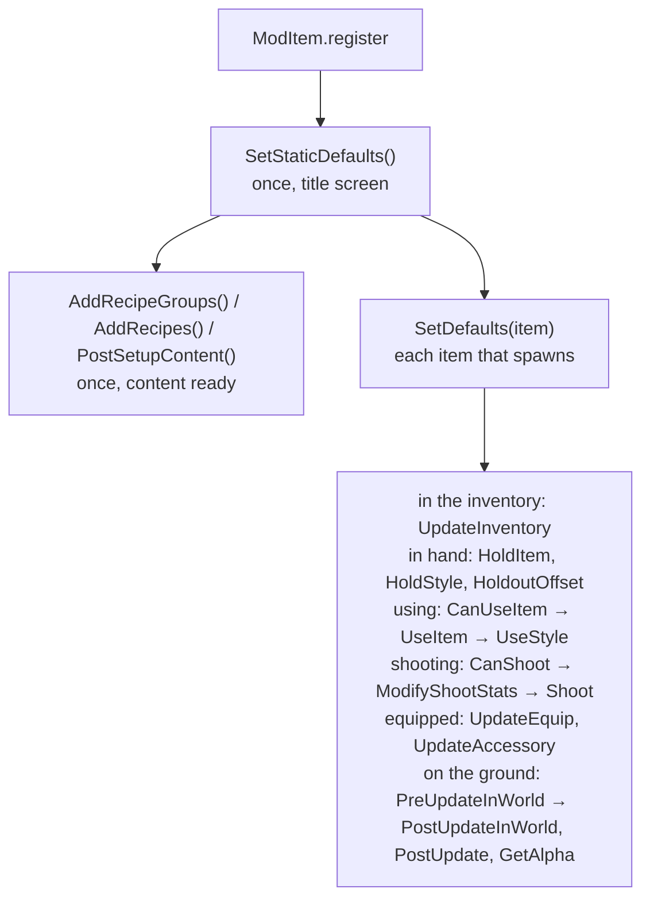
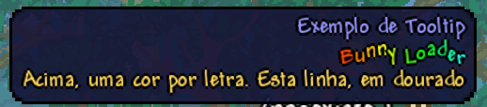

# 5. Items

A new item is a class that extends `ModItem`. This guide covers the item
itself (stats, use, shooting, accessories), prefixes, tooltips, fishing rods,
recipes and `ModSystem`. Read the [ideas in guide 4](04-conteudo-novo.md)
first: template and instance, `register`, textures, localization.

The full list of fields and methods is in the
[reference](../referencia/classes.md#moditem).

## The simplest item

```js
export class ExampleItem extends ModItem {
    SetDefaults() {
        this.Item.width = 20;
        this.Item.height = 20;
        this.Item.maxStack = ModItem.CommonMaxStack;        // 9999
        this.Item.value = Terraria.Item.buyPrice(0, 0, 1, 0);
    }

    AddRecipes() {
        this.CreateRecipe(999)
            .AddIngredient(Terraria.ID.ItemID.DirtBlock, 10)
            .AddTile(Terraria.ID.TileID.WorkBenches)
            .Register();
    }
}
```

`this.Item` is this instance's game `Item`: every C# field is there
(`damage`, `useTime`, `shoot`, `rare`...). It also arrives as an argument,
`SetDefaults(item)`.

The name and description come from `ItemName.ExampleItem` and
`ItemTooltip.ExampleItem` in `Localization/<language>.json`, or from the
class's `DisplayName` and `Tooltip` fields.

## When each method runs

A mod item's life, from registration to use:



| Method | When |
|---|---|
| `SetStaticDefaults()` | Once, with the type already in the game. For per-type tables (`Terraria.ID.ItemID.Sets...[this.Type]`). |
| `SetDefaults(item)` | Every item of this type that spawns. The stats go here. |
| `AddRecipeGroups()` | Once, before any recipe (from every mod). |
| `AddRecipes()` | Once, when the game's recipes already exist. |
| `PostSetupContent()` | Once, with all mod content in the game. |
| `OnCraft(item, player, recipe)` | When crafting this item from the menu; `item` is what the player will receive, and it can still be changed. |
| `ModifyTooltipLines()` | Once per language, with `this.TooltipLines` filled in: change the lines. |
| `ModifyTooltips(item, tooltips)` | Every time the tooltip shows up (see [Tooltip](#tooltip)). |
| `PreDrawTooltip(item, lines, x, y)`, `PostDrawTooltip(item, lines)` | Drawing the whole tooltip (see [Drawing the tooltip](#drawing-the-tooltip)). |
| `PreDrawTooltipLine(item, line, yOffset)`, `PostDrawTooltipLine(item, line)` | Drawing each line. |
| `CanUseItem(item, player)` | `false` prevents use. |
| `UseItem(item, player)` | On each use. Return `true` when the item did something only here (summoning a boss): it counts as used and a consumable is spent. |
| `HoldItem(item, player)` | Every frame with the item in hand. |
| `UseStyle(...)`, `HoldStyle(...)` | Every frame of use / of holding, after the game's style. |
| `HoldoutOffset(item, player)` | Shifts the weapon in hand: return `{ X, Y }` in pixels. |
| `CanShoot(item, player)` | `false`: uses, but does not shoot. |
| `ModifyShootStats(item, player, stats)` | Before each projectile: change `stats.position`, `velocity`, `type`, `damage`, `knockBack`. |
| `Shoot(item, player, position, velocity, type, damage, knockBack)` | `false`: the game's projectile does not spawn (create yours here). |
| `CanHitNPC(item, player, target)`, `ModifyHitNPC(item, player, target, modifiers)`, `OnHitNPC(item, player, target, hit, damageDone)` | The melee hit on an NPC; `CanHitPvp`, `ModifyHitPvp`, `OnHitPvp` in PvP. See [Hits](16-golpes.md). |
| `UpdateInventory(item, player)` | Every frame, in the inventory. |
| `UpdateEquip(item, player)`, `UpdateAccessory(item, player, vanity, hideVisual)` | Every frame, equipped. For accessories, `vanity` is the vanity slot (visuals only) and `hideVisual` the closed eye. |
| `GetAlpha(item, lightColor)` | On the ground: return the `Color` it is drawn with (`Color.White` = glows in the dark). `item` only has a position (`Center`) when it is the one on the ground; in the inventory and shop it is an `Item` without a position: light and dust go in `PostUpdate`. |
| `PostUpdate(item)` | Every frame, with the item on the ground (`item` is the `WorldItem`: `Center`, `position`, `velocity`). The place for light and dust, like the Example Soul's. |
| `PreUpdateInWorld(item, worldItem)`, `PostUpdateInWorld(item, worldItem)` | Every frame, around the update of the item on the ground (falling, water, the player's magnet). `item` is the `Item`; `worldItem` is the `WorldItem` carrying it (`Center`, `position`, `velocity`). `false` in `Pre` skips the game's update for that frame (the item stays still); `Post` runs anyway. In `GlobalItem` too, for any item on the ground. |
| `ModifyFishingLine(item, bobber, lineOriginOffset, lineColor)` | Fishing rod: where the line comes from and its color (see [Fishing rod](#fishing-rod)). |
| `CanPickup`, `OnPickup`, `ItemSpace`, `GrabRange`, `GrabStyle` | Picking up from the ground (see [Picking up](#picking-up-from-the-ground)). |

Only the methods you write cost anything: the game hook behind each one is
only installed when some class overrides it, and almost all of them only
enter JS for **mod items** (see the [cost guide](03-custo-e-desempenho.md#mod-classes-are-already-economical)).

## Picking up from the ground

The pickup methods, as in tModLoader. `worldItem` is the `WorldItem` on the
ground (`Center`, `position`, `velocity`, and the `Item` in
`worldItem.inner`); `player`, whoever picks it up.

| Method | When |
|---|---|
| `CanPickup(worldItem, player)` | `false`: the player neither picks up nor pulls the item. |
| `OnPickup(worldItem, player)` | On pickup, on the picker's device. `false`: the item disappears without entering the inventory. |
| `ItemSpace(item, player)` | `true`: picks it up even with a full inventory. Goes with `OnPickup`, which consumes it. |
| `GrabRange(worldItem, player, grabRange)` | The pickup range, in pixels (`grabRange` is a `Ref`: add to or subtract from the game's range). |
| `GrabStyle(worldItem, player)` | `true`: the mod moves the item to the player (change `worldItem.velocity`) and the game does not pull it. |

A mod heart that heals and disappears, like the game's:

```js
export class LifeOrb extends ModItem {
    ItemSpace(item, player) { return true; }   // picks up with a full inventory
    GrabRange(worldItem, player, grabRange) { grabRange.value += 100; }
    OnPickup(worldItem, player) {
        player.Heal(20);
        return false;   // does not enter the inventory
    }
}
```

With `ItemID.Sets.IsAPickup[this.Type] = true` in `SetStaticDefaults` (what
hearts and stars have), the game itself picks it up with a full inventory,
without `ItemSpace`. The Example Mod's `ExamplePickup` works like that: it
gives 10 seconds of Ironskin, comes from farther away with the Heartreach
Potion (`GrabRange`) and drops from enemies like hearts
(`Common/GlobalNPCs/ExamplePickupGlobalNPC.js`).

In `GlobalItem`, the same methods apply to any item (and for every item in
range the hook enters JS). On mobile, the range math is baked into the game's
`GrabItems`: a range larger than the game's is pulled by the loader, and a
smaller one makes the game ignore the item outside it (touching it still picks
it up).

## Shortcuts

```js
this.SetWeaponValues(50, 6, 6);        // damage, knockback, crit
this.SetDefaultWeaponStyle(20, true);  // useTime (and useAnimation), autoReuse
this.SetShopValues(ItemRarityID.Green, Terraria.Item.sellPrice(0, 1, 0, 0));  // rarity, price
this.CloneDefaults(Terraria.ID.ItemID.Minishark);            // copies a vanilla item
this.DefaultToPlaceableTile(tileType);
this.DefaultToFood(buffType, buffTime);
this.DefaultToGolfBall(projType);                            // tee and club, like the game's
this.DefaultToWhip(projType, damage, knockback, speed);
this.DefaultToSpear(projType, speed, time);
this.SetItemAnimation(4, 6);                                 // in SetStaticDefaults: 4 frames, 6 ticks each
ModItem.sellPrice(platinum, gold, silver, copper);
ModItem.buyPrice(platinum, gold, silver, copper);
```

Rarity: `ItemRarityID.Green`, `ItemRarityID.Pink`... (this Terraria does not
ship the names; Bunny Loader does).

## A weapon that shoots

```js
export class ExampleGun extends ModItem {
    SetDefaults() {
        this.Item.ranged = true;
        this.Item.shoot = Terraria.ID.ProjectileID.PurificationPowder;  // replaced by the ammo
        this.Item.shootSpeed = 10;
        this.Item.useAmmo = Terraria.ID.AmmoID.Bullet;
        this.SetWeaponValues(20, 5, 0);
        this.SetDefaultWeaponStyle(10, true);
        this.Item.noMelee = true;
        this.Item.UseSound = Terraria.ID.SoundID.Item41;
    }

    HoldoutOffset() {
        return { X: -18, Y: 0 };
    }
}
```

And the ammo points to the mod projectile:

```js
this.Item.shoot = ModContent.ProjectileType('ExampleBulletProjectile');
this.Item.ammo = Terraria.ID.AmmoID.Bullet;
```

### Shooting, step by step

When the game is about to shoot with a mod item:

1. `CanShoot(item, player)`: `false`, and the use happens without a
   projectile;
2. for **each** projectile the game would create (the shotgun creates
   several): `ModifyShootStats(item, player, stats)`, with `stats.position`,
   `velocity`, `type` (already replaced by the ammo), `damage` and
   `knockBack`, which you change;
3. `Shoot(item, player, position, velocity, type, damage, knockBack)`: return
   `false` so the game does not create its projectile, and create yours.
   `position` and `velocity` are game `Vector2`s: you can pass them straight
   to a `NewProjectile`.

```js
const NewProjectile = Terraria.Projectile['int NewProjectile(IEntitySource spawnSource, float X, float Y, float SpeedX, float SpeedY, int Type, int Damage, float KnockBack, int Owner, float ai0, float ai1, float ai2, NewProjectileModifier modifer)'];

Shoot(item, player, position, velocity, type, damage, knockBack) {
    for (let i = 0; i < 3; i++) {
        const v = Vector2.RotatedBy(velocity, MathHelper.ToRadians(-10 + i * 10));
        NewProjectile(player.GetProjectileSource_Item(item), position.X, position.Y, v.X, v.Y,
                      type, damage, knockBack, player.whoAmI, 0, 0, 0, null);
    }
    return false;   // the three above instead of the game's shot
}
```

## Accessories and armor

`UpdateEquip` runs every frame with the item equipped; `UpdateAccessory`, only
for accessories, with two extra parameters:

```js
export class ExampleShield extends ModItem {
    SetDefaults() {
        this.Item.accessory = true;
        this.Item.defense = 4;
    }

    UpdateAccessory(item, player, vanity, hideVisual) {
        if (vanity) return;                 // in the vanity slot: visuals only
        player.GetModPlayer(ExampleDashPlayer).DashAccessoryEquipped = true;
    }
}
```

An accessory usually turns on a field in a `ModPlayer`, and the `ModPlayer`
does the effect ([guide 8](08-jogador-e-buffs.md)). The `ModPlayer`'s
`ResetEffects` turns the field off every frame; if the accessory is still
equipped, it turns it back on.

### The texture on the body

Like tModLoader's `[AutoloadEquip]`, but by file name: next to the item's
texture, `<Texture>_<type>.png` becomes the worn texture.
`ExampleHelmet.png` has `ExampleHelmet_Head.png`; `ExampleWings.png`,
`ExampleWings_Wings.png`. The types (`EquipType`): `Head`, `Body`, `Legs`,
`HandsOn`, `HandsOff`, `Back`, `Front`, `Shoes`, `Waist`, `Wings`, `Shield`,
`Neck`, `Face`, `Beard`, `Balloon`.

Each texture gets a slot after the game's (`Item.headSlot`, `wingSlot`...),
already set in the item's `SetDefaults`. The body uses 1.4's composite sheet
(`ArmorIDs.Body.Sets.UsesNewFramingCode`), as in tModLoader. In
`SetStaticDefaults`, `this.Item` is the game's sample, with the slots:

```js
export class ExampleWings extends ModItem {
    SetStaticDefaults() {
        const stats = Terraria.ID.ArmorIDs.Wing.Sets.Stats[this.Item.wingSlot];
        stats.FlyTime = 180;              // tModLoader's WingStats(180, 9, 2.5)
        stats.AccRunSpeedOverride = 9;
        stats.AccRunAccelerationMult = 2.5;
    }

    // The five `ref`s of the game's WingMovement (Ref, .value).
    VerticalWingSpeeds(item, player, ascentWhenFalling, ascentWhenRising, maxCanAscendMultiplier, maxAscentMultiplier, constantAscend) {
        ascentWhenFalling.value = 0.85;
        ascentWhenRising.value = 0.15;
        maxCanAscendMultiplier.value = 1;
        maxAscentMultiplier.value = 3;
        constantAscend.value = 0.135;
    }
}
```

`EquipLoader.GetEquipSlot('ExampleHelmet', EquipType.Head)` returns the slot
(-1 if there is none). Accessories store the slot in an `sbyte`: up to 127
per type, counting the game's. `SetWingStats(time, speed, acceleration, ...)`
is the WingStats shortcut (TL's ExMod one).

Wings also have `HorizontalWingSpeeds(item, player, speed, acceleration)`
(running in the air, two `Ref`s) and `WingUpdate(player, inUse)`: `true` says
the mod animates the wings, and the game's `WingFrame` does not run.

#### Registering by hand

With `static AutoloadEquip = [EquipType.Body]` only the listed types are found
by name; `[]` turns it off (tModLoader's `[AutoloadEquip]`). The rest goes in
the item's `Load()`, with `EquipLoader.AddEquipTexture(this.Mod, texture,
type, item, name, equipTexture)`: the slot only exists afterwards, so
`GetEquipSlot(this.Mod, name, type)` works from `SetStaticDefaults` on. A
custom `EquipTexture` changes the behavior of that texture only:

```js
class BlockyHead extends EquipTexture {
    IsVanitySet(head, body, legs) { return true; }   // a vanity set on its own
    UpdateVanitySet(player) { /* sparks */ }
}

export class ExampleCostume extends ModItem {
    static AutoloadEquip = [];

    Load() {
        EquipLoader.AddEquipTexture(this.Mod, this.Texture + '_Head', EquipType.Head, this, null, new BlockyHead());
        EquipLoader.AddEquipTexture(this.Mod, this.Texture + 'Alt_Head', EquipType.Head, this, 'BlockyAlt', new BlockyHead());
        // ...
    }
}
```

The body's look comes from tModLoader's tables, which here belong to Bunny
Loader: `ArmorIDs.Head.Sets.DrawHead` (the game's `HidesHead`, inverted),
`ArmorIDs.Body.Sets.HidesTopSkin`/`HidesBottomSkin`/`HidesHands`/`HidesArms`
and `ArmorIDs.Legs.Sets.HidesTopSkin`/`HidesBottomSkin`, applied after the
game's `PlayerDrawSet.BoringSetup`.

#### Hair and hats

`Player.GetHairSettings` consults `ArmorIDs.Head.Sets.DrawFullHair`,
`DrawHatHair` and `DrawsBackHairWithoutHeadgear`, with tModLoader's defaults.
These Sets use the equipment slot (`Item.headSlot`), already available in
`SetStaticDefaults`. For a hat drawn over the hair:

```js
SetStaticDefaults() {
    Terraria.ID.ArmorIDs.Head.Sets.DrawHatHair[this.Item.headSlot] = true;
}
```

`DrawFullHair` shows the full hair; `DrawHatHair` uses the hat hair texture
(`PlayerHairAlt`). `DrawsBackHairWithoutHeadgear` allows the full back hair.
`ArmorIDs.Face.Sets.PreventHairDraw` and `player.faceHead` can hide the hair.

The hairstyle uses its own type in `Terraria.ID.HairID.Sets.DrawBackHair`. A
`ModHair` can set `HairID.Sets.DrawBackHair[this.Type] = true` in its
`SetStaticDefaults` to draw the hair behind the player. The new Sets return
`false` for mod slots not yet set.

#### Visuals: FrameEffects, vanity and robes

- `ModPlayer.FrameEffects(player)` runs every frame after the game assembles
  what gets drawn: switching `player.head`/`body`/`legs` to a slot changes the
  drawing (`ExampleCostumePlayer` puts on the costume this way).
- `IsVanitySet(head, body, legs)` receives the drawn SLOTS (not items) and is
  asked of each one's texture; if `true`, `PreUpdateVanitySet(player)` (before
  FrameEffects), `UpdateVanitySet(player)` (after) and
  `ArmorSetShadows(player)` (the `armorEffectDraw*` fields). Without an
  override, it is the `IsArmorSet` of those slots' items.
- `SetMatch(male, equipSlot, robes)` decides the piece's drawn slot. The robe
  sets `robes.value = true` and its legs in `equipSlot.value` (the
  `ExampleRobe`).
- `EquipFrameEffects(player, type)` runs with the item's texture worn;
  `UpdateVanity(item, player)`, with the accessory in the vanity slot.

`FrameEffects` can change the set between `PreUpdateVanitySet` and
`UpdateVanitySet`: ExampleCostume uses `ExampleCostume` when dry and
`BlockyAlt` when `player.wet` is true. A `GlobalItem.IsVanitySet` that counts
the callbacks of both looks needs to recognize both head slots.

The mannequin (`TEDisplayDoll`) draws mod pieces like the player does, and mod
armor goes back into place when the character loads (`tools/tests/armor` and
`armorsave`).

### Armor sets

`IsArmorSet(head, body, legs)` runs for each worn piece that is a mod item; if
it returns `true`, its `UpdateArmorSet(item, player)` grants the bonus. The
bonus text goes in `player.setBonus`: the game shows the "Set bonus" line in
the tooltip of the worn pieces.

```js
export class ExampleHelmet extends ModItem {
    IsArmorSet(head, body, legs) {
        return body.type === ModContent.ItemType('ExampleBreastplate') &&
               legs.type === ModContent.ItemType('ExampleLeggings');
    }

    UpdateArmorSet(item, player) {
        player.setBonus = ModLocalization.Translate('ArmorSetBonus.ExampleArmor').replace('{0}', 20);
        player.meleeDamage += 0.2;
        player.rangedDamage += 0.2;
        player.magicDamage += 0.2;
        player.minionDamage += 0.2;
    }
}
```

This game version has no `DamageClass`: damage is per class
(`meleeDamage`, `rangedDamage`, `magicDamage`, `minionDamage`).

For sets made of any items (including vanilla ones), `GlobalItem`:
`IsArmorSet(head, body, legs)` returns the set's NAME (`''` = none), and
`UpdateArmorSet(player, name)` gives the effect. The vanity, shadow,
`SetMatch` and wing methods also exist in `GlobalItem`, as in tModLoader.

In multiplayer the usual rule for mod items applies: both sides with the same
mods, in the same order. The game sends the ITEM of each armor slot, and each
device builds the slots on its own (checked in `tools/tests/mparmor`).

## Prefixes

A new prefix is a class that extends `ModPrefix` (in `Content/Prefixes/`, for
example). The Example Mod's `ExamplePrefix`, like tModLoader's:

```js
export class ExamplePrefix extends ModPrefix {
    get Power() { return 1; }

    // Which items can get it: Melee, Ranged, Magic, Summon, AnyWeapon, Accessory or Custom.
    get Category() { return PrefixCategory.AnyWeapon; }

    // The weight in the roll; each vanilla prefix weighs 1.
    RollChance(item) { return 5; }

    // tModLoader's `ref`s arrive as Ref.
    SetStats(damageMult, knockbackMult, useTimeMult, scaleMult, shootSpeedMult, manaMult, critBonus) {
        damageMult.value *= 1 + 0.20 * this.Power;
    }

    ModifyValue(valueMult) {
        valueMult.value *= 1 + 0.05 * this.Power;
    }
}
```

The name comes from `PrefixName.ExamplePrefix` in `Localization/<culture>.json`
(or `Prefixes.ExamplePrefix.DisplayName`, as in tModLoader). The game builds
the item's name with it, in the language's word order (in English: "Example
Night's Edge").

The rest is done by the game, because mobile's `Item.Prefix` is the PC one and
calls the right pieces as methods: Bunny Loader puts the prefix in the item's
list (`GetRollablePrefixes`), in the weighted roll (`RollAPrefix`) and in the
stats (`TryGetPrefixStatMultipliersForItem`); the game applies damage, speed,
size, mana and crit, raises the rarity, changes the price and writes the
"+20% damage" in the tooltip, as it does with its own. That is why the game's
rule also applies: if some stat the prefix touches does not actually change on
the item (10% of a weapon with 3 damage), the prefix does not take on that
item. Reforging, crafted items and the generated world's chests roll mod
prefixes the same way.

For what is not a game stat: `Apply(item)` (after the stats),
`ApplyAccessoryEffects(player)` (every frame, on the equipped accessory) and
`GetTooltipLines(item)` (extra lines; the game only writes the lines of its
own prefixes). The Example Mod's accessory one:

```js
export class ExampleAccessoryPrefix extends ModPrefix {
    get Category() { return PrefixCategory.Accessory; }

    ModifyValue(valueMult) { valueMult.value *= 1.2; }

    ApplyAccessoryEffects(player) { player.statDefense += 4; }

    GetTooltipLines(item) {
        const line = new TooltipLine(this.Mod, 'PrefixAccDefense', '+4' + Terraria.Lang.tip[25].Value);
        line.IsModifier = true;   // the green color of prefix lines
        return [line];
    }
}
```

A prefix can inherit from another: `ExampleDerivedPrefix` only changes `Power`
(`get Power() { return super.Power * 2; }`) and gets +40%.

### Mod items and prefixes

The game tables that say what is a sword, a gun or a magic weapon
(`PrefixLegacy.ItemSets`) do not know mod items. As in tModLoader, the
category comes from the item's class: `ModItem`'s `MeleePrefix`,
`RangedPrefix`, `MagicPrefix`, `SummonPrefix` and `WeaponPrefix`, defaulting
to the item's `melee`, `ranged`, `magic` and `summon`. Only an item with
damage that is neither ammo nor a consumable gets weapon prefixes (on mobile
every item has `maxStack` 9999, so the stack cannot decide it).
`ExampleMultiplePrefixCategoryWeapon` is ranged and takes melee and magic
prefixes:

```js
MeleePrefix(item) { return true; }
MagicPrefix(item) { return true; }
RangedPrefix(item) { return false; }
```

`ChoosePrefix(item, rand)` forces a prefix (it is how to give a `Custom` one),
`PrefixChance(item, pre, rand)` prevents or guarantees one,
`AllowPrefix(item, pre)` removes a prefix from the options and
`ApplyPrefix(item, pre)` runs after the stats. All four also exist in
`GlobalItem`, for any item.

### Saving and multiplayer

The game stores the prefix in a byte, and a mod prefix's number depends on
which mods are installed and in what order they load. Bunny Loader also writes
mod prefixes by name, in the character and in chests: with another mod
installed before, the item comes back with the right prefix, and without its
mod the item stays without the prefix until the mod returns (checked in
`tools/tests/prefix`).

In multiplayer the prefix travels as the usual number, and each side applies
the `ModPrefix` on its own: both need the same mods, in the same order, as for
mod items (`tools/tests/mpprefix`).

## Tooltip

`ModifyTooltips(item, tooltips)` runs **every time** the item's tooltip shows
up, with the lines the game built: a list of `TooltipLine`s, each with `Mod`,
`Name`, `Text`, `OverrideColor`, `IsModifier` and `IsModifierBad`. Change
them freely: swap the text, paint the whole line with `OverrideColor`, insert
new lines (`splice`) or hide the ones you do not want (`line.Hide()`).



```js
ModifyTooltips(item, tooltips) {
    tooltips.splice(1, 0, new TooltipLine(this.Mod, 'Notice', 'Right below the name'));
    const description = tooltips.find((line) => line.Name === TooltipNames.Tooltip(0));
    if (description) description.OverrideColor = Color.new(255, 215, 90);
    const knockback = tooltips.find((line) => line.Name === TooltipNames.Knockback);
    if (knockback) knockback.Hide();
}
```

The game's lines have `Mod` `'Terraria'` and tModLoader's names: `ItemName`,
`Favorite`, `NoSocial`, `Damage`, `CritChance`, `Speed`, `Knockback`,
`FishingPower`, `Equipable`, `Vanity`, `Defense`, `PickPower`, `AxePower`,
`HammerPower`, `TileBoost`, `HealLife`, `HealMana`, `UseMana`, `Placeable`,
`Ammo`, `Consumable`, `Material`, `Tooltip0`, `Tooltip1`... (the description,
one per line), `BuffTime`, `OneDropLogo`, `Expert`, `Master`, `PrefixDamage`,
`PrefixSpeed`, `PrefixCritChance`... (the prefix ones), `SetBonus`,
`JourneyResearch`, `Price` and `SpecialPrice`; and mobile's own,
`ReforgePrice` and `CraftingMaterials`. The lines from a mod prefix's
`GetTooltipLines` go right after the vanilla prefix lines.

The names are also in `TooltipNames`, so you do not write the bare text:
`line.Name === TooltipNames.Damage`. The description is
`TooltipNames.Tooltip(0)`, `TooltipNames.Tooltip(1)`... A wrong name in the
enum gives `undefined`, and the search finds nothing.

To paint **spans**, use the `[c/RRGGBB:text]` tag inside the text.
`TooltipLine.colorTag(text, color)` builds the tag from a `Color`, from
`{ R, G, B }` or from `'#RRGGBB'`:

```js
const red = TooltipLine.colorTag('fire', Color.new(255, 60, 30));
tooltips.push(new TooltipLine(this.Mod, 'Element', 'Deals ' + red + ' damage'));
```

For an **item icon** in the middle of the text, `[i:type]`, with the item's
number, vanilla or mod. It comes out at the font's size, in a line of any
color, and works in text the game draws with the font, like the tooltip and
the Mod Configuration header.

```js
tooltips.push(new TooltipLine(this.Mod, 'Trade', `Trade for [i:${ModContent.ItemType(ExampleItem)}]`));
```

The One Drop logo, the one on the game's licensed yoyos, is a line with no
text and `OneDropLogo = true`. `ExampleYoyo` puts its own at the end:

```js
ModifyTooltips(item, tooltips) {
    const logo = new TooltipLine('OneDropLogo', '');
    logo.OneDropLogo = true;
    tooltips.push(logo);
}
```

### Drawing the tooltip

Four methods touch the drawing, as in tModLoader:

| Method | When |
|---|---|
| `PreDrawTooltip(item, lines, x, y)` | Before the lines, with the box already drawn. `x` and `y` are `Ref`s: changing them moves the lines. `false` draws none of them. |
| `PreDrawTooltipLine(item, line, yOffset)` | Before each line. `false` does not draw the line (the mod can draw it its own way). |
| `PostDrawTooltipLine(item, line)` | After each line, including the one that was not drawn. |
| `PostDrawTooltip(item, lines)` | After all of them, with the `DrawableTooltipLine`s. |

The `line` is a `DrawableTooltipLine`: everything from `TooltipLine`, plus
`Index`, `X`, `Y` (and `OriginalX`, `OriginalY`), `Color` (the final color,
with the tooltip's transparency), `Font`, `Rotation`, `Origin`, `BaseScale`
and `Spread` (the shadow distance). Changing `X`, `Y`, `Rotation`,
`BaseScale` or `Spread` in `PreDrawTooltipLine` changes how the line is drawn;
text and lines are changed in `ModifyTooltips`.

`yOffset` (a `Ref`, 0 at the start) is the extra space **after each line**,
from that one on, as in tModLoader: `yOffset.value = 6` on a line pushes all
the following ones away; set it back to 0 to stop. The tooltip box is
measured beforehand and does not grow with it.

On mobile the tooltip has its own scale (`Settings.Tooltips.Scale`, which PC
does not have). It is already included in `BaseScale`: draw with
`line.BaseScale.X` and the text comes out the size of the other lines.

The Example Mod's `ExampleTooltipItem` (an example by GST378) adds the "Bunny
Loader" line and draws it in `PreDrawTooltipLine`, letter by letter, in a
wave; it returns `false` so the game does not draw it again. The core:

```js
PreDrawTooltipLine(item, line, yOffset) {
    if (line.Name !== 'BunnyLoader') return true;

    const draw = 'void DrawString(SpriteFont spriteFont, string text, Vector2 position, Color color, float rotation, Vector2 origin, float scale, SpriteEffects effects, float layerDepth)';
    const time = Terraria.Main.GlobalTimeWrappedHourly * 8;
    const scale = line.BaseScale.X;
    for (let i = 0; i < line.Text.length; i++) {
        const x = line.X + line.Font['Vector2 MeasureString(string text)'](line.Text.substring(0, i)).X * scale;
        const y = line.Y + Math.sin(time + i * 1.15) * 3;
        Terraria.Main.spriteBatch[draw](line.Font, line.Text[i], Vector2.new(x, y), line.Color, line.Rotation, line.Origin, scale, 0, 0);
    }
    return false;
}
```

(The Example Mod's version also draws the four shadows and a color per
letter.)

**Under the hood**: with one of these methods (or `ModifyTooltips`) in a
`ModItem`, a `GlobalItem` or a mod prefix, or with a mod rarity on the item,
Bunny Loader draws that item's tooltip in JS: a port of mobile's
`Main.MouseText_DrawItemTooltip`, made by GST378, with the mod hooks in the
middle. Other items use the game's drawing, at no cost. The crafting guide
popup (`GUICraftGuidePopup`) shows the same lines, without color. Mobile draws
raw text, without PC's tag parser, so a line with tags is drawn span by span
(a hook on `SpriteBatch.DrawString` with `whileIn`, only during the tooltip),
and the box is measured without the tags. If the port breaks on a new game
version, the log says so once and the tooltip falls back to the game's.

## Mod rarity

A new rarity is a class that extends `ModRarity`, in any file in `Content/`,
as in tModLoader. The type is assigned on registration, after the game's 12;
the item uses `ModContent.RarityType(Class)`:

```js
export class ExampleModRarity extends ModRarity {
    get RarityColor() {
        return Color.new(200, 215, 230);
    }

    // Good prefix (offset 1 or 2): the item moves up to the rarity above.
    GetPrefixedRarity(offset, valueMult) {
        if (offset > 0) return ModContent.RarityType(ExampleHigherTierModRarity);
        return this.Type;
    }
}

// in the ModItem:
SetDefaults() {
    this.Item.rare = ModContent.RarityType(ExampleModRarity);
}
```

`RarityColor` is read on every draw and can flash
(`ExampleHigherTierModRarity` uses `Main.DiscoR/G/B`). The color applies to
the tooltip name, the item's name on the ground, the text that pops up on
pickup and the chat's `[i:]` tag (this one with the color at load time).

`GetPrefixedRarity(offset, valueMult)` decides the rarity when a prefix moves
the item up (`offset` 1 or 2) or down (-1 or -2); the default is to stay the
same. The game clamps every rarity to 11 (purple) when applying a prefix:
without this, a mod item would lose its rarity when dropped on the ground with
a prefix. `ModContent.GetModRarity(type)` returns the instance.

## Damage classes

`this.Item.DamageType = DamageClass.Melee` (or `Ranged`, `Magic`,
`Summon`...) says which bonuses the weapon benefits from, which effects it
triggers and which prefixes it accepts. Per-class bonuses on the player and
new classes: [guide 15](15-classes-de-dano.md).

## Fishing rod

The game only knows where the tip of its own rods is; without
`ModifyFishingLine`, a mod rod's line comes out of the player's center. As in
tModLoader, the last two parameters are `Ref`s: `lineOriginOffset.value` is
where the line comes from, in pixels from the player's center facing right
(Bunny Loader mirrors it for facing left and for reversed gravity);
`lineColor.value` is the color, and a colored fishing line the player has
equipped overrides it.

```js
ModifyFishingLine(item, bobber, lineOriginOffset, lineColor) {
    lineOriginOffset.value = Vector2.new(43, -30);
    lineColor.value = Color.new(255, 215, 0);
}
```

The old way, with three parameters (`item, bobber, line`) and
`line.lineOriginOffset` / `line.lineColor`, still works.

`bobber` is the bobber (the projectile): `ExampleFishingRod` paints the line
with the color `ExampleBobber` rolled when it spawned (`bobber.ModProjectile`).

## Recipes

`this.CreateRecipe(amount)` inside `AddRecipes`, and a chain:

```js
this.CreateRecipe()
    .AddIngredient(Terraria.ID.ItemID.IronBar, 5)
    .AddIngredient(ModContent.ItemType('ExampleItem'), 10)
    .AddTile(Terraria.ID.TileID.Anvils)
    .SetProperty('needWater', true)
    .Register();
```

| Method | What it does |
|---|---|
| `SetResult(type, n)` | What the recipe gives (`CreateRecipe` already calls it). |
| `AddIngredient(type, n)` | Up to 15 ingredients. |
| `AddRecipeGroup(group, n)` | Accepts any item in the group (see below). |
| `AddTile(type)` | The crafting station. Only one per recipe (the game stores one number). |
| `SetProperty(name, value)` | `needWater`, `needLava`, `needHoney`, `needSnowBiome`, `needGraveyardBiome`, `needTorchGodsFavor`, `needMechdusa`, `notDecraftable`, `crimson`, `corruption`, `alchemy`. |
| `AddCustomShimmerResult(type, n)` | What comes out when the item is thrown into Shimmer, instead of the ingredients. |
| `Register()` | Puts the recipe into the game. |

A recipe for a **vanilla** item works too:
`new ModRecipe().SetResult(type, n).AddIngredient(...).Register()`.

### Recipe groups

A group makes the recipe accept any item from a list ("Any Iron Bar"). The
game's go by name, as they appear in `Terraria.ID.RecipeGroups` (`'IronBar'`,
`'Wood'`, `'Sand'`, `'Fragment'`...):

```js
new ModRecipe()
    .SetResult(Terraria.ID.ItemID.SpikyBall, 50)
    .AddRecipeGroup('IronBar')          // iron bar OR lead bar
    .AddTile(Terraria.ID.TileID.Anvils)
    .Register();
```

A new group: `ModRecipe.CreateRecipeGroup(name, [types])`, in
`AddRecipeGroups` (which runs before any recipe). The menu shows "Any <name>".
The name comes from the localization, in `RecipeGroups.<name>`, and without it
the `name` itself is used:

```js
AddRecipeGroups() {
    this.constructor.Group = ModRecipe.CreateRecipeGroup('ExampleItem', [
        ModContent.ItemType('ExampleItem'),
        ModContent.ItemType('ExampleSoul'),
    ]);
}
```

`AddRecipeGroup(group, n)` accepts the object, the name of a vanilla group or
the name of one created by a mod. If no ingredient already added belongs to
the group, it adds the group's first item with `n`. If one already does, that
ingredient starts accepting the whole group
(`.AddIngredient(ExampleItem, 50).AddRecipeGroup(group)`).

### The recipe limit

The game has 3600 recipe slots (`Recipe.maxRecipes`, fixed in the code), and
its own take 3570. Past that, the table grows, and Bunny Loader walks the rest
after the game, like TL Pro's Recipe Limit Fix: hooks on `Recipe.FindRecipes`
(crafting menu), `GUICraftGuidePopup.FindRecipes` (Guide) and
`Recipe.UpdateItemVariants`. A recipe beyond 3600 shows up in the menu like
the others, at the end of the list.

## ModSystem

For what belongs to the whole mod, not to one item: recipes for vanilla
items, groups, setup that depends on all the content.

```js
export class ExampleRecipes extends ModSystem {
    AddRecipeGroups() { /* ModRecipe.CreateRecipeGroup(...) */ }
    AddRecipes() { /* new ModRecipe()... */ }
    PostSetupContent() {}
}
```

`ModSystem` also follows the world (loading, updating, leaving) and saves data
along with it: that is in [guide 12](12-globais-e-mundo.md#modsystem-the-world).
To change a **vanilla** item (the copper sword's damage, gel's tooltip), the
way is a `GlobalItem`, from the same guide.

## Saving

Mod items in the inventory, the piggy bank and chests are saved **by name**
(mod + class), in a file next to the game's save. Turning the mod off loses
nothing: the item becomes a "?" and goes back to normal when the mod is turned
back on.

### Per-instance data: SaveData and LoadData

Implement both methods to store the item's own fields. The loader passes a
new `TagCompound` to `SaveData(tag)` and hands the saved data to
`LoadData(tag)`. The methods' return value is ignored; write to the `tag`.

```js
export class OwnedItem extends ModItem {
    owner = '';

    SaveData(tag) {
        tag.Set('owner', this.owner);
    }

    LoadData(tag) {
        this.owner = tag.GetString('owner');
    }

    UpdateInventory(item, player) {
        if (!this.owner) this.owner = player.name;
    }
}
```

The example only shows the data and picking the owner; add your item's
texture and defaults. The condition in `UpdateInventory` keeps an owner that
was already chosen. For items that represent different people, use
`maxStack = 1`.

The data follows the inventory, equipment, personal storage, equipment
loadouts and world chests in the `.plr.bl`/`.wld.bl` files, and the display
furniture (item frame, weapon rack, food platter, jar, mannequin and hat rack)
in `<world>.wld.bl.json`. Old saves, without their own data, call `LoadData`
with an empty tag. Accept missing fields and validate your mod's versions and
specific values. `GetString` returns `''` when the key is missing; `GetInt`
returns `0`.

Use strings, finite numbers, booleans, `null`, dense lists, plain data objects
and other `TagCompound`s. References to the game, functions, `undefined`,
`BigInt`, cycles, getters, non-enumerable properties and non-finite values are
rejected, to avoid silent losses in the JSON conversion. An error in
`SaveData` prevents the character's companion save from being replaced. An
error in `LoadData` keeps the original text and blocks a new save of that item
until a successful load or until it is reset by `SetDefaults`.

`Item.Clone`, `DeepClone` and `clientClone` copy the instance through
`Clone`. When the fields hold mutable objects/lists, override `Clone` to copy
them too; the default clone is shallow. Drops from `DropSelectedItem` and from
the mobile UI button (`DropUIItem`) copy the instance before sending the new
item. An item placed in a display piece carries the instance of the one in
hand, and the one that comes out of it (`DropItem`) drops with it. A mod that
creates another item manually through `NewItem(type, ...)` must set its data,
since that call does not receive a source item.

### Data in multiplayer

With the same mods on both sides, the loader sends the data together with the
native messages for inventory (5), world item (21/90), chest (32) and display
furniture (86, 89, 121, 123, 124, 133, 149 and the world chunks). The server
applies the data before relaying the item. If you only implement
`SaveData`/`LoadData`, the saved JSON also serves for syncing. That is why
these methods should only deal with data, with no gameplay effects.

To use a different representation on the network, implement **both**:

```js
NetSend(writer) {
    writer.WriteString(this.owner);
}

NetReceive(reader) {
    this.owner = reader.ReadString();
}
```

When overridden, `NetSend` takes precedence over the automatic `SaveData`
sending. The mod packet limit is 65000 bytes, including the envelope. Dropped
items follow Terraria's normal cycle: the world save does not persist items on
the ground. The companion files are local; this data is not persisted in
cloud saves.
