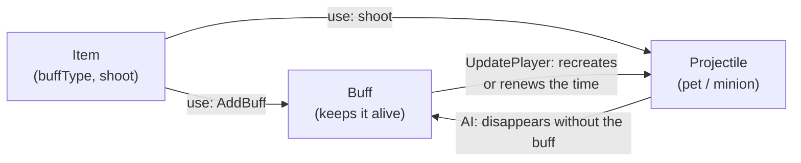

# 6. Projectiles

Everything that flies, spins or stays in the world for a while is a
projectile: bullets, arrows, spells, yoyos, spears, whips, pets, minions,
sentries, grappling hooks. A new projectile is a class that extends
`ModProjectile`.

Read the [ideas in guide 4](04-conteudo-novo.md) first. The full list of
fields and methods is in the [reference](../referencia/classes.md#modprojectile).

## The simplest projectile

```js
export class ExampleBulletProjectile extends ModProjectile {
    SetDefaults() {
        this.Projectile.width = 8;
        this.Projectile.height = 8;
        this.Projectile.aiStyle = 1;          // the game's bullet AI
        this.Projectile.friendly = true;
        this.Projectile.ranged = true;
        this.Projectile.penetrate = 5;
        this.Projectile.timeLeft = 600;
    }
}
```

Register the projectile **before** the item that uses it: the item needs its
number in `SetDefaults`.

## The AI: the game's or yours

A projectile moves through its **AI**, which runs every frame. There are three
ways to write it:

1. **A vanilla projectile's**, through `aiStyle`: `aiStyle = 1` is a bullet;
   the projectile behaves like that style.
2. **A specific vanilla projectile's**, through `AIType`: the projectile's
   type is swapped for `AIType` **only during the AI**. That is what makes a
   mod flail swing like the Sunfury, or a pet fly like the Zephyr Fish: some
   AIs look at the type, not just the `aiStyle`.

   ```js
   SetDefaults() {
       this.CloneDefaults(Terraria.ID.ProjectileID.Sunfury);
       this.AIType = Terraria.ID.ProjectileID.Sunfury;
   }
   ```

3. **Your own**, with `aiStyle = 0` and the movement in `AI`:

   ```js
   AI(proj) {
       proj.rotation += 0.2;
       proj.velocity.Y += 0.15;       // gravity
       if (++proj.ai[0] > 60) proj.velocity.X *= 0.98;
   }
   ```

`PreAI` runs before and, by returning `false`, skips the game's AI **and**
`AI`; `PostAI` runs after everything. `OnSpawn` runs once, on the first frame
of life.

`proj.ai` and `proj.localAI` hold the AI state: in the game they are structs
of 3 floats (`Float_FixedArray_3`), and the bridge accepts `[i]` on them like
an array (`proj.ai[0]++`, `proj.localAI[1] = 5`). Out of range, `RangeError`.

## When each method runs

| Method | When |
|---|---|
| `SetStaticDefaults()` | Once. `Terraria.Main.projFrames[this.Type] = n` here says how many frames the texture has. |
| `SetDefaults(proj)` | Every projectile of this type that spawns. |
| `OnSpawn(proj)` | Once, on the first frame of life. |
| `PreAI(proj)` | Before the AI. `false` skips the game's AI and `AI`. |
| `AI(proj)` | Your AI, every frame. |
| `PostAI(proj)` | After the AI. |
| `TileCollideStyle(proj, width, height, fallThrough, hitboxCenterFrac)` | Before colliding with tiles, every frame. All four are `Ref`s (`.value`): the size of the box that hits tiles, whether it falls through platforms and the point of the box pinned to the projectile's center (`Vector2`, default 0.5/0.5). `false`: goes through tiles this frame. |
| `OnTileCollide(proj, oldVelocity)` | Hit a tile: `false` avoids the death caused by that collision (to bounce, change `proj.velocity`). `oldVelocity` is the one from before the impact. Minions and pets (`Main.projPet`) do not die on tiles: they get it every frame with an impact (on the ground, every frame). |
| `PreKill(proj, timeLeft)` | `false` removes the game's death effects (dust, sound); the projectile dies anyway. |
| `OnKill(proj, timeLeft)` | On death (dust, sound, fragments). |
| `CanHitNPC(proj, target)`, `ModifyHitNPC(proj, target, modifiers)`, `OnHitNPC(proj, target, hit, damageDone)` | The hit on an NPC. See [Hits](16-golpes.md). |
| `CanHitPlayer(proj, target)`, `ModifyHitPlayer(proj, target, modifiers)`, `OnHitPlayer(proj, target, info)`, `CanHitPvp(proj, target)` | The hit on a player (hostile or PvP). |
| `Colliding(proj, projHitbox, targetHitbox)` | `true`/`false` decides the hit; `undefined` keeps the game's. |
| `CanDamage(proj)` | `false`: deals no damage. |
| `MinionContactDamage(proj)` | `true`: the minion (or pet) hurts on contact. |
| `ModifyDamageHitbox(proj, hitbox)` | Change the `hitbox` (Rectangle) so damage uses another area. |
| `CanCutTiles(proj)`, `CutTiles(proj)` | Cutting grass and cobwebs. |
| `GetAlpha(proj, lightColor)` | The final color (a `Color`), or `undefined` for the game's. |
| `PreDraw(proj, lightColor)`, `PostDraw(proj, lightColor)` | Drawing: `false` in `PreDraw` skips the game's drawing; draw yours with `Main.EntitySpriteDraw`. |
| `CanUseGrapple(player, type)`, `UseGrapple(player, type)` | Grappling hook, on the **template**, before launching: `false` prevents it; `UseGrapple` returns the type to launch. |
| `GrappleCanLatchOnTo(proj, player, tile)` | `true`/`false`: the hook latches onto this tile; `undefined` = the game's (solid tile). |
| `GrappleRange(proj)` | The hook's range, in pixels: farther than that, it comes back. Default 300. |
| `NumGrappleHooks(proj, player, numHooks)` | How many hooks stay latched at the same time (`Ref`; default 3). Above that, the oldest lets go. |
| `GrappleRetreatSpeed(proj, player, speed)` | The return speed (`Ref`; default 11). |
| `GrapplePullSpeed(proj, player, speed)` | The speed at which the latched hook pulls the player (`Ref`; default 11). |
| `GrappleTargetPoint(proj, player, grappleX, grappleY)` | The point the hook pulls toward (`Ref`; the sum of the centers of the hooks latched so far). |
| `ShouldUpdatePosition(proj)` | `false`: the game does not add velocity to position; your `AI` sets the position (held projectile, laser). |

All of them enter JS only for **mod** projectiles (native type filter).

`OnTileCollide` returning `false` does not prevent death by time, by
penetration after hitting an NPC or by an explicit `proj.Kill()` call. Those
deaths still call `PreKill` and, if it allows, `OnKill`, even with the
projectile on the ground.

### Bouncing

```js
OnTileCollide(proj, oldVelocity) {
    if (proj.velocity.X !== oldVelocity.X) proj.velocity.X = -oldVelocity.X;
    if (proj.velocity.Y !== oldVelocity.Y) proj.velocity.Y = -oldVelocity.Y * 0.8;
    return false;   // stays alive
}
```

### Grappling hook

A mod hook uses the game's hook AI (`aiStyle` 7): the simplest one copies a
hook with `CloneDefaults` and adjusts it with the methods above.

```js
export class ExampleHook extends ModProjectile {
    SetDefaults() { this.CloneDefaults(ProjectileID.GemHookAmethyst); }
    GrappleRange(proj) { return 500; }
    NumGrappleHooks(proj, player, numHooks) { numHooks.value = 2; }
    GrappleRetreatSpeed(proj, player, speed) { speed.value = 18; }
    GrapplePullSpeed(proj, player, speed) { speed.value = 10; }
}
```

The item that launches it: `shoot` with the hook's type and `shootSpeed`;
mobile's grapple button finds the item through `Main.projHook`, which
`ModProjectile` already sets for `aiStyle` 7. With a vanilla hook's `AIType`,
the range is that hook's (as in tModLoader). The grapple methods only exist on
`ModProjectile`. The Example Mod's `ExampleHookProjectile` uses all of them,
plus `CanUseGrapple` and `GrappleTargetPoint`, which leaves the player hanging
50 px from the tile.

`ExampleShortsword` shows `ShouldUpdatePosition`: the thrust is a projectile
that `AI` pins to the hand on every update, and the `false` stops the game from
adding velocity to position afterwards.

## Shortcuts

- `this.CloneDefaults(ProjectileID.Spear)`: copies a vanilla projectile's
  values.
- `this.DefaultToSpear()`, `DefaultToYoyo()`, `DefaultToFlail()`,
  `DefaultToWhip()`, `DefaultToDrillOrChainsaw()`, `DefaultToKite()`: the
  game's defaults for each family of held projectiles. On the **item**,
  `this.DefaultToWhip(projType, damage, knockback, speed)` and
  `this.DefaultToSpear(projType, speed, time)`.

## Pets, minions and sentries

They are a buff, an item and a projectile working together, as in tModLoader.
The Example Mod has all four: the **Paper Airplane** (pet), the **Annoying
Light** (light pet), the **Example Minion Staff** and the **Example Sentry
Staff**.



### Pet

The buff keeps the pet alive. The game has the method that creates the pet if
it is missing and renews the buff; it has a `ref bool` parameter, so a `Ref`
goes there ([guide 2](02-ref-e-out.md)):

```js
const SpawnPet = Terraria.Player['void BuffHandle_SpawnPetIfNeededAndSetTime(int buffIndex, ref bool petBool, int petProjID, int buffTimeToGive)'];

export class ExamplePetBuff extends ModBuff {
    SetStaticDefaults() {
        Terraria.Main.buffNoTimeDisplay[this.Type] = true;
        Terraria.Main.vanityPet[this.Type] = true;     // lightPet for a light pet
    }

    UpdatePlayer(player, buffIndex) {
        SpawnPet(player, buffIndex, new Ref(false), ModContent.ProjectileType('ExamplePetProjectile'), 18000);
    }
}
```

On the item, `shoot` is the pet and `buffType` is the buff; in `UseItem`, the
buff is added with `player.AddBuff(item.buffType, 3600, false)`. The
projectile sets `Main.projPet[this.Type] = true` and, every frame, stays alive
while its owner has the buff:

```js
AI(proj) {
    const player = Terraria.Main.player[proj.owner];
    if (!player.dead && player.FindBuffIndex(ModContent.BuffType('ExamplePetBuff')) >= 0) proj.timeLeft = 2;
}
```

With `Main.vanityPet` (or `Main.lightPet`) on the buff, the item also goes
into the equipment's **pet slot** (or light slot), and the game adds the buff
on its own. The Paper Airplane uses the Zephyr Fish AI:
`this.CloneDefaults(ProjectileID.ZephyrFish)` and
`this.AIType = ProjectileID.ZephyrFish`. The Zephyr Fish AI keeps the pet
alive through `player.zephyrfish`; with it set to `false` in `PreAI`, the
mod's buff decides.

### Minion

- On the projectile: `Main.projPet[this.Type] = true`,
  `ProjectileID.Sets.MinionSacrificable` (the game replaces the oldest when
  slots run out), `ProjectileID.Sets.MinionTargetingFeature` (follows the
  target marked by the whip) and, in `SetDefaults`, `minion = true` and
  `minionSlots = 1`.
- On the buff: `buffNoSave` and, in `UpdatePlayer`, `buffTime[i] = 18000`
  while `player.ownedProjectileCounts[minion] > 0`; with no minion,
  `player.DelBuff(i)`.
- On the item: `summon = true`, `buffType` and `shoot`; `Shoot` adds the buff
  (`player.AddBuff(item.buffType, 2, false)`) and returns `true` so the game
  creates the minion. In `ModifyShootStats`, `stats.position = Main.MouseWorld`
  puts the minion where you tapped.
- `MinionContactDamage(proj)` returning `true`: the minion hurts on contact
  (the game does not let pets or minions deal contact damage).

The minion's damage comes from `originalDamage`, which the game recalculates
every frame with the summon bonuses. Bunny Loader fills it with the damage of
the item that created the projectile, as tModLoader does.

The minion counter under the buff icon:

```js
const counter = Terraria.DataStructures.CachedProjectileCounterBuffTextHandler.new(ModContent.ProjectileType('ExampleMinion'));
Terraria.ID.BuffID.Sets.BuffTextHandlers.Add(this.Type, counter);
```

### Sentry

On the item, `sentry = true`; on the projectile, `sentry = true` and
`timeLeft = 36000` (10 minutes). The Example Mod's `Shoot` finds the ground
with `player.FindSentryRestingSpot(type, x, y, push)` (three `out`s), creates
the sentry and calls `player.UpdateMaxTurrets()`, which removes the oldest one
when the limit is exceeded.

For the sentry to land on a platform, `fallThrough.value = false` in
`TileCollideStyle`. And `OnTileCollide` returning `false`, so the ground does
not kill it.

### A collision box smaller than the drawing

```js
TileCollideStyle(proj, width, height, fallThrough, hitboxCenterFrac) {
    width.value = height.value = 10;   // the spear fits through gaps
    fallThrough.value = false;         // and stops on platforms
    return true;
}
```

The box only applies against tiles; damage still uses `width`/`height` (or
`ModifyDamageHitbox`). A projectile with `aiStyle` 10 (falling sand) always
uses its own size.

## Custom drawing

`PreDraw` returning `false` removes the game's drawing; draw yours with
`Main.EntitySpriteDraw`. `lightColor` is the light at that spot.

An instance method stored in a variable stays bound to the object it was read
from:

```js
const Draw = Terraria.Main.spriteBatch['void Draw(Texture2D texture, Vector2 position, Nullable`1 sourceRectangle, Color color, float rotation, Vector2 origin, float scale, SpriteEffects effects, float layerDepth)'];
Draw(texture, position, null, color, 0, origin, 1, 0, 0);   // calls on Main.spriteBatch
```

### Trails (`oldPos`, `oldRot`, `oldSpriteDirection`)

The game only records the trail with a `TrailingMode` in
`SetStaticDefaults`, as in tModLoader. Without it (the default is `-1`), the
positions stay zeroed.

```js
SetStaticDefaults() {
    ProjectileID.Sets.TrailCacheLength[this.Type] = 5;   // how many positions (default 10)
    ProjectileID.Sets.TrailingMode[this.Type] = 0;       // 0: oldPos only; 2: also oldRot and oldSpriteDirection
}
```

`oldPos.Length` is `TrailCacheLength`. In mode 0, `oldRot` and
`oldSpriteDirection` stay zeroed on purpose.

## Differences from tModLoader

- `proj.ai`, `proj.localAI`, `proj.oldPos`, `proj.oldRot` are not arrays on
  mobile (they are fixed-size structs), but `[i]` works the same. `ai` has 3
  slots.
- Projectiles have no `DamageType`: `melee`, `ranged`, `magic`, `minion` and
  `sentry` are `bool` fields. On the item, `summon = true`.
- `player.HasBuff(t)` does not exist on mobile: `player.FindBuffIndex(t) >= 0`.
- `Main.ActiveNPCs` does not exist: iterate `Terraria.Main.npc` (the last one
  is empty) and skip the `!npc.active` ones.
