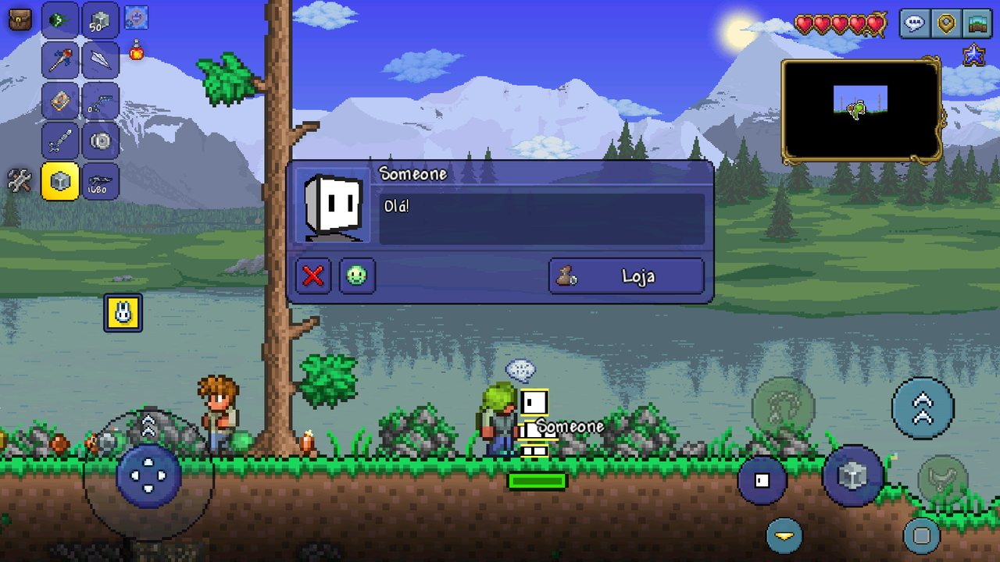
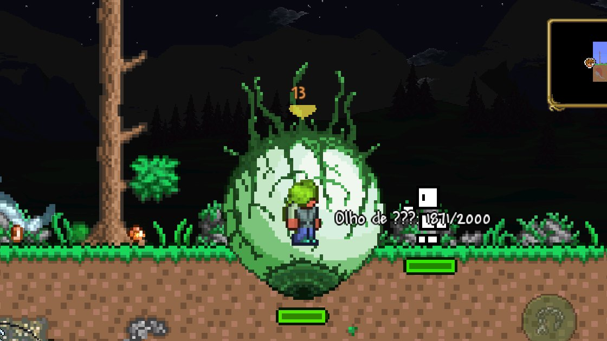

# 7. NPCs: enemies, town NPCs and bosses

Every living thing in the world that is not a player is an NPC: slimes,
zombies, bosses, the Guide, the Nurse, the critters. A new NPC is a class that
extends `ModNPC`. This guide goes from the simple enemy (drops, natural
spawning, Bestiary) to the town NPC (house, chat, shop, mood) and the boss
(custom AI and music).

Read the [ideas in guide 4](04-conteudo-novo.md) first. The full list of
fields and methods is in the [reference](../referencia/classes.md#modnpc).

## An enemy: the example slime

`ExampleSlimeNPC` is a slime with two animation frames, drops, natural
spawning during the day and a Bestiary entry:

```js
const { SoundID, NPCID, ItemID } = Terraria.ID;
const { ItemDropRule } = Terraria.GameContent.ItemDropRules;
const Common = ItemDropRule['IItemDropRule Common(int itemId, int chanceDenominator, int minimumDropped, int maximumDropped)'];

export class ExampleSlimeNPC extends ModNPC {
    SetStaticDefaults() {
        Terraria.Main.npcFrameCount[this.Type] = 2;   // the texture has 2 frames, stacked
    }

    SetDefaults() {
        this.NPC.width = 32;
        this.NPC.height = 24;
        this.NPC.aiStyle = 1;          // the game's slime AI
        this.NPC.damage = 7;
        this.NPC.defense = 2;
        this.NPC.lifeMax = 25;
        this.NPC.HitSound = SoundID.NPCHit1;
        this.NPC.DeathSound = SoundID.NPCDeath1;
        this.NPC.value = ModNPC.NPCValue(0, 0, 0, 25);
        this.AnimationType = NPCID.BlueSlime;   // animates like the blue slime
    }

    SpawnChance(info) {
        if (!info.CommonEnemy || !info.Day || !info.AboveSurface) return 0;
        return info.Rain ? 0.05 : 0.1;
    }

    ModifyNPCLoot(npcLoot) {
        npcLoot.Add(Common(ItemID.Gel, 1, 1, 2));
        npcLoot.Add(Common(ModContent.ItemType('ExampleItem'), 3, 5, 10));
    }
}
```

- `SetDefaults` gives the **base** life, damage and defense. The Expert and
  Master scaling is applied afterwards, by the game, as with its own NPCs.
- The texture is a **vertical strip** of frames; `Main.npcFrameCount[this.Type]`
  says how many.
- `AnimationType` makes the NPC animate like a vanilla one. For your own
  animation, write `FindFrame(npc, frameHeight)` and change `npc.frame.Y`.

## Enemy banners

An enemy banner connects the kill counter to the item and to the bonus of the
placed tile. On the representative NPC, set it up in `SetDefaults`:

```js
this.Banner = this.Type;
this.BannerItem = ModContent.ItemType('ExampleSlimeBanner');
```

For another NPC to share the counter and the bonus, set its `Banner` to the
representative's type. The item is defined on the representative.

```js
export class ExampleSlimeBanner extends ModItem {
    SetDefaults() {
        this.DefaultToPlaceableTile(ModContent.TileType('ExampleEnemyBannerTile'), 1);
        this.Item.width = 10;
        this.Item.height = 24;
    }
}

export class ExampleEnemyBannerTile extends ModBannerTile {}
```

Style `1` identifies the matching column in the 1x3 tile's texture. The base
tile sets up ceiling and platform anchors, identifies the item that places
each style and activates the native bonus in `SceneMetrics.NPCBannerBuff`.
Drawing uses the native `MultiTileVine` renderer's sway, respecting the game's
wind option. Keep the base methods when overriding `PreDraw` or
`SetDrawPositions`.

By default one banner is unlocked every 50 kills through Terraria 1.4.5's
claim system. In the item's `SetStaticDefaults`, customize
`ItemID.Sets.KillsToBanner[this.Type]` or `ItemID.Sets.BannerStrength[this.Type]`.
Count, claimable amount and notification are saved by the NPC's UID/name, so
they survive changes to the mods' load-time IDs.

The Example Mod includes these three components. The wide decorative banner
`ExampleWideBannerTile` remains another furniture example.

## The AI

`this.CloneDefaults(NPCID.BlueSlime)` in `SetDefaults` copies a vanilla NPC's
base stats. It also accepts another ModNPC's type. The copy keeps the
identity, the instance, the globals and the players' participation; the loader
applies the world difficulty afterwards. It does not replace `AIType`: set
that field so the type checks inside the AI see the vanilla NPC you are
reusing.

As with projectiles ([guide 6](06-projeteis.md#the-ai-the-games-or-yours)):
`aiStyle` gives the AI of a game family (1 is slime, 3 is zombie, 7 is town
NPC), and `aiStyle = -1` leaves everything to your `AI`. `PreAI` returning
`false` skips the game's AI and `AI`; `PostAI` runs afterwards.

`AIType` makes the type checks inside the AI see a specific vanilla NPC. In
`SetDefaults`, for example:

```js
SetDefaults(npc) {
    // Besides your NPC's life, size and other stats:
    npc.aiStyle = 2;
    this.AIType = Terraria.ID.NPCID.DemonEye;
}
```

The loader swaps `npc.type` for `AIType` only while running the native AI and
restores the type before `AI` and `PostAI`. `PreAI` also receives the original
type. This works even without writing any of those three methods. The value
belongs to the instance: it can be changed during `PreAI` for that frame's
call. `0` turns the swap off; negative variant IDs do not activate `AIType`.

`AIType` does not copy stats or set `aiStyle`, frames or texture.
`AnimationType` remains the independent choice for animation. If the borrowed
AI creates other NPCs, projectiles or effects, it keeps creating the vanilla
types that AI expects.

With `GlobalNPC`, the order follows tModLoader: every `GlobalNPC.PreAI`,
`ModNPC.PreAI`, native AI, `ModNPC.AI`, `GlobalNPC.AI`, `ModNPC.PostAI` and
`GlobalNPC.PostAI`. A global veto skips the local `PreAI` and the AI step; a
local veto skips the AI step. The `PostAI`s are still called.

`npc.ai[0]` to `npc.ai[3]` and `npc.localAI[...]` hold the state, as with
projectiles. `npc.target` is the target player's index (`npc.TargetClosest()`
picks the nearest).

## Methods

| Method | When |
|---|---|
| `SetStaticDefaults()` | Once. `Terraria.Main.npcFrameCount[this.Type] = n`: the texture's frames. |
| `SetDefaults(npc)` | Every NPC of this type that spawns. Life, damage and defense here. |
| `ApplyBuffImmunity(npc)` | `npc.buffImmune[id] = true`. |
| `ModifyNPCLoot(npcLoot)` | The drops: `npcLoot.Add(rule)`. Once. |
| `SetBestiary(database, bestiaryEntry)` | The Bestiary entry: biome, time, text. |
| `SpawnChance(info)` | Weight in natural spawning (`0` = does not spawn). |
| `SpawnNPC(tileX, tileY)` | How it spawns when picked, at the spawn tile. Default: on top of the tile. |
| `HitEffect(npc, hitDirection, damage)` | On each hit (dust, gore). `npc.life <= 0` is the killing hit. |
| `PreAI(npc)`, `AI(npc)`, `PostAI(npc)` | The AI, every frame. |
| `FindFrame(npc, frameHeight)` | Your own animation: change `npc.frame.Y`. |
| `CheckActive(npc)` | `false`: does not despawn when far from the player. |
| `PreKill(npc)`, `OnKill(npc)` | On death. `PreKill` returning `false` cancels the drop. |
| `CanBeHitByItem`, `ModifyHitByItem`, `OnHitByItem`; `CanBeHitByProjectile`, `ModifyHitByProjectile`, `OnHitByProjectile`; `ModifyIncomingHit` | The hits it takes. See [Hits](16-golpes.md). |
| `CanHitPlayer`, `ModifyHitPlayer`, `OnHitPlayer`; `CanHitNPC`, `CanBeHitByNPC`, `ModifyHitNPC`, `OnHitNPC` | Its own hits (on the player; on another NPC). |

## Drops

`ItemDropRule` is the game's class; get the methods by signature:

```js
const { ItemDropRule } = Terraria.GameContent.ItemDropRules;
const Common = ItemDropRule['IItemDropRule Common(int itemId, int chanceDenominator, int minimumDropped, int maximumDropped)'];
const NormalvsExpert = ItemDropRule['IItemDropRule NormalvsExpert(int itemId, int chanceDenominatorInNormal, int chanceDenominatorInExpert)'];

npcLoot.Add(Common(ItemID.Gel, 1, 1, 2));              // always, 1 to 2
npcLoot.Add(Common(myItem, 3, 5, 10));                 // 1 in 3, 5 to 10
npcLoot.Add(NormalvsExpert(ItemID.SlimeStaff, 10000, 7000));
```

Mod items work in any rule. The game's drop code (`CommonCode.DropItem*`)
refused types above the vanilla ones, with the limit fixed in the code; Bunny
Loader swaps that limit for the item total, as tModLoader does. The drops show
up in the Bestiary on their own.

## Natural spawning

`SpawnChance(info)` returns a **weight**. When the game is about to spawn an
enemy, the roll is between the game's (weight 1) and the mod ones with a
weight above zero: `0.1` is "now and then"; `1` ties with the game's. As in
tModLoader, natural spawning runs in single player or on the server, and
`info.Player` is the player the NPC spawns near (in multiplayer, do not use
`Main.LocalPlayer`).

`info` is an `NPCSpawnInfo`, with:

- `SpawnTileX`, `SpawnTileY`, `Player`; `GroundTileY`, `SpawnTileType` and
  `SpawnWallType` (the ground at that spot);
- the fields of the game's `NPC.Spawner`, as in tModLoader: `waterTile`,
  `nearGranite`, `nearMarble`, `spawnSpider`, `ZoneCorrupt`...;
- height: `Sky`, `Surface`, `Underground`, `Cavern`, `Underworld`,
  `AboveSurface`, `BelowSurface`;
- time and events: `Day`, `Night`, `Rain`, `SlimeRain`, `BloodMoon`,
  `SolarEclipse`, `PumpkinMoon`, `FrostMoon`, `AnyEvent`, `Invasion`,
  `AnyTower`;
- world: `HardMode`, `Expert`, `Master`;
- biome: `Corruption`, `Crimson`, `Hallow` (and `Underground...` for each),
  `Snow`, `Ice`, `Jungle`, `UndergroundJungle`, `Mushroom`, `SurfaceMushroom`,
  `Ocean`, `Desert`, `DesertCave`, `Meteor`, `Marble`, `Granite`,
  `Graveyard`, `Dungeon`, `Lihzahrd`;
- `CommonEnemy`: no invasion, event or pillar. The normal case.

The game's own conditions, as in tModLoader, are in `SpawnCondition`:
`SpawnCondition.OverworldNightMonster.Chance` is the share of the game's roll
that would land there (0 to 1) at the spawn point. Multiplying it gives a
proportional weight:

```js
SpawnChance(info) {
    return SpawnCondition.OverworldNightMonster.Chance * 0.2;   // 20% of the night zombies
}
```

For the NPC to show up in a mod biome in the Bestiary (the name, the icon,
the background and the filter), put the biome in `SpawnModBiomes`, in
`SetDefaults`:

```js
SetDefaults() {
    // ...
    this.SpawnModBiomes = [MyBiome];
}
```

## Bestiary

```js
const { BestiaryDatabaseNPCsPopulator, FlavorTextBestiaryInfoElement } = Terraria.GameContent.Bestiary;

SetBestiary(database, bestiaryEntry) {
    const { SpawnConditions } = BestiaryDatabaseNPCsPopulator.CommonTags;
    bestiaryEntry.Info.Add(SpawnConditions.Biomes.Surface);
    bestiaryEntry.Info.Add(SpawnConditions.Times.DayTime);

    const text = FlavorTextBestiaryInfoElement.new();
    text['void .ctor(string languageKey)'](ModLocalization.Key('Bestiary.ExampleSlimeNPC'));
    bestiaryEntry.Info.Add(text);
}
```

The Bestiary builds the portrait, the drops and the kill count on its own.
`HideFromBestiary = true` removes the NPC from the Bestiary.

To show a **still image** instead of the animated NPC (in the list and the
portrait), put a `<Texture>_BestiaryIcon.png` file next to the texture
(`ExampleBoss_BestiaryIcon.png`), or the path in `BestiaryIcon`. tModLoader's
way also works: `NPCBestiaryDrawModifiers`'s `CustomTexturePath` pointing to a
file in the mod. The image is drawn at its original size, centered in the
frame; the modifier's `Scale` enlarges or shrinks it.

## Town NPC

An NPC that moves into a house, chats, sells and has a mood, like the game's.
The Example Mod has the **Person** (`ExamplePerson`).



```js
export class ExamplePerson extends ModNPC {
    SetStaticDefaults() {
        Terraria.Main.npcFrameCount[this.Type] = 25;
        NPCID.Sets.ExtraFramesCount[this.Type] = 9;
        NPCID.Sets.AttackFrameCount[this.Type] = 4;
        NPCID.Sets.DangerDetectRange[this.Type] = 700;
        NPCID.Sets.AttackType[this.Type] = 1;        // 0 throwing, 1 shooting, 2 magic
        NPCID.Sets.AttackTime[this.Type] = 60;
        NPCID.Sets.AttackAverageChance[this.Type] = 35;
        this.Happiness
            .SetNPCAffection(NPCID.Nurse, AffectionLevel.Love)
            .SetBiomeAffection('Desert', AffectionLevel.Hate);
    }

    SetDefaults() {
        this.NPC.townNPC = true;
        this.NPC.friendly = true;
        this.NPC.aiStyle = 7;                        // the game's town NPC AI
        this.AnimationType = NPCID.Guide;
        // ...life, defense, sounds
    }

    CanTownNPCSpawn(numTownNPCs) { /* true: can move in */ }
    CheckConditions(left, right, top, bottom) { return bottom <= Terraria.Main.worldSurface; }
    SetNPCNameList() { return ['Someone', 'Somebody', 'Blocky', 'Colorless']; }
    GetChat(npc) { return ModLocalization.GetTextValue('NPCChat.ExamplePerson_1'); }
}
```

| Method | When |
|---|---|
| `CanTownNPCSpawn(numTownNPCs)` | Every so often, while there is none of this type in the world: `true` and it moves into the next empty house. |
| `CheckConditions(left, right, top, bottom)` | Does the room (in tiles) suit it? Applies when moving in and in the housing menu. |
| `SetNPCNameList()` | Its first names; one is picked when it arrives. |
| `GetChat(npc)` | What it says when you chat (text). |
| `SetChatButtons(npc, buttons)` | The chat buttons: `buttons.button` and `buttons.button2` (mobile shows up to two). |
| `OnChatButtonClicked(npc, firstButton)` | A button was tapped. Return a shop's name to open it. |
| `AddShops()` | The shops, once (see below). |
| `TownNPCAttackProj(npc, attack)` | The attack's projectile: `attack.projType` and `attack.attackDelay`. |
| `TownNPCAttackStrength(npc, attack)` | `attack.damage` and `attack.knockback`. |
| `TownNPCAttackProjSpeed(npc, attack)` | `attack.speed`, `attack.gravityCorrection` (aiming higher) and `attack.randomOffset`. |

### Head and textures

Next to the `Texture`, by name:

| File | What for |
|---|---|
| `_Head.png` | The head on the map and in the housing menu. **Without it the town NPC never moves in.** |
| `_Shimmer_Head.png` | The head after shimmering. |
| `_Party.png`, `_Shimmer.png`, `_Shimmer_Party.png` | During a party, after shimmering, and both. |
| `_Portrait.png`, `_Shimmer_Portrait.png` | The chat portrait (200x200). Without it, the chat shows the sprite frame. |

### Shop

```js
SetChatButtons(npc, buttons) {
    buttons.button = Terraria.Localization.Language['string GetTextValue(string key)']('LegacyInterface.28');   // "Shop"
}

OnChatButtonClicked(npc, firstButton) {
    if (firstButton) return 'Shop';
}

AddShops() {
    new NPCShop(this.Type, 'Shop')
        .Add(ModContent.ItemType('ExampleGun'))
        .Add(ModContent.ItemType('ExampleYoyo'), { condition: () => !Terraria.Main.dayTime })
        .Add(ModContent.ItemType('ExampleSwingingEnergySword'), { currency: ExampleCustomCurrency.CurrencyId, price: 10 })
        .Register();
}
```

Each item's options: `condition` (a function; `false` and it does not show
up), `price` (the price) and `currency` (a custom currency). The price goes
through the town NPC's happiness, as in the game's shops.

A custom currency, paid with an item (the Example Mod's is the Example Item):

```js
const { CustomCurrencyManager, CustomCurrencySingleCoin } = Terraria.GameContent.UI;
const currency = CustomCurrencySingleCoin.new();
currency['void .ctor(int coinItemID, long currencyCap)'](ModContent.ItemType('ExampleItem'), 999);
currency.CurrencyTextKey = ModLocalization.Key('CustomCurrency.ExampleItemCurrency');
currency.CurrencyTextColor = Color.new(138, 43, 226);
const id = CustomCurrencyManager.RegisterCurrency(currency);
```

`CurrencyTextColor` is the price's color in the shop. The mobile game ignores
it (it paints every custom-currency price the same pink); Bunny Loader draws
that tooltip itself and uses the currency's color. Without it, the game's pink
stays.

### Happiness

`this.Happiness` (in `SetStaticDefaults`) writes the preferences into the
game's own personality database, which calculates the mood and the shop
prices: `SetNPCAffection(vanillaNpc, level)` and
`SetBiomeAffection('Forest' | 'Desert' | 'Snow' | 'Jungle' | 'Ocean' |
'Underground' | 'Hallow' | 'Mushroom' | 'Dungeon' | 'Corruption' | 'Crimson',
level)`, with `AffectionLevel.Love`, `Like`, `Dislike` or `Hate`. A mod biome
goes in by class, as in tModLoader: `SetBiomeAffection(MyBiome,
AffectionLevel.Love)`; the dialogue mentions its `TownNPCDialogueName`
(`Biomes.MyBiome.TownNPCDialogueName` in `Localization`, or "the My Biome").

Mood lines come from `TownNPCMood.<Class>` in `Localization/<language>.json`:
`Content`, `NoHome`, `FarFromHome`, `LoveSpace`, `LikeBiome`, `LoveNPC`,
`DislikeCrowded`... `{0}` becomes the biome's or the NPC's name.

### Attacking

With `NPCID.Sets.AttackType` and the other attack sets, the game's town NPC AI
makes it attack: it picks the moment and animates. The projectile comes from
`TownNPCAttackProj` and goes at the nearest visible enemy, with damage scaled
by the game.

### Gore

Every PNG in a `Gores/` folder of the mod (`Content/Gores/`,
`Content/NPCs/Gores/`...) becomes a gore, named after the file:

```js
const NewGore = Terraria.Gore['int NewGore(Vector2 Position, Vector2 Velocity, int Type, float Scale)'];
NewGore(npc.position, npc.velocity, ModGore.getTypeByName('ExamplePerson_Gore_Head'), 1);
```

### Saving

The town NPC goes into `<world>.wld.npcs.bl`, **by name**: position, house,
first name, variation, the stored room and whether it was shimmered. The
`.wld` stays without it, so the world opens without the mod, and the town NPC
comes back when the mod does.

### Differences from tModLoader

- Mobile shows up to two buttons in the chat (`SetChatButtons`).
- There is no `ModifyNPCHappiness`, `CanGoToStatue` (king or queen statue) yet,
  nor the `TownNPCAttackCooldown`, `Shoot`, `Magic` and `Swing` attacks.
- The shot's target is the nearest visible enemy (the game's is kept in
  variables the mod cannot reach).

## Boss

The Example Mod has a boss, the **Eye of ???** (`ExampleBoss`), summoned at
night by `ExampleBossSummonItem`.



- `this.NPC.boss = true`: the game treats it as a boss (it does not despawn
  far away, it does not count toward natural spawning);
- `aiStyle = -1` and the AI in `AI`: it chases the player; at half life it
  speeds up and switches animation; during the day, it flees
  (`npc.EncourageDespawn(10)`);
- the summon is a plain item that calls the game:

  ```js
  CanUseItem(item, player) {
      return !Terraria.Main.dayTime && !Terraria.NPC.AnyNPCs(ModContent.NPCType('ExampleBoss'));
  }
  UseItem(item, player) {
      if (player.whoAmI !== Terraria.Main.myPlayer) return;
      PlaySound(SoundID.Roar, player.position, 0, 0);
      Terraria.NPC.SpawnOnPlayer(player.whoAmI, ModContent.NPCType('ExampleBoss'), 0, 0, 0, 0);
  }
  ```

- the fight's **music** is the `Music` field ([guide 10](10-sons-e-musica.md#music)):

  ```js
  SetDefaults() {
      // ...
      this.Music = MusicLoader.GetMusicSlot('Music/Ropocalypse2');
  }
  ```

- the **boss icon** is the `<Texture>_Head_Boss.png` file next to the
  texture (`ExampleBoss_Head_Boss.png`), or the path in `BossHeadTexture`. It
  shows up on the boss health bar and on the map. **Without it, the boss has
  no big bar and no map icon** (the game only shows the bar for those with an
  icon).
- a **second icon** (another phase, for example) is registered with
  `Mod.AddBossHeadTexture`, which returns the slot, and goes in through
  `BossHeadSlot`. `BossHeadRotation` and `BossHeadSpriteEffects` rotate and
  mirror the map icon:

  ```js
  static secondPhase = -1;

  SetStaticDefaults() {
      ExampleBoss.secondPhase = this.Mod.AddBossHeadTexture(this.Texture + '_Head_Boss_2');
  }
  BossHeadSlot(npc, index) {
      if (npc.ai[0] === 1 && ExampleBoss.secondPhase !== -1) index.value = ExampleBoss.secondPhase;
  }
  ```

  `ModContent.GetModBossHeadSlot(path)` returns the slot of an icon already
  registered (or -1), including another mod's (`'modId/Content/...'`).

### Custom bar (ModBossBar)

A `ModBossBar` replaces a mod NPC's big bar and gives one to an NPC that would
not have it (not a boss, no boss icon). The NPC asks for it in `SetDefaults`:

```js
export class FortressBar extends ModBossBar {
    // The icon; `frame` (Ref) can crop part of the texture.
    GetIconTexture(frame) {
        return ModContent.Request('Content/NPCs/Fortress_Icon');
    }

    // A multi-part boss adds up their life; the shield shows in another color.
    ModifyInfo(info, life, lifeMax, shield, shieldMax) {
        const npc = Terraria.Main.npc[info.npcIndexToAimAt];
        if (!npc.active) return false;   // false: no bar
        life.value = npc.life;
        lifeMax.value = npc.lifeMax;
        shield.value = npc.ai[3];
        shieldMax.value = 300;
        return true;                     // null: the NPC's life, no shield
    }
}

export class Fortress extends ModNPC {
    SetDefaults(npc) {
        // ...
        this.BossBar = ModContent.GetInstance(FortressBar);
    }
}
```

The bar is drawn like the game's bars on mobile (`GUIBossBar.Draw`): the
panel under the minimap, in the same place and style as the Eye of Cthulhu's,
with the icon on the left, the life and the shield over it (with a
shield, the number shown is the shield's, as on the Lunar Pillars).

`PreDraw(spriteBatch, npc, drawParams)` receives tModLoader's
`BossBarDrawParams` (`IconTexture`, `IconFrame`, `Life`, `LifeMax`, `Shield`,
`ShieldMax`, `BarCenter`, `BarColor`, `IconColor`, `IconScale`, `ShowText`,
`TextOffset`, `BarTexture`); returning `false`, the bar does not show, and
`PostDraw` comes after. What is changed in it applies to the drawing, within
the mobile layout: the values, the icon, `BarColor` (tints the bar),
`IconColor` and `ShowText`. `BarCenter` says where the panel is but changing
it does not move it, `IconScale` and `TextOffset` do not apply, and
`BarTexture` is `null`. A
[`GlobalBossBar`](12-globais-e-mundo.md#tiles-buffs-boss-bars-and-recipes)
changes every bar, the game's included.

The Example Mod's Eye of ??? uses `ExampleBossBar`: the head icon for the
current phase and, as a shield, what is left until the 2nd phase.

A treasure bag is a `ModItem` with `CanRightClick` and `ModifyItemLoot` (the
Example Mod's `ExampleBossBag`). Marked with `ItemID.Sets.BossBag[Type] = true`,
it glows on the ground and can drop a developer set when opened, like the
game's hardmode bags; also marking `ItemID.Sets.PreHardmodeLikeBossBag[Type]`
turns that off, like the pre-hardmode ones (and Queen Slime's).

The boss-defeated flag does not have a Bunny Loader shortcut
yet.
