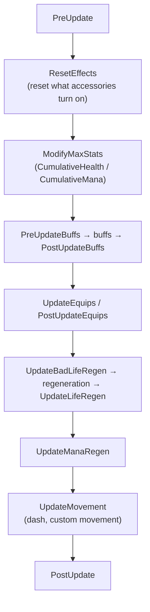

# 8. Player and buffs

Two kinds of content that live on the **player**:

- `ModPlayer`: each player's data and behavior (a dash, a death counter, a
  bonus an accessory turns on);
- `ModBuff`: a new buff or debuff, with an icon and an effect.

Read the [ideas in guide 4](04-conteudo-novo.md) first. The full list is in
the reference: [`ModPlayer`](../referencia/classes.md#modplayer) and
[`ModBuff`](../referencia/classes.md#modbuff).

Combat, shooting, mana, jumps, drawing, fishing, services, crafting and
networking are in the [reference for the additional ModPlayer hooks](../referencia/modplayer-hooks.md).

## ModPlayer

Each player has **its own instance** of each registered `ModPlayer`, created
the first time someone asks for it. In multiplayer, one player's shield turns
on only that player's dash, not everyone's.

```js
export class ExampleDashPlayer extends ModPlayer {
    DashAccessoryEquipped = false;

    ResetEffects(player) {
        this.DashAccessoryEquipped = false;   // the accessory turns it back on, if equipped
    }

    UpdateMovement(player) {
        if (this.DashAccessoryEquipped) { /* ... */ }
    }
}
```

And on the accessory:

```js
UpdateAccessory(item, player, vanity, hideVisual) {
    player.GetModPlayer(ExampleDashPlayer).DashAccessoryEquipped = true;
}
```

That is the pattern for almost every equipment effect: `ResetEffects` **turns
it off** every frame, the item **turns it on** while equipped, and the
`ModPlayer` does the effect. Take the item off and the effect is gone on the
next frame, without anyone having to notice the change.

### Finding the instance

| | |
|---|---|
| `player.GetModPlayer(Class)` | That player's instance (also by name: `GetModPlayer('ExampleDashPlayer')`). |
| `Class.get(player)` | The same. |
| `this.Player` | This instance's player. The methods also receive it as the first argument. |
| `ModPlayer.getByName(name)` | The **local** player's instance. Good for single-screen code (UI), not for game logic. |

Two mods can have a `ModPlayer` with the same class name: each has its own,
and what each one saves stays separate. By class there is never any doubt. By
name, your mod's applies; if the name belongs to another mod and more than one
mod has it, nothing comes back (and the log warns): ask with
`'modId/Class'`.

```js
player.GetModPlayer(ExampleDashPlayer);              // by class: always the right one
player.GetModPlayer('ExampleDashPlayer');            // by name: your mod's first
player.GetModPlayer('examplemod/ExampleDashPlayer'); // a specific mod's
```

### One player frame

The methods, in the order they run in a frame:



| Method | When |
|---|---|
| `PreUpdate(player)` | Start of the player's frame. |
| `ResetEffects(player)` | Right after the game resets the effects: reset here what accessories turn on. |
| `ModifyMaxStats(player)` | After `ResetEffects`: `this.CumulativeHealth`/`CumulativeMana` add to max life/mana. |
| `PreUpdateBuffs(player)`, `PostUpdateBuffs(player)` | Around the buffs. |
| `UpdateEquips(player)` (or `PostUpdateEquips`) | After equipment and accessories. |
| `UpdateBadLifeRegen(player)`, `UpdateLifeRegen(player)` | Before and after life regeneration. |
| `UpdateManaRegen(player)` | After mana regeneration. |
| `PreModifyLuck(player, luck)`, `ModifyLuck(player, luck)` | Luck (`luck` is a `Ref`: `luck.value`), recalculated every frame. `PreModifyLuck` returning false skips the game's sum (ladybug, torches, potion, kite, coins); `ModifyLuck` changes the result. |
| `UpdateMovement(player)` | Custom movement (dash): near the end of the frame. |
| `PostUpdate(player)` | End of the frame. |
| `UpdateDead(player)` | Every frame while dead (instead of the others). |

Others:

| Method | When |
|---|---|
| `Initialize()` | Once, when the instance is created. |
| `OnEnterWorld(player)` | The player entered the world. |
| `OnRespawn(player)` | Came back to life. |
| `CanUseItem(player, item)` | `false` prevents use. |
| `ModifyWeaponDamage(player, item, damage)` | Return the new damage (or put it in `this.WeaponDamage`), or change `damage` as a `StatModifier` (`damage.Additive += 0.1`, tModLoader's way). |
| `ImmuneTo(player, source, cooldown, dodgeable)` | `true`: the hit does not happen. |
| `FreeDodge(player, source, damage, ...)` | `true`: dodges. |
| `ModifyHurt(player, mod)` | Change `mod.damage`, `mod.hitDirection`, `mod.crit`... before the hit. |
| `OnHurt(player, source, damage, ...)`, `PostHurt(...)` | After the hit (`PostHurt`, only if the player survived). |
| `PreKill(player, source, damage, direction, pvp)` | `false` prevents death (give the player life, or they stay at 0). |
| `Kill(player, source, damage, direction, pvp)` | Died. |

More than one mod with a `ModPlayer`: they run in the mods' load order (the
Packages tab order) and, within a mod, in `register` order.

### Saved data

What the player should remember between sessions goes in `SaveData` and comes
back in `LoadData`:

```js
SaveData(data) {
    data.deaths = this.deaths;
}

LoadData(data) {
    this.deaths = data.deaths ?? 0;
}
```

`data` is a plain JS object (it becomes JSON), written to
`Players/<character>.plr.bl.json`, next to the game's save, **whenever the
game saves the character** (on exit, on death, on autosave). With the mod
turned off, its data stays in the file and comes back when it is turned back
on. Characters saved in the cloud are left out.

### Dashes and double taps on mobile

On mobile, the first tap in a direction sets `player.doubleTapCardinalTimer`
to **30**, not 15 as on PC. The second tap only counts with the timer below
30. A dash copied from tModLoader with `timer < 15` never fires on the device.
`ExampleDashPlayer` uses 30 and also accepts the game's dash button
(`player.controlDash`).

In multiplayer, **only the owner** decides the dash
(`player.whoAmI === Main.myPlayer`). The other devices receive the controls
over the network with a delay, and their timer would see a double tap where
there was none. The movement reaches the others through the player's
position.

## ModBuff

A new buff (or debuff). **One instance per type** (a buff is not an entity: it
is a number and a time in a player's or NPC's list). The methods receive the
player or the NPC and the buff's position in its list.

```js
export class ExampleDefenseBuff extends ModBuff {
    constructor() {
        super();
        this.DefenseBonus = 10;
    }

    ModifyDescription() {
        this.Description = this.Description.replace('{0}', this.DefenseBonus);
    }

    UpdatePlayer(player, buffIndex) {
        player.statDefense += this.DefenseBonus;
    }
}
```

An item that grants the buff: `this.Item.buffType = ModContent.BuffType('ExampleDefenseBuff')`
and `this.Item.buffTime = 5400` (in frames; 60 = 1 second). Register the buff
before the item.

Name and description come from `BuffName.<Class>` and `BuffDescription.<Class>`
in `Localization/*.json` (or from `this.DisplayName`/`this.Description`).
`ModifyDisplayName`/`ModifyDescription` run once per language.

| Method | When |
|---|---|
| `SetStaticDefaults()` | Once, with the type in the tables: `Terraria.Main.debuff[this.Type] = true`, `buffNoSave`, `buffNoTimeDisplay`, `persistentBuff`, `BuffID.Sets...`. |
| `UpdatePlayer(player, i)` | Every frame, with the buff active on the player (after `ResetEffects`, like the game's). It can remove its own buff with `player.DelBuff(i)`: the buff that moves into position `i` still runs in the same frame. |
| `UpdateNPC(npc, i)` | Every frame, with the buff active on the NPC. |
| `ApplyPlayer(player, time)`, `ApplyNPC(npc, time)` | When the buff is added. |
| `ReApplyPlayer(player, time, i)`, `ReApplyNPC(npc, time, i)` | When it is added again while already active. `false` stops the game from renewing the time. |
| `CanRemove(player, time, i, debuff)` | On tapping the icon to remove it. `true`/`false` decides; `null` leaves it to the game (debuffs do not come off). |
| `OnRemove(player, time, i)` | After being removed by the tap. |
| `ModifyBuffText(buffName, tip, rare)` | The buff's name and tip in the bar, every time they show up (three `Ref`s). For changing numbers: `tip.value = 'Defense +' + bonus`. `rare` does not change the color on mobile. The Example Mod's `ExampleDefenseBuff` puts the remaining time in the tip. |

An active mod buff on the character is saved by **name**, like items. With the
mod turned off, it stays in the file and comes back when the mod is turned
back on.

The buff also serves as the "engine" for pets and minions ([guide 6](06-projeteis.md#pets-minions-and-sentries)).
