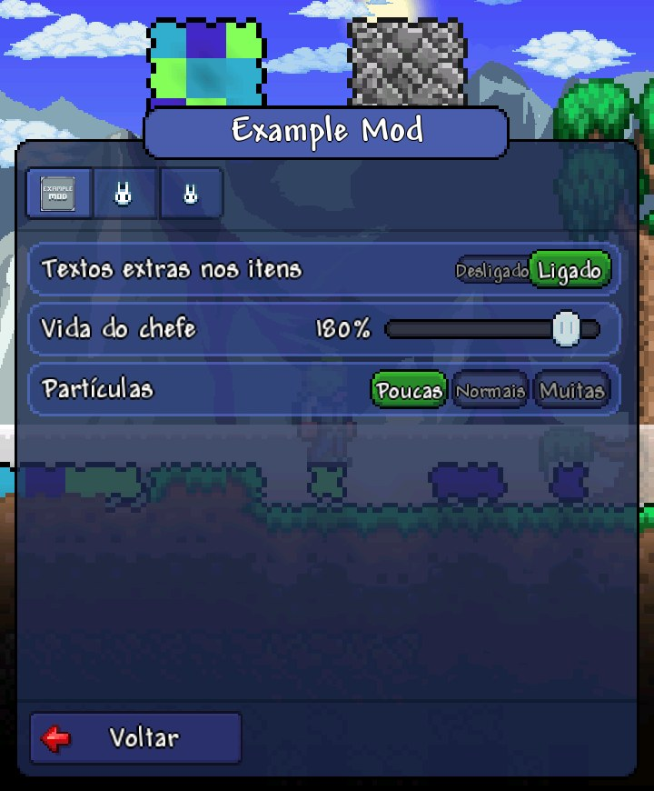

# 14. Mod options (`ModConfig`)

The player changes your mod's options in two places:

- in the world, from the pause menu, with the **Mod Configuration** button,
  right below Settings, with the Bunny Loader bunny as its icon;
- outside the world, in the main menu's **Settings**: the first row of the
  General tab is **Mod Configuration**, with the **Open** button.


The screen it opens is the game's Settings screen: the same pieces and the
same sounds, with the Discard, Default and Apply buttons from the keybinding
screen. A mod without a `ModConfig` does not show up there.

It is tModLoader's `ModConfig`, with the options declared in an object instead
of C# attributes.

## The screen

<table>
<tr>
<td width="50%"></td>
<td width="50%"></td>
</tr>
<tr>
<td>A mod with options: a single tab. At the bottom, Discard, Default and Apply.</td>
<td>Three mods: one tab per mod. A mod without <code>icon.png</code> gets the bunny.</td>
</tr>
</table>

- **The tabs**, at the top, are the mods: one per mod that has options, with
  its `icon.png`. Tapping a tab shows that mod's options, and its name goes to
  the title. With more mods than fit in the width, the row scrolls sideways:
  drag left or right, and on release it keeps going with momentum. Lifting
  your finger over a tab after dragging does not switch mods; only a tap does.
- **The rows** are the selected mod's options, in the order they were
  declared.
- **The list scrolls** like the Settings one: drag up or down, and on release
  it keeps going with momentum until it stops. A row at the edge shows cut
  off.
- **Toggle**: tap the row to switch between Off and On.
- **Slider**: drag the knob. Only the slider your finger touched moves;
  dragging the list over the sliders changes none of them.
- **Single choice**: tap the choice. Tapping the row's name moves to the next
  one.
- **Nothing changes before Apply.** The screen works on a draft of each
  config: the mod's config, `OnChanged` and the file only see the changes on
  Apply.
- **Apply** saves the changes of every mod (from every tab) and closes the
  screen. It is dimmed while nothing has changed.
- **Default** resets the options of the tab's mod to their defaults, in the
  draft: you still need to Apply. It is dimmed when they are already at the
  defaults.
- **Discard** (or Android's back) closes the screen and throws the draft away.
  Opened from the main menu, it goes back to Settings.

## Main menu only

An option that only matters before entering the world (world generation, for
example) has nothing to do in the pause menu. With
`static VisibleInWorld = false`, the config stays only in the main menu's Mod
Configuration:

```js
export class WorldGenConfig extends ModConfig {
    static VisibleInWorld = false;

    static Options = {
        BigCaves: ModConfig.Toggle(false),
        OreAmount: ModConfig.Range(100, { min: 50, max: 200, step: 10, suffix: '%' }),
    };
}
```

The default is `true`: the config shows up in both places. The flag only hides
the config from the in-world screen; the values still apply there, and
`ModContent.GetInstance` reads them the same way. A mod whose configs are all
like this gets no tab in the world.

## Declaring

A class that extends `ModConfig`, exported from any file in `Content/` or
`Common/` (the loader finds it on its own, like the rest of the content):

```js
// Common/Configs/ExampleConfig.js
export class ExampleConfig extends ModConfig {
    static Options = {
        ShowFlavorText: ModConfig.Toggle(true),
        BossHealth: ModConfig.Range(100, { min: 50, max: 200, step: 10, suffix: '%' }),
        Particles: ModConfig.Radio('normal', ['low', 'normal', 'high']),
    };

    OnChanged(key) {
        bl.log(`ExampleConfig: ${key} = ${this[key]}`);
    }
}
```

| Control | On screen | The value |
|---|---|---|
| `ModConfig.Header({ color, align })` | A section title with a line below: white and centered, or in the requested color and side | None |
| `ModConfig.Toggle(default)` | The game's "Off / On" toggle | `true` or `false` |
| `ModConfig.Range(default, { min, max, step, suffix })` | The game's slider, with the value beside it (`suffix` goes after the number) | A number from `min` to `max`, always on a `step` notch |
| `ModConfig.Radio(default, [choices])` | One button per choice, side by side; the selected one is green | The choice's text |
| `ModConfig.Dropdown(default, [choices])` | The game's dropdown (like "Auto Pause"): tap the row and choose; up to 12 choices | The choice's text |
| `ModConfig.Cycle(default, [choices])` | `< Choice >` on the right; each tap moves to the next one | The choice's text |
| `ModConfig.Color('#RRGGBB')` | A color swatch and the game's hue, saturation and lightness sliders | `'#RRGGBB'` |
| `ModConfig.Button('Method')` | A button on the right of the row; a tap calls the config's method (or the function passed) | None |
| `ModConfig.Link('https://...')` | A button on the right of the row that opens the address in the browser | None |

`Header` accepts the title's color and side, both optional:

```js
Visual: ModConfig.Header({ color: '#7FD4FF', align: 'left' }),
Danger: ModConfig.Header({ color: '#FF6060' }),
```

| Field | Values | Default |
|---|---|---|
| `color` | `'#RRGGBB'` (upper or lower case) | `'#FFFFFF'`, white |
| `align` | `'left'`, `'center'` or `'right'` | `'center'` |

Anything else and the mod does not load, and the error says which header is
wrong.

Any option accepts `enabledWhen`: the name of another option (the row only
applies when that one is on) or a function that receives the config.
Disabled, the row is dimmed like the game Settings' "Map" and does not accept
taps.

```js
EnablePets: ModConfig.Toggle(false),
PetGlow: ModConfig.Toggle(true, { enabledWhen: 'EnablePets' }),
```

A `Button` can call the methods every config has: `ResetToDefaults()` sets
everything back to default, and `SetOption(key, value)` changes one option,
like the Example Mod's "Randomize". With the screen open, the button's method
runs on the draft: `this` has the screen's values, and what it changes also
waits for Apply. Outside the screen, both change the config immediately, save
it and notify `OnChanged`.

```js
RandomGlow: ModConfig.Button('RandomizeGlow'),
ResetAll: ModConfig.Button('ResetToDefaults'),

RandomizeGlow() {
    this.SetOption('GlowColor', '#' + Math.floor(Math.random() * 0x1000000).toString(16).padStart(6, '0'));
}
```

The slider's number shows with `step`'s decimal places: `step: 0.1` shows
`1.5x`, `step: 10` shows `150%`.

The options show up in the order they were written. A mod can have more than
one `ModConfig` class: the options of all of them go into the same tab, one
class after the other.

The Example Mod's [`ExampleConfig`](../../samples/ExampleMod/content/Common/Configs/ExampleConfig.js)
has an example section for each type ("Toggle Example", "Dropdown Example",
"Color Example"...).

## Reading

Each option's current value is a property of the instance:

```js
const config = ModContent.GetInstance(ExampleConfig);
if (config.ShowFlavorText) { ... }
npc.lifeMax = Math.round(npc.lifeMax * config.BossHealth / 100);
```

Read it when you use it; do not store it in a variable during loading: the
player can change the option with the game open.

## The texts

As in tModLoader, from the mod's `Localization/<culture>.json`:

```json
{
  "Configs": {
    "ExampleConfig": {
      "BossHealth": { "Label": "Boss health" },
      "Particles": { "Label": "Particles", "low": "Few", "normal": "Normal", "high": "Many" }
    }
  }
}
```

`Configs.<Class>.<Option>.Label` is the row's name (in a `Header`, the
title). In a `Radio`, `Dropdown` or `Cycle`, each choice has its own key
(`Configs.<Class>.<Option>.<choice>`), and in a `Button` or `Link` the button
text comes from `Configs.<Class>.<Option>.Text`. Without the file, the
`label` passed in the option applies (`ModConfig.Toggle(true, { label: 'Fast mode' })`,
and `labels: [...]` for a `Radio`'s choices); without it, the option's name
split into words ("BossHealth" becomes "Boss Health"). The toggle's "On" and
"Off" come from the game itself, in its language.

Prefer short names: a slider row shares the space with the value and the
slider, and a long name runs into the number (in the Example Mod, "Ore
amount" became "Ore"). A `Radio`'s choices shrink to fit the button.

## Where it is saved

In `mod_data/<mod uid>/<Class>.json`, only what differs from the default. It
saves on Apply (and immediately, with `SetOption` outside the screen). A saved
value that no longer fits (the option was removed, the `Radio` lost the
choice, the number fell out of the new range) goes back to the default: a new
version of the mod does not break because of the old one's config.

## Hooks

- `OnLoaded()`: the values were just read from the file, when the mod loads.
- `OnChanged(key)`: option `key` changed. From the screen, it comes on Apply,
  once per changed option.
- `OnApply()`: the player pressed Apply and this config changed; it comes
  after its `OnChanged`s, with the new values already in the config.

## What is not there yet

- **Server options.** Every option belongs to the device (tModLoader's
  `ClientSide`): in multiplayer, each player has their own.
- Text fields and typed numbers (`Text` and `Number`): they depend on the
  Android keyboard opened from inside the pause menu, which does not work
  properly yet.
- Item lists and item pickers.
