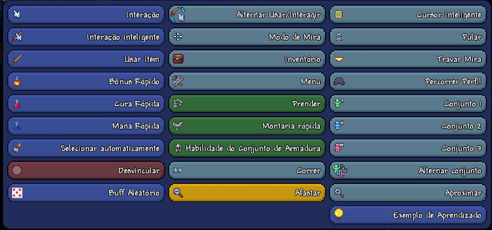

# Touch buttons: your own controls

A touch button is a mod action on Terraria Mobile's **own** controls. The
player adds it in the game's controls editor, the same screen where Jump,
Heal, Mana and Zoom are placed, and it looks, scales and saves like them.
It is tModLoader's `ModKeybind`, made for a phone: there is no keyboard, so
the "key" is a button on the screen.

```js
// Common/Systems/TouchButtonSystem.js: register
export class TouchButtonSystem extends ModSystem {
    static Dash = null;

    Load() {
        TouchButtonSystem.Dash = TouchButtonLoader.RegisterButton(this.Mod, 'Dash');
    }
}

// Common/Players/DashPlayer.js: read
export class DashPlayer extends ModPlayer {
    ProcessTriggers(player, triggersSet) {
        if (TouchButtonSystem.Dash.JustPressed) this.StartDash(player);
    }
}
```

## Registering

`TouchButtonLoader.RegisterButton(mod, name, options)` returns a
`ModTouchButton`. Call it from `Load()` of a `ModSystem` (or of your `Mod`
class), and keep the result in a static field.

- `mod`: your `Mod` (`this.Mod` in a `ModSystem`).
- `name`: unique inside your mod, without spaces. It is what the saved layout
  remembers (`FullName` is `'yourmod/Name'`), so do not rename it later.
- `options` (all optional):

| Option | What it does |
|---|---|
| `icon` | A path in your mod (`'Assets/Buttons/Dash.png'`), a `Texture2D`, an `Asset<Texture2D>`, or a function returning one. 48×48 fits best. |
| `label` | A text or a function returning one, instead of the localized name. |
| `visible` | A function: `false` hides the button (in play, not in the editor). |
| `enabled` | A function: `false` greys the button out and ignores taps. |
| `onPress` | A function `(player)` called once per tap, right on the touch. |

Without `icon`, the button uses `Assets/TouchButtons/<Name>.png` and, without
it, your package's `icon.png`.

The name shown in the editor comes from your localization, under
`TouchButtons.<Name>.DisplayName` (tModLoader's `Keybinds.<Name>.DisplayName`
also works). Without it, the name is split at capitals: `RandomBuff` becomes
"Random Buff".

```json
{
  "TouchButtons": {
    "RandomBuff": { "DisplayName": "Random Buff" }
  }
}
```

## Reading

Read the button in `ModPlayer.ProcessTriggers`, which runs once per update
for the local player, as in tModLoader:

| Property | True when |
|---|---|
| `JustPressed` | The button was touched in this update. Once per touch, even for a tap shorter than an update. |
| `Current` | The button is being held. |
| `JustReleased` | The button was let go in this update. |
| `Old` | It was held in the previous update. |
| `RetroCurrent` | `Current`, but false with the chat, a conversation or a sign open. |

Held for half a second, and a double tap:

```js
ProcessTriggers(player, triggersSet) {
    if (TouchButtonSystem.Charge.Current) {
        if (++this.HeldTimer === 30) this.Release(player);
    } else {
        this.HeldTimer = 0;
    }

    this.DoubleTapTimer = Math.max(0, this.DoubleTapTimer - 1);
    if (TouchButtonSystem.Charge.JustPressed) {
        if (this.DoubleTapTimer > 0) this.Burst(player);
        else this.DoubleTapTimer = 15;
    }
}
```

Other members:

- `IsBound`: whether the button is in the layout in use. Use it for hints
  ("add the Dash button in Controls").
- `DisplayName.Value`: the name in the game's language.
- `GetAssignedKeys()`: tModLoader's list of keys. Here it is the button's name
  when it is in the layout, or an empty list.

A button inside a **round group** (the radial menu) only fires when the
player picks it and lets go: `JustPressed`, then `JustReleased` on the next
update. It cannot be held.

## Porting from tModLoader

`KeybindLoader.RegisterKeybind(mod, name, defaultKey)` and `ModKeybind`
exist, so a ported mod works unchanged:

```js
RandomBuffKeybind = KeybindLoader.RegisterKeybind(this.Mod, 'RandomBuff', 'P');
```

The default key is accepted and ignored: it is the same `ModTouchButton`,
which the player places in the editor.

## What the player sees

1. **Settings > Controls** (or Controls in the pause menu), then a **custom**
   layout and **Edit**.
2. Touch a button slot (or add one) and open its action list: the mod
   actions are at the end, with their icon and name.
3. **Apply.** The button now works in play. Mod actions also work inside
   round group buttons.



Good to know:

- The game's own layout file never contains mod actions. When it saves, a mod
  button becomes an empty slot in the file and is kept in
  `BunnyLoader.touchbuttons.json`, next to the game's saves, by its name and
  slot. Without Bunny Loader, or without the mod, the layout keeps working.
- A removed mod leaves its slots empty; they come back when it is installed
  again.
- Share codes leave mod buttons out.
- The buttons are local: each player places their own. Nothing goes over the
  network; send what the button does with a `ModPacket` if other players need
  to know.

## The example

The Example Mod has both buttons of tModLoader's `ExampleKeybindPlayer`:
`samples/ExampleMod/content/Common/Systems/TouchButtonSystem.js` registers
them, and `Common/Players/ExampleTouchButtonPlayer.js` reads them (a random
buff on each touch, a message after holding half a second and another on a
double tap).
