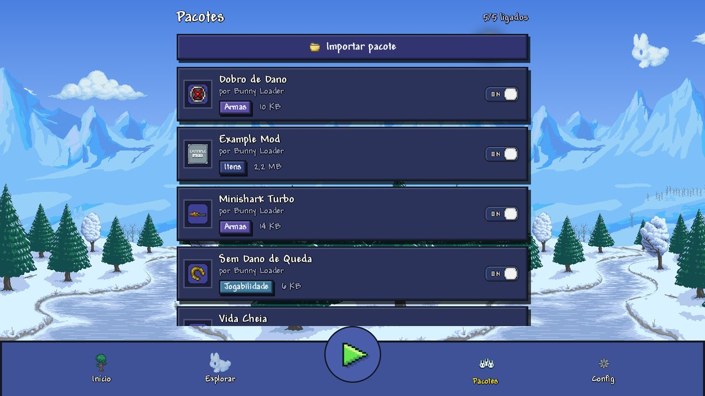
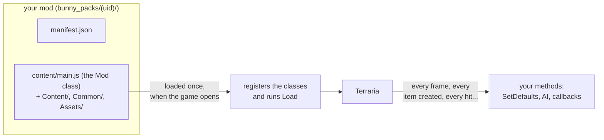
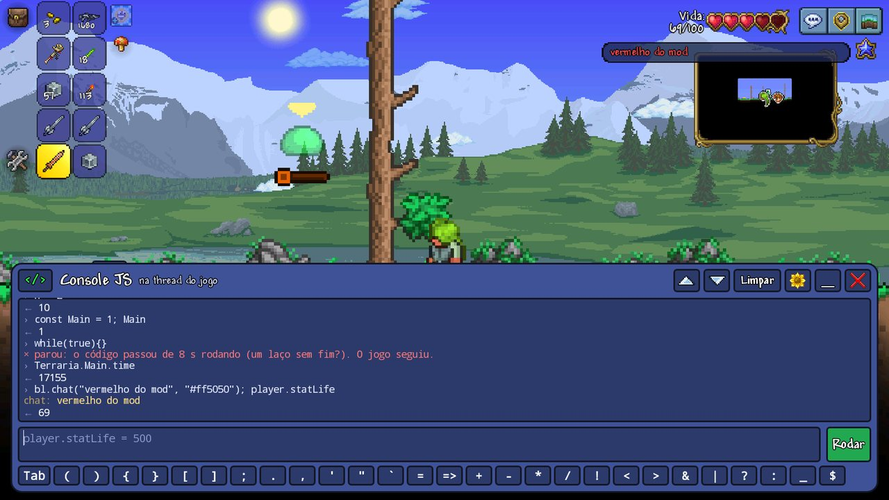

# Making mods for Bunny Loader

A Bunny Loader mod is **JavaScript that runs inside Terraria Mobile**. It
reads and writes the game's fields, calls its methods, intercepts (hooks) any
method to change what it does, and creates new content: items, weapons,
projectiles, enemies, bosses, town NPCs, tiles, buffs, sounds and music.

There is nothing to compile and nothing to patch in the game: a mod is a folder
with a `manifest.json` and a `main.js`. If you come from tModLoader, the
classes have the same names and the same shape (`ModItem`, `ModNPC`,
`SetDefaults`, `AI`...), and the package has the same layout: the `Mod` class
in the entry file, and the `Assets/`, `Common/`, `Content/` and
`Localization/` folders.



## How a mod runs



1. When the game opens, Bunny Loader loads each enabled mod **once**: it runs
   `main.js` and the files in `Content/` and `Common/`, registers every
   content class they export on its own and calls `Load()` on the `Mod`
   class, where the mod installs its hooks.
2. After that, it is the **game** that calls the mod: every frame, every item
   that spawns, every hit. The mod's code runs inside those moments.
3. All mods run in the **same JavaScript engine** (QuickJS), so one mod can
   call another like a plain function.

## The guides

Packages without code: [Texture packs](14-pacotes-de-textura.md) and [Font packs](21-pacotes-de-fonte.md).

Read them in order; each one builds on the previous.

| Guide | What it teaches |
|---|---|
| **Before you start** | |
| [0. How it works: from TL Pro to Bunny Loader](00-como-funciona.md) | The whole flow, from boot to `UseItem`: who hooks what, what is C++ and what is JS, and how it differs from TL Pro's ExMod. Optional. |
| **The bridge to the game** | |
| [1. Hooks: changing what the game already has](01-hooks-do-zero.md) | The first mod. Classes, fields, methods, structs and, above all, hooks. |
| [2. `ref` and `out`](02-ref-e-out.md) | Calling and hooking methods that return through parameters: fishing, spawn rate, collision. |
| [3. Cost and performance](03-custo-e-desempenho.md) | What each thing costs, how often the game calls each method, and how to make a lightweight mod. |
| **New content** | |
| [4. New content: the ideas](04-conteudo-novo.md) | Extending and registering, template and instance, `ModContent`, textures, localization, Mod Menu, saves. |
| [5. Items](05-itens.md) | `ModItem`: weapons, shooting, accessories, colored tooltips, fishing rods, recipes, `ModSystem`. |
| [6. Projectiles](06-projeteis.md) | `ModProjectile`: AI, collision, drawing; pets, minions and sentries. |
| [7. NPCs](07-npcs.md) | `ModNPC`: enemies, drops, natural spawning, Bestiary, town NPCs with shops and bosses. |
| [8. Player and buffs](08-jogador-e-buffs.md) | `ModPlayer` (dash, saved data) and `ModBuff`. |
| [9. Tiles](09-blocos.md) | `ModTile`: blocks and furniture (`TileObjectData`), and how a saved world keeps opening without the mod. |
| [10. Sounds and music](10-sons-e-musica.md) | `SoundStyle`, `SoundEngine.PlaySound`, boss music. |
| [15. Damage classes](15-classes-de-dano.md) | `DamageClass`: a weapon's class, per-class bonuses on the player and new classes. |
| [16. Hits](16-golpes.md) | `CanHit`, `ModifyHit` and `OnHit` for items, projectiles, NPCs and players (also in the Globals); `HitModifiers` and `HurtModifiers`. |
| [17. Screen effects](17-efeitos-de-tela.md) | Post-processing between the world and the interface: the 18 presets, `ModScreenEffect` with your own GLSL (`.frag`), multi-pass drawing, distortion, masks, LUT grading, `/fx` and hot reload. |
| [18. Touch buttons](18-botoes-de-toque.md) | `ModTouchButton`: your own buttons in the game's controls editor, read with `JustPressed`/`Current`/`JustReleased` (tModLoader's `ModKeybind`). |
| [19. Dust](19-poeiras.md) | `ModDust`: new dust types with their own texture or a frame of the game's sheet, `OnSpawn`/`Update`/`MidUpdate`/`UpdateType`/`GetAlpha`/`PreDraw`, killing dusts on a phone, cost. |
| [20. Interface](20-interface.md) | tModLoader's UI (`UIState`, `UserInterface`, `UIPanel`, `UIText`, `UIImageButton`, `UIList`...), touch on a phone, `ModifyInterfaceLayers`, a resource bar and `ModResourceOverlay` for hearts and stars. |
| **Between mods** | |
| [11. Talking between mods](11-conversa-entre-mods.md) | Finding another mod and calling what it offers (`ModLoader.TryGetMod` + `Call`). |
| [12. Globals and the world](12-globais-e-mundo.md) | Changing what the game already has (`GlobalItem`, `GlobalNPC`, `GlobalProjectile`), drops, and `ModSystem` with world data. |
| **Publishing** | |
| [13. The package page](13-pagina-do-pacote.md) | The mod's page in the launcher: `description.md`, `changelog.md`, `license.md`, authors with photos, links, extra tabs and custom colors, and the Markdown it understands. |
| [14. Mod options](14-opcoes-do-mod.md) | `ModConfig`: toggles, sliders and single-choice options on the "Mod Configuration" screen of the pause menu, the texts and where they are saved. |

For lookup:

- [What each class has today](../referencia/classes.md): every field and every
  method of `ModItem`, `ModNPC`... and what does not exist yet;
- [The bridge and `bl`](../referencia/ponte-e-bl.md): the bridge syntax and
  every `bl.*` function.

## The examples

The mods in [`samples/`](../../samples) are complete examples:

| Mod | What it shows |
|---|---|
| [`DobroDeDano`](../../samples/DobroDeDano) | The smallest mod that does something: a hook on `Item.SetDefaults`. |
| [`VidaCheia`](../../samples/VidaCheia), [`SemQueda`](../../samples/SemQueda) | A hook on `Player.Update`, changing the player's fields. |
| [`HelloMod`](../../samples/HelloMod) | A faster Minishark; the comment at the top documents the whole API. |
| [`ExampleMod`](../../samples/ExampleMod) | tModLoader's `ExampleMod`, ported: dozens of items, projectiles, NPCs, a town NPC, a boss, tiles, buffs, recipes, localization, sound, music and screen effects. |

---

## The package

A mod is a folder (or a zip of it) that looks like this:

```
MyMod/
  manifest.json      who the mod is (required)
  description.md     the description on the mod's page, in Markdown (recommended)
  changelog.md       what is new in each version (optional)
  license.md         the license (optional)
  authors/           the authors' photos (optional)
  icon.png           square icon, shown in the list (recommended)
  icon.gif           the same icon, animated, launcher only (optional)
  banner.png         cover of the mod's page, ~3.4:1, e.g. 384x112 (optional; .gif animates)
  thumbnails/        extra images for the page: png, gif, webp or jpg (optional)
  content/           the mod itself
    main.js          the entry file: the Mod class (the name comes from the manifest)
    Assets/
      Textures/      PNGs: Items/, NPCs/, Projectiles/, Tiles/, Buffs/, Gores/...
      Sounds/        sound effects (.ogg, .wav, .mp3)
      Music/         music
    Common/          what is not new stuff: ModPlayer, ModSystem, Global*
    Content/         what is new: items, NPCs, projectiles, tiles, buffs...
    Localization/    en-US.json, pt-BR.json...
```

It is tModLoader's layout. Everything the mod reads (another `.js`, a
texture, a `.json`) lives inside `content/`, and paths in code are relative to
it.

### The entry file

It **must** export the mod's class, which extends `Mod`, like tModLoader's
`public class ExampleMod : Mod`:

```js
// content/main.js
export default class MyMod extends Mod {
    Load() {
        // hooks and anything else that belongs to the whole mod
    }
}
```

Without it the mod does not load, and the log says why. Bunny Loader creates
the class on its own (no `new`): its object is your mod's `bl.mod` and what
another mod receives from `ModLoader.GetMod` ([guide 11](11-conversa-entre-mods.md)).

### Automatic registration

Every class **exported** by `main.js` or by a `.js` in `Content/` and
`Common/` that extends `ModItem`, `ModNPC`, `ModProjectile`, `ModTile`,
`ModBuff`, `ModPlayer`, `ModSystem`, `GlobalItem`, `GlobalNPC`,
`GlobalProjectile` or `GlobalLoot` is registered on its own, with no `import`
in `main.js` and no `register`:

```js
// content/Content/Items/Sword.js
export class Sword extends ModItem {
    SetDefaults() { this.Item.damage = 30; }
}
```

- The **texture** sits next to the file, with the same name, as in
  tModLoader: `Content/Items/Sword.js` uses `Content/Items/Sword.png`.
  `get Texture() { return 'Art/OtherImage'; }` (or `this.Texture = ...`)
  picks another one. Older mods, with their textures in `Assets/Textures/`
  mirroring the file, keep working.
- The order is fixed (buffs, players, NPCs, projectiles, items, tiles, systems
  and globals; within each, by file path), so each thing gets the same type on
  every device, which multiplayer requires.
- `static Autoload = false` leaves a class out: a base that others extend
  (tModLoader's `abstract` ones; see
  [base classes](04-conteudo-novo.md#your-mods-base-classes-tmodloaders-abstract-ones)),
  or one you register by hand in `Load()` with `ModItem.register(X)`.
- A class that is not a mod class (an exported helper) is ignored.

### `manifest.json`

```json
{
  "uid": "7c2e9d41-5b3a-4f8e-9a61-2d0c4e8b7f15",
  "id": "mymod",
  "name": "My Mod",
  "version": "1.0.0",
  "authors": [{ "name": "Your Name", "avatar": "you.png" }],
  "category": "Jogabilidade",
  "summary": "One line, for the list card.",
  "license": "MIT",
  "updated": "2026-09-24",
  "blVersion": 2,
  "entry": "main.js"
}
```

| Field | |
|---|---|
| `uid` | **Required.** A lowercase UUID. It is the mod's identity and its folder name: two mods with the same `uid` are the same mod (installing one replaces the other). Generate one once and never change it: `python -c "import uuid; print(uuid.uuid4())"`. |
| `id` | A short nickname, letters only. It is how another mod finds yours (`ModLoader.TryGetMod`, [guide 11](11-conversa-entre-mods.md)) and how `ModContent` finds your content (`'mymod/Sword'`). It does not need to be unique, but two installed mods with the same `id` can only find each other by `uid`. |
| `name`, `version` | What the list shows. |
| `authors` | Who made the mod: plain names or objects with a photo (`authors/`), role, color and link. `author`, a single name, still works. See [guide 13](13-pagina-do-pacote.md#the-authors). |
| `category` | Free text. `Textura`, `Armas`, `Jogabilidade`, `Cheat`, `Utilidade` and `Itens` (texture, weapons, gameplay, cheat, utility, items) get their own color and icon. |
| `type` | Optional. The launcher list the package shows up in (Explore and Packages): `"mod"` (the default), `"texture"` or `"font"`. Portuguese and plurals are accepted (`"textura"`, `"fontes"`). Without the field, or with any other value, it is a mod. It only separates the lists: every package installs and loads the same way. |
| `summary`, `updated` | The list card's line and the date of the latest version (`YYYY-MM-DD`). The long description goes in `description.md` ([guide 13](13-pagina-do-pacote.md)); the old `description` field only applies without it. |
| `license`, `links`, `pages`, `theme` | The license, link buttons, extra tabs and the page theme: text, panel and button colors, and a custom background (color or image, GIF animates). See [guide 13](13-pagina-do-pacote.md#the-colors-theme). |
| `blVersion` | The package format. Today, `2`: the layout above, with the `Mod` class in the entry file. `1` (without the `Mod` class) no longer loads: the app shows it as "Legacy format" and refuses it on import, just like a package that asks for a newer version than the app's. |
| `entry` | The entry file, relative to `content/`. Default: `main.js`. |
| `dependencies` | Optional. The mods (`id` or `uid`) that load before this one; if one of them is not enabled, this one does not load. See [guide 11](11-conversa-entre-mods.md#dependencies). |

## Installing

Installed mods live in

```
Android/data/com.bunnyloader/bunny_packs/<uid>/
```

the same folder as the saves (`Players/`, `Worlds/`), and that is where the
game loads them **from**. Four ways to put a mod there:

1. **Download from the catalog**: on the *Explore* tab, the mods published in
   Bunny Loader's online catalog. "Download mod" installs it, and an installed
   mod with a new version in the catalog gets an "Update to v…" button. The
   repository maintainer is the one who publishes (see
   [Online catalog](../../tools/README.md#online-catalog)).
2. **Import**: on the *Packages* tab, "Import package", pick the zip. The zip
   (`.bmod` or `.zip`) has `manifest.json`, `icon.png` and `content/` at the
   root, or inside a single folder, which the app ignores. If the manifest is
   wrong, the app says what is wrong and installs nothing.
3. **Copy the folder**: with a file manager, put the mod's folder in
   `bunny_packs/`. It shows up in the list when the app comes back to the
   foreground. With another name (`bunny_packs/MyMod/`), the app renames it to
   the manifest's `uid`.
4. **adb**, the fastest for development. Send a `.tar` and extract it on the
   device (on some devices and emulators, `adb push` of a folder with
   subfolders into `Android/data` arrives half-done):

   ```bash
   tar -C MyMod -cf mod.tar .
   adb push mod.tar /data/local/tmp/mod.tar
   adb shell "P=/sdcard/Android/data/com.bunnyloader/bunny_packs/7c2e9d41-5b3a-4f8e-9a61-2d0c4e8b7f15; rm -rf \$P; mkdir -p \$P && tar -xf /data/local/tmp/mod.tar -C \$P && chmod -R 777 \$P"
   ```

   The `chmod` matters: a file put there by adb belongs to the `shell` user,
   and without it the app can read the mod but cannot delete or update it
   later.

To change an installed mod, edit the files inside `bunny_packs/<uid>/` and
**reopen the game**: mods are read when the game boots, not while it runs. The
toggle on the *Packages* tab turns the mod on or off for the next boot.

## Testing fast: Restart and the console

The game reads the mods **once**, when it opens. The development cycle is:

1. edit the mod's files directly in `bunny_packs/<uid>/` (with root, through
   the file manager, or `adb push`);
2. in the game, open the **Mod Menu** (the bunny) and tap **Restart**. The
   game closes and opens again, reading the mods from the folder. Inside a
   world, **Save and restart** saves the player and the world first, like
   "Save & Exit".


To skip the title screen every time, turn on **Quick start** in the launcher
(*Settings* > *Developer*) and pick the character and the world. The game
opens straight into that world, without the Re-Logic logo and without a
single tap, and **Restart** goes straight back to it. On the emulator, the
time from tapping Play to being in the world went from ~17 s just to reach
the title screen to ~11 s already in the world. The "None: stop at title
screen" option keeps only the fast startup.

The same section has three toggles for what appears inside the game: the
**Mod Menu** (the bunny), the **JS editor** and **Restart**. With the editor
enabled, its floating JS icon is available from Terraria's title screen, with
or without the Mod Menu. Closing or minimizing the editor brings the icon
back; without the Mod Menu, no power stays on from the previous session.

If the character or the world no longer exists (or one is Journey mode and
the other is not), the game warns you in the error panel and stops at the
title screen or the world list. The session log shows the time of each step,
on the `inicio rapido: ...` lines.

To test a line without restarting, there is the JavaScript **Editor**: from
the floating JS icon or the **Editor** button in the Mod Menu. It sits at the
bottom of the screen, and the game stays visible and playable above it.



- Code runs on the **game thread**, on the next frame, as in a hook. `Main`,
  `ID` and `player` (your player) are ready to use:
  `player.statLife = 500`, `Main.dayTime = false`.
- The output shows the result of each run (`←`), errors with their line
  (`×`), what went to the chat, and the **live log**: mods' `bl.log`, and the
  errors from their hooks and classes.
- `print(...values)` writes to the **game chat**; `bl.chat(text, color)` does
  the same with a color (`'#ff5050'`, `{ R, G, B }` or a `Color`). Both work
  in any mod, not just in the editor.
- `let` and `const` only last for that run, and the same snippet runs again
  without a redeclaration error. To keep something from one run to the next:
  `var` or `globalThis.x`.
- An endless loop stops on its own after **8 s**, with a warning, and the
  game carries on.
- The editor has syntax colors, auto-indent and history on the ▲▼ arrows.
  The history and the draft survive Restart. On a physical keyboard,
  Ctrl+Enter runs.
- With the keyboard open, the panel moves up with it and sits right above it,
  without Android's full-screen editing mode and without pushing the game.
- **Full screen** covers the game and **freezes** it (the game's own pause,
  the one used with the inventory open): nothing moves in the world until you
  minimize or close. The code you ran stays in effect. Single player only; in
  a world with other people the game does not stop.
- `_` minimizes and X closes the panel. In both cases the floating JS icon
  comes back: you can drag it and reopen the editor as it was, windowed or
  full screen.

## Seeing what the mod does

Everything the mod writes with `bl.log(...)`, and every JavaScript error,
goes to a text file, one per game launch:

```
Android/data/com.bunnyloader/logs/bunny_2026-09-25_14-03-27.txt
```

The 3 most recent are kept (the oldest is deleted), so the log from the time
the game closed on its own is still there when you reopen it. Each line has
the time and the level (`I` info, `W` warning, `E` error):

```
14:03:31.204 I [mod] Double Damage: active
```

From Bunny Loader itself, the file only has each system's summary
(`itens de mod: 97 instalado(s)...`, `tiles de mod: limites do codigo
trocados em 19 de 19`), the saves and the errors. The details (each enlarged
table, each hook, each registered type) only go into the file with
**Settings > Detailed log** on; to investigate a problem in the loader itself,
turn it on and send the file.

From the computer, the same output goes to logcat, with the `BunnyLoader` tag
(the details always show up there):

```bash
adb logcat -s BunnyLoader
```

`bl.log` accepts several values, like `console.log`, and an object or array
becomes JSON: `bl.log('life', player.statLife, { x: 1 })` writes
`life 400 {"x":1}`.

### When something goes wrong

- An error at the **top level** of a mod file, while registering a class or
  in `Load()` stops the mod from loading and shows up in the log with the line
  (and, for registration, with the class and the file). So does an entry file
  without `export default class ... extends Mod`. The other mods load
  normally.
- An error inside a **hook** does not crash the game: it is logged on
  **every** call (an error in a per-frame hook fills the log fast), and if the
  callback broke before calling `original`, Bunny Loader calls the game's
  method for you.
- In **class** methods (`SetDefaults` of a `ModItem`, `AI` of a
  `ModNPC`...), the error is logged **once** per method and the rest goes on.

With **Show errors in game** on (*Settings* tab), the first error also shows
up on screen, inside the game, with a button to copy the log.

## Multiplayer

Mods run on each device: the host's and the one joining. The rules:

- **Everyone needs the same content mods.** Mod items and NPCs get a number in
  the order they are registered; if one side has one mod more or less, an
  item's number points to something else on the other side.
- **Hooks run for every player.** `Player.Update` is called for each player in
  the world, not just yours. To change only yours, check the index:
  `if (i !== Terraria.Main.myPlayer) return;` (see [guide 1](01-hooks-do-zero.md#hooks-run-for-everyone)).
- **Each device has its own state.** A field the server changed does not
  change by itself on the client: mod data travels over the network with
  `NetSend`/`NetReceive` and custom packets (see [guide 12](12-globais-e-mundo.md#network)).

## Under the hood

How Bunny Loader gets into the game, intercepts methods, shares the engine
between threads and puts new content in the tables is in the
[core documentation](../nucleo/README.md).
