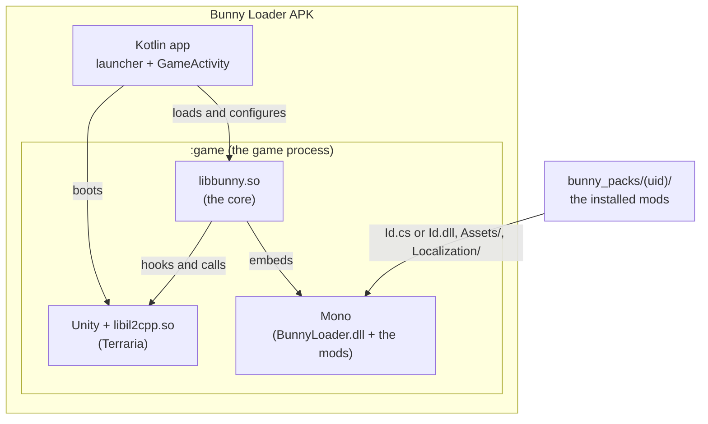
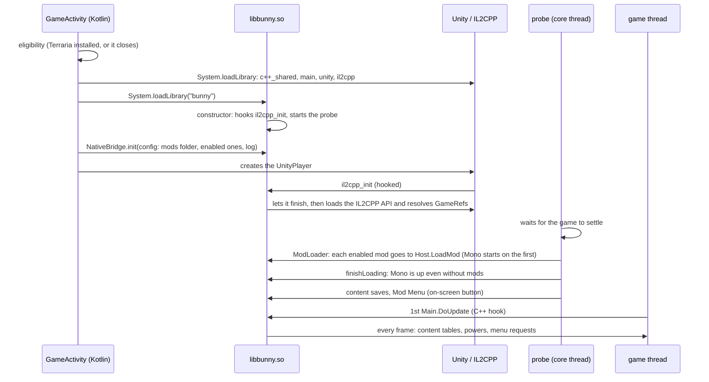

# Inside Bunny Loader: the native core

This part of the documentation is for people who want to understand, or work
on, Bunny Loader's **C++**: how it gets into the game, how it intercepts
methods, how it hosts the .NET runtime the mods run on and how it puts new
content into a compiled game. To **write mods**, the
[mod guides](../mods-em-csharp/README.md) are enough.

| Document | Subject |
|---|---|
| This one | What the core is, the boot, the folders, the general rules. |
| [Hooks under the hood](hooks.md) | ShadowHook, the hook chain, the slots, the dispatcher, `original()`, the native filters. |
| [C# under the hood](../mods-em-csharp/08-por-baixo-dos-panos.md) | The .NET runtime, the generated game API, calls, hooks and the two garbage collectors. |
| [New content under the hood](conteudo.md) | Per-type tables, compiled limits, installation, saves. |
| [Joining a server](multijogador.md) | Syncing mods and textures from the Host screen, the handshake on join and the automatic return. |
| [Menu localization](localizacao-menu.md) | The launcher's and the Mod Menu's language, the shared catalog and translations. |
| [Shader research](pesquisa-shaders.md) | Evidence about Terraria's effects and Unity materials, loading hypotheses and criteria for practical proofs. |
| [The cost of C# hooks](custo-csharp.md) | The hook profiler and what entering C# costs per frame, on the emulator and on a phone. |

## What the core is

Terraria Mobile is a Unity game whose C# was compiled to ARM64 by **IL2CPP**:
the game's code is `libil2cpp.so`, machine code, with the class and method
names stored separately, in the metadata (`global-metadata.dat`). There is no
.NET virtual machine to load a mod DLL.

The core is `libbunny.so`, written in C++20, which runs **inside the game's
process** and plays the role tModLoader plays on PC:

1. **boots along with the game** and waits for IL2CPP to be ready;
2. **finds the game's classes and methods by name**, through IL2CPP's
   embedding API (`il2cpp_class_from_name`, `il2cpp_class_get_method_from_name`...);
3. **intercepts** the game's methods (inline hooks);
4. **hosts the .NET runtime** (Mono) in which the mods run, with
   `BunnyLoader.dll`: the game as typed C# and the tModLoader-shaped API;
5. **puts new content** (items, NPCs, projectiles, buffs, tiles) into the
   game's tables, and saves that content next to the game's saves;
6. **the Mod Menu**, the superpowers and the in-game error panel.



## The process

Bunny Loader is **a single app**. The game runtime (Unity's and IL2CPP's `.so`
files and the data in `assets/bin/Data/`) goes **into the build itself**: to
Android, Bunny Loader **is** a Unity app. Those files stay out of Git (see the
[root README](../../README.md)).

Two processes:

- the **main** one, with the launcher (`LauncherActivity`, Jetpack Compose):
  mod list, import, enable and disable, settings;
- **`:game`**, with `GameActivity`, which boots Unity. This is where the game
  and the core run. A game crash does not take the launcher down with it.

## The boot



In order:

1. **Kotlin.** `GameActivity` checks eligibility (the official Terraria from
   Google Play installed on the device), checks that the runtime is in the
   build, loads the game's `.so` files by name and, after them, `libbunny.so`.
2. **`libbunny`'s constructor.** `bl_on_load`
   ([`boot/Entry.cpp`](../../app/src/main/cpp/boot/Entry.cpp)) installs the
   hook on `il2cpp_init` ([`boot/LibWatcher.cpp`](../../app/src/main/cpp/boot/LibWatcher.cpp))
   and starts the **probe**, a core thread.
3. **`NativeBridge.init`** ([`boot/jni_entry.cpp`](../../app/src/main/cpp/boot/jni_entry.cpp)):
   Kotlin passes the configuration (mods folder, which ones are enabled, log
   file, "Detailed log", "Show errors in game").
4. **`il2cpp_init`.** Before it finishes, `libil2cpp.so` is loaded but there
   is no domain, no classes and no metadata. The hook lets the original finish
   and only then loads the API (`il2cpp_*` via `dlsym`,
   [`il2cpp/Api.cpp`](../../app/src/main/cpp/il2cpp/Api.cpp)) and checks the
   game's essential references (`GameRefs`): if something does not resolve,
   it is an incompatible version and mods stay off.
5. **The probe** ([`boot/Probe.cpp`](../../app/src/main/cpp/boot/Probe.cpp))
   waits for the game to settle (calling the IL2CPP API during initialization
   kills the process), then loads each enabled mod into the .NET runtime
   (started on the first one, or by `finishLoading` when there are none,
   because the Host screen, the server sync and the config screens run on it).
   Then it installs the content saves and the Mod Menu, and marks the core
   ready: C# hooks installed during loading only start running from there.
6. **Game thread.** The core has a C++ hook on `Main.DoUpdate`
   ([`menu/Cheats.cpp`](../../app/src/main/cpp/menu/Cheats.cpp), `hkDoUpdate`).
   On the first frame, it records which thread is the game thread; on every
   frame, it runs the *ticks*: content installation on the title screen,
   pending tables, the content-ready step (`ModContent.ContentReady` in C#),
   superpowers, Mod Menu and network requests, the C# console's code and the
   save before a "Restart".

The Mod Menu's **Restart** ([`menu/DevTools.cpp`](../../app/src/main/cpp/menu/DevTools.cpp)
and `DevTools.java`) saves, if asked, on the game thread; then Java opens
`RestartActivity` in the launcher's process and kills `:game`.
`RestartActivity` waits for the old process to go away and opens
`GameActivity` in a new process, which boots everything from scratch and reads
the mods from the folder again.

### Quick start

A developer option in the launcher (*Settings* > *Developer*), in
[`boot/QuickStart.cpp`](../../app/src/main/cpp/boot/QuickStart.cpp). Off,
nothing of it is installed. On:

1. **The splash.** Mobile's Re-Logic logo is **timed**: `Main.DrawSplash`
   computes the frame from the clock (`splashCounter = ms × 60 / 1000`, seen
   in the disassembly) and only ends on frame 620, 10.3 s after the timer
   starts, whether or not the game has finished loading. Measured on the
   emulator: content ready (Unity's "Finished") at ~7 s and the splash on
   screen until ~16 s. The hook on `DrawSplash` (installed in `boot()`, right
   after `il2cpp_init`) fast-forwards the timer as soon as the game has loaded
   **and** the mods have too; `DrawSplash` itself runs the usual ending
   (`Initialize_AlmostEverything`, `PostContentLoadInitialize`, title).
2. **The probe** wakes up when the game finishes loading, instead of waiting
   the fixed 10 s (which remain as a ceiling). Mods keep loading before the
   rest of the game's initialization, as always. The decision cannot be the
   probe's: it is created in `libbunny`'s constructor, before
   `NativeBridge.init` hands over the config; what wakes the probe is the
   hook, which only exists with the option on.
3. **Entering the world** (`tickQuickStart`, in `hkDoUpdate`), with the title
   on screen and mod content ready (`contentSettled`): what the "Play" buttons
   of both lists do — `Main.LoadPlayers`, `Main.SelectPlayer`, the world's
   `SetAsActive`, `menuMode = 10` and `WorldGen.playWorld`. The character and
   the world arrive by file name (`Bench.plr`). The "Would you like to edit
   the controls now?" prompt that `Player.Spawn` opens while the touch
   controls have never been configured is dismissed only for this session
   (`DisableCheck`; `Main.PerformedTouchInputConfig` would go into the save).

### The mods, in two passes

[`mods/ModLoader.cpp`](../../app/src/main/cpp/mods/ModLoader.cpp):

- loading has **two passes**: first every manifest is read and every mod gets
  its entry in the registry; only then do the mods load, in the launcher's
  order with each `dependencies` entry pulled ahead of the mod that asks for
  it (`mods/LoadOrder.cpp`; a missing dependency or a cycle disables the mod,
  with the reason in the panel). That way `ModLoader.TryGetMod` finds a mod
  that has not loaded yet;
- a mod's entry is `<Id>.dll` or, without it, `<Id>.cs` at the package root.
  any other entry is skipped, with a line in the log;
- loading a mod is `DotnetHost::loadMod`
  ([`script/dotnet/DotnetHost.cpp`](../../app/src/main/cpp/script/dotnet/DotnetHost.cpp)),
  which calls `BunnyLoader.Host.LoadMod`
  ([`Host.cs`](../../app/src/main/csharp/BunnyLoader/Host.cs)): a source mod
  is compiled first (`BunnyLoader.Compiler`, skipped when the stamp in `bin/`
  matches), the assembly is loaded, its `Mod` classes are created, the
  translations read, the content autoloaded in tModLoader's order and `Load()`
  run;
- a mod that throws while loading, or has no `Mod` class, is marked as failed;
  the other mods load normally.

The mod API (`Mod`, `ModItem`, `ModNPC`...) is C#, in
[`app/src/main/csharp/BunnyLoader`](../../app/src/main/csharp/BunnyLoader):

- `Terraria/ModLoader/`, the API mods use, with tModLoader's names, and the
  loaders (`ItemLoader`, `NPCLoader`, `TileLoader`...);
- `Terraria/ModLoader/Core/`, the game hooks behind each loader
  (`ItemCombatHooks`, `NPCDrawHooks`, `TileDrawHooks`...);
- `Interop/`, the native table (`NativeApi`), calls into the game, game
  arrays, lists and delegates;
- the generated game API (`Terraria.Player`, `On_Player`...), written by
  `ProxyGen` from the game's dump at build time.

## The folders

```
app/src/main/cpp/
  boot/       Entry and boot: Entry (constructor), jni_entry (NativeBridge),
              LibWatcher (il2cpp_init hook), Boot, Probe (the probe),
              QuickStart, FramePacing
  core/       Global config and log (logcat + session file)
  il2cpp/     The IL2CPP API (Api: il2cpp_* via dlsym), Resolver
              (name → class/method/field), Signature (signature matching),
              GuardedCall (calls that turn game exceptions into errors)
  hook/       HookManager (chained hooks) and CodePatch (compiled limits)
  mods/       ModLoader: finds the packages and loads each one
  content/    Mod content in the game's tables
    common/     ModContent (content ready), TypeTables (per-type tables),
                ContentAssets (texture, name), GameRefs, ModNet, GameTexts
    items/ npcs/ projectiles/ buffs/ dusts/ tiles/ walls/    one per kind,
                with its save and the native stages the C# hooks run in
    players/ systems/ ui/   the player, ModSystem and HUD stages
    sounds/     AndroidAudio (mod sound and music through Android)
    textures/   texture and font packs
  graphics/   screen effects: render hook, shaders, GL state
  menu/       In-game Mod Menu: CheatButton (the bridge to Java), Cheats
              (the DoUpdate hook and the actions), Powers, MapReveal, ModMenu,
              MenuCatalog, NetRequests (client requests in multiplayer)
  script/
    dotnet/     The .NET host: DotnetHost (starts Mono, Host.LoadMod),
                MonoApi (the runtime's functions), NativeApi (the table
                of native functions C# calls), DotnetCall, HookProfile
    api/        Console (the in-game console's log)
  third_party/  notes on the native dependencies (ShadowHook comes by Gradle)

app/src/main/csharp/
  BunnyLoader/            the mod API and the loaders (BunnyLoader.dll)
  BunnyLoader.Compiler/   compiles source mods (Roslyn), on the phone and in the catalog
  ProxyGen/               generates the game API from the dump
```

The loaders (`ItemLoader`, `NPCLoader`...) are C#. The native core keeps what
only it can do: growing the game's tables, the saves next to the game's files,
the native stages and filters around hot game code, and the hooks themselves.

## General rules

1. **Everything by name.** No game offset or address is hard-coded:
   classes, fields and methods are resolved through the IL2CPP API. A game
   update changes every address; the names almost never.
2. **A broken mod does not break the game.** An exception in a C# hook is
   logged, and the game's method runs anyway.
3. **Check before writing.** A compiled limit is only swapped if the pattern
   matches exactly; a table only grows if it has its factory size. Otherwise,
   nothing is written and the log says why.
4. **Clean game saves.** The game's file never carries mod content; it goes
   next to it, by name.
5. **Only the game thread creates Unity objects** and touches the content
   tables.
6. **One table between C++ and C#.** C# reaches the core only through
   `NativeApi`, a table of function pointers that only grows at the end; its
   size is checked when the runtime starts, so a `BunnyLoader.dll` from
   another build is refused instead of calling the wrong function.

## The log

The core writes to logcat (tag `BunnyLoader`) and to a file per session,
`Android/data/com.bunnyloader/logs/bunny_<date>.txt` (the 3 most recent are
kept). The levels are `I` info, `W` warning, `E` error and `D` detail. `D`
(each enlarged table, each hook, each registered type) only goes into the file
with **Settings > Detailed log**; in logcat, always. Without it, a session
with the Example Mod comes to ~4 KB of log.

The first error (`E`) opens the **in-game error panel**, if the option is on:
an overlay of Android Views with the accumulated log and a copy button.

## Where to test

Development happens on MuMu Player (x86_64, which runs the game's ARM code
through translation) and is checked on a real ARM device. The tests are C#
mods in [`tools/tests/`](../../tools/tests), run by
[`tools/tests/run-cs.sh`](../../tools/tests/run-cs.sh), which installs the
mod, opens the game, enters the flat test world and waits for the mod's `END`
line in the log.
See [`tools/README.md`](../../tools/README.md).

## History

The architecture decisions, the crash investigations and the optimization
rounds, with the raw data, are in [`../historico/`](../historico/README.md).
