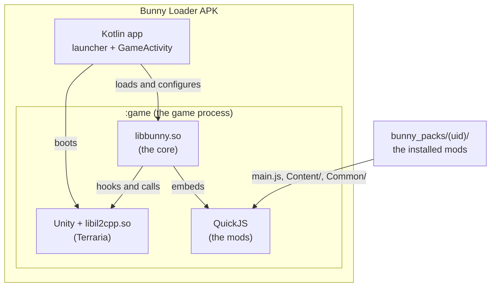
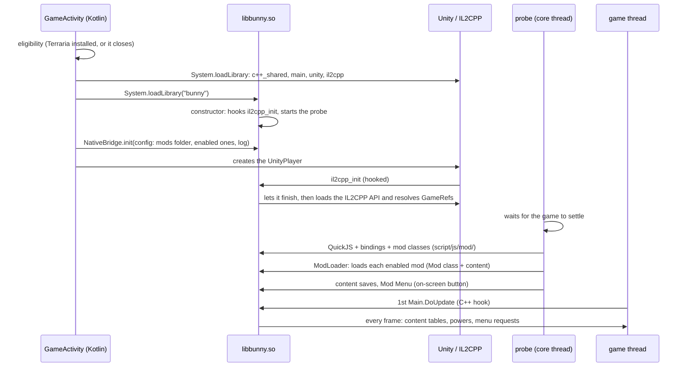

# Inside Bunny Loader: the native core

This part of the documentation is for people who want to understand, or work
on, Bunny Loader's **C++**: how it gets into the game, how it intercepts
methods, how it shares the JS engine between threads and how it puts new
content into a compiled game. To **write mods**, the [mod guides](../mods/README.md)
are enough.

| Document | Subject |
|---|---|
| This one | What the core is, the boot, the folders, the general rules. |
| [Hooks under the hood](hooks.md) | ShadowHook, the hook chain, the slots, the dispatcher, `original()`, the native filters. |
| [Threads and the JS engine](threads-e-motor-js.md) | Who runs mod code, the engine lock, the per-thread stack, `ifBusy`. |
| [The JS ↔ game bridge](ponte.md) | Names, types, structs, calls, garbage collector anchors, object identity. |
| [New content under the hood](conteudo.md) | Per-type tables, compiled limits, installation, saves. |
| [Joining a server](multijogador.md) | Syncing mods and textures from the Host screen, the handshake on join and the automatic return. |
| [Menu localization](localizacao-menu.md) | The launcher's and the Mod Menu's language, the shared catalog and translations. |
| [Shader research](pesquisa-shaders.md) | Evidence about Terraria's effects and Unity materials, loading hypotheses and criteria for practical proofs. |
| [tModLoader contracts](compatibilidade-tmodloader-desenho-banners.md) | Analysis of the item drawing, CloneDefaults and banner implementation; native boundaries, persistence, networking and combat limits. |

## What the core is

Terraria Mobile is a Unity game whose C# was compiled to ARM64 by **IL2CPP**:
the game's code is `libil2cpp.so`, machine code, with the class and method
names stored separately, in the metadata (`global-metadata.dat`). There is no
.NET virtual machine to load a mod DLL.

The core is `libbunny.so`, written in C++20, which runs **inside the game's
process** and plays the role tModLoader plays on PC:

1. **boots along with the game** and waits for IL2CPP to be ready;
2. **finds the game's classes and methods by name**, through IL2CPP's
   embedding API (`il2cpp_class_from_name`, `il2cpp_class_get_method_from_name`...);
3. **intercepts** the game's methods (inline hooks);
4. **hosts the mod engine**, [QuickJS](https://github.com/quickjs-ng/quickjs)
   (JavaScript ES2020, no JIT), and the **bridge** between JS and the game's
   objects;
5. **puts new content** (items, NPCs, projectiles, buffs, tiles) into the
   game's tables, and saves that content next to the game's saves;
6. **the Mod Menu**, the superpowers and the in-game error panel.



## The process

Bunny Loader is **a single app**. The game runtime (Unity's and IL2CPP's `.so`
files and the data in `assets/bin/Data/`) goes **into the build itself**: to
Android, Bunny Loader **is** a Unity app. Those files stay out of Git (see the
[root README](../../README.md)).

Two processes:

- the **main** one, with the launcher (`LauncherActivity`, Jetpack Compose):
  mod list, import, enable and disable, settings;
- **`:game`**, with `GameActivity`, which boots Unity. This is where the game
  and the core run. A game crash does not take the launcher down with it.

## The boot



In order:

1. **Kotlin.** `GameActivity` checks eligibility (the official Terraria from
   Google Play installed on the device), checks that the runtime is in the
   build, loads the game's `.so` files by name and, after them, `libbunny.so`.
2. **`libbunny`'s constructor.** `bl_on_load`
   ([`boot/Entry.cpp`](../../app/src/main/cpp/boot/Entry.cpp)) installs the
   hook on `il2cpp_init` ([`boot/LibWatcher.cpp`](../../app/src/main/cpp/boot/LibWatcher.cpp))
   and starts the **probe**, a core thread.
3. **`NativeBridge.init`** ([`boot/jni_entry.cpp`](../../app/src/main/cpp/boot/jni_entry.cpp)):
   Kotlin passes the configuration (mods folder, which ones are enabled, log
   file, "Detailed log", "Show errors in game").
4. **`il2cpp_init`.** Before it finishes, `libil2cpp.so` is loaded but there
   is no domain, no classes and no metadata. The hook lets the original finish
   and only then loads the API (`il2cpp_*` via `dlsym`,
   [`il2cpp/Api.cpp`](../../app/src/main/cpp/il2cpp/Api.cpp)) and checks the
   game's essential references (`GameRefs`): if something does not resolve,
   it is an incompatible version and mods stay off.
5. **The probe** ([`boot/Probe.cpp`](../../app/src/main/cpp/boot/Probe.cpp))
   waits for the game to settle (calling the IL2CPP API during initialization
   kills the process), starts QuickJS, installs the bridge and the mod
   classes, and loads each enabled mod. Then it installs the content saves and
   the Mod Menu. The JS engine is created and loads the mods on the **same**
   thread (see [threads](threads-e-motor-js.md#the-lock-jslock)).
6. **Game thread.** The core has a C++ hook on `Main.DoUpdate`
   ([`menu/Cheats.cpp`](../../app/src/main/cpp/menu/Cheats.cpp), `hkDoUpdate`).
   On the first frame, it records which thread is the game thread; on every
   frame, it runs the *ticks*: content installation on the title screen,
   pending tables, `bl.onContentReady`, superpowers, Mod Menu and network
   requests, the JS console's code and the save before a "Restart".

The Mod Menu's **Restart** ([`menu/DevTools.cpp`](../../app/src/main/cpp/menu/DevTools.cpp)
and `DevTools.java`) saves, if asked, on the game thread; then Java opens
`RestartActivity` in the launcher's process and kills `:game`.
`RestartActivity` waits for the old process to go away and opens
`GameActivity` in a new process, which boots everything from scratch and reads
the mods from the folder again.

### Quick start

A developer option in the launcher (*Settings* > *Developer*), in
[`boot/QuickStart.cpp`](../../app/src/main/cpp/boot/QuickStart.cpp). Off,
nothing of it is installed. On:

1. **The splash.** Mobile's Re-Logic logo is **timed**: `Main.DrawSplash`
   computes the frame from the clock (`splashCounter = ms × 60 / 1000`, seen
   in the disassembly) and only ends on frame 620, 10.3 s after the timer
   starts, whether or not the game has finished loading. Measured on the
   emulator: content ready (Unity's "Finished") at ~7 s and the splash on
   screen until ~16 s. The hook on `DrawSplash` (installed in `boot()`, right
   after `il2cpp_init`) fast-forwards the timer as soon as the game has loaded
   **and** the mods have too; `DrawSplash` itself runs the usual ending
   (`Initialize_AlmostEverything`, `PostContentLoadInitialize`, title).
2. **The probe** wakes up when the game finishes loading, instead of waiting
   the fixed 10 s (which remain as a ceiling). Mods keep loading before the
   rest of the game's initialization, as always. The decision cannot be the
   probe's: it is created in `libbunny`'s constructor, before
   `NativeBridge.init` hands over the config; what wakes the probe is the
   hook, which only exists with the option on.
3. **Entering the world** (`tickQuickStart`, in `hkDoUpdate`), with the title
   on screen and mod content ready (`contentSettled`): what the "Play" buttons
   of both lists do — `Main.LoadPlayers`, `Main.SelectPlayer`, the world's
   `SetAsActive`, `menuMode = 10` and `WorldGen.playWorld`. The character and
   the world arrive by file name (`Bench.plr`). The "Would you like to edit
   the controls now?" prompt that `Player.Spawn` opens while the touch
   controls have never been configured is dismissed only for this session
   (`DisableCheck`; `Main.PerformedTouchInputConfig` would go into the save).

### The mods: modules, in two passes

[`mods/ModLoader.cpp`](../../app/src/main/cpp/mods/ModLoader.cpp):

- each mod file is an **ES module** (strict mode, its own scope). Two mods can
  each have a `const Update` without colliding; relative `import` works inside
  the mod, with the module named `<uid>/<path>`;
- loading has **two passes**: first every manifest is read and every mod gets
  its `Mod` object (with `id`, `name`, `version`); only then do the mods load,
  in the launcher's order with each `dependencies` entry pulled ahead of the
  mod that asks for it (`mods/LoadOrder.cpp`; a missing dependency or a cycle
  disables the mod, with the reason in the panel). That way
  `ModLoader.TryGetMod` finds a mod that has not loaded yet
  ([guide 11](../mods/11-conversa-entre-mods.md));
- loading a mod is `ScriptEngine::loadMod`
  ([`script/bridge/ScriptEngine.cpp`](../../app/src/main/cpp/script/bridge/ScriptEngine.cpp)):
  it imports the entry file and the `.js` files in `Common/` and `Content/`
  (in alphabetical order, the same on every device) and hands the namespaces
  to the JS loader ([`script/js/mod/Core/ContentAutoload.js`](../../app/src/main/cpp/script/js/mod/Core/ContentAutoload.js)),
  which requires the `Mod` class as the entry file's `export default`,
  registers the exported content classes in a fixed order by kind and runs
  `Load()`;
- the core knows **which mod** is calling from QuickJS's module stack, and
  that is how `bl.mod`, `bl.loadTexture('x.png')` and `bl.file.read('...')`
  resolve relative paths to the right folder, even inside a hook, long after
  loading;
- a mod that throws (at the top of a file, during registration or in
  `Load()`), or has no `Mod` class, is marked as failed; the other mods load
  normally.

The mod classes (`Mod`, `ModItem`, `ModNPC`...) are JS embedded in
`libbunny`: [`script/js/mod/`](../../app/src/main/cpp/script/js/mod/), one
class per file, which CMake joins into a single function, in the order of the
list in `CMakeLists.txt`, in `ModClassesJs.h`:

- at the root, the API mods use (`ModItem.js`, `ModNPC.js`, `ModTile.js`...);
- `Loaders/`, the registration and game hooks for each kind of content
  (`ItemLoader`, `NPCLoader`, `TileLoader`...), like tModLoader's;
- `Core/`, what everyone uses (`Safe`, `Hooks`, `Ready`, `Entities`, the mod
  registry, the network, loading);
- `Enums/`, the constants (`AffectionLevel`, `SceneEffectPriority`...).

Internal methods start with an uppercase letter (`TileLoader.CheckObject`);
the mod API keeps the names it already had (`ModItem.register`,
`getTypeByName`).

## The folders

```
app/src/main/cpp/
  boot/       Entry and boot: Entry (constructor), jni_entry (NativeBridge),
              LibWatcher (il2cpp_init hook), Boot, Probe (the probe)
  core/       Global config and log (logcat + session file)
  il2cpp/     The IL2CPP API (Api: il2cpp_* via dlsym), Resolver
              (name → class/method/field), Signature (signature matching)
  hook/       HookManager (chained hooks) and CodePatch (compiled limits)
  mods/       ModLoader: finds the packages and loads each one
  content/    Mod content in the game's tables
    common/     ModContent (bl.onContentReady), TypeTables (per-type tables),
                ContentAssets (texture, name), GameRefs, TileAccess
    items/ npcs/ projectiles/ buffs/ tiles/    one loader per kind, with its save
    sounds/     AndroidAudio (mod sound and music through Android)
  menu/       In-game Mod Menu: CheatButton (the bridge to Java), Cheats
              (the DoUpdate hook and the actions), Powers, MapReveal, ModMenu,
              MenuCatalog, NetRequests (client requests in multiplayer)
  script/
    bridge/     The JS ↔ IL2CPP bridge: ScriptEngine (QuickJS, JsLock, JsSuspend),
                Bindings (the JS objects), JsHook (hooks), Invoke and Abi
                (calls), Value and Marshal (types), Members (name cache),
                Roots and WrapperMap (pinned objects), ExtraFields, Ref,
                QuickJsExt.c
    api/        The mods' bl.*: items, NPCs, projectiles, buffs, tiles,
                textures, files, sounds; ModClasses.cpp embeds the JS
    js/         mod/ (Mod, ModItem, ModNPC... and the class hooks, one
                file per subject) and ModHelpers.js (Vector2, Color, Rand...)
  third_party/  QuickJS (cloned separately, see the README there)
```

The mod classes (`ModItem`, `ModNPC`...) are written **in JavaScript**
([`script/js/mod/`](../../app/src/main/cpp/script/js/mod/)), embedded in
`libbunny.so` by CMake and evaluated in the global scope before the mods. They
use the same bridge and the same hooks a mod would, plus the native loaders
(`bl.items.register`...) for what only C++ can do.

## General rules

1. **Everything by name.** No game offset or address is hard-coded:
   classes, fields and methods are resolved through the IL2CPP API. A game
   update changes every address; the names almost never.
2. **A broken mod does not break the game.** A JS error in a hook is logged,
   and the game's method runs anyway. In mod classes, the error is logged once
   per method.
3. **Check before writing.** A compiled limit is only swapped if the pattern
   matches exactly; a table only grows if it has its factory size. Otherwise,
   nothing is written and the log says why.
4. **Clean game saves.** The game's file never carries mod content; it goes
   next to it, by name.
5. **Only the game thread creates Unity objects** and touches the content
   tables.
6. **One engine, one lock.** Every entry into QuickJS goes through `JsLock`.

## The log

The core writes to logcat (tag `BunnyLoader`) and to a file per session,
`Android/data/com.bunnyloader/logs/bunny_<date>.txt` (the 3 most recent are
kept). The levels are `I` info, `W` warning, `E` error and `D` detail. `D`
(each enlarged table, each hook, each registered type) only goes into the file
with **Settings > Detailed log**; in logcat, always. Without it, a session
with the Example Mod comes to ~4 KB of log.

The first error (`E`) opens the **in-game error panel**, if the option is on:
an overlay of Android Views with the accumulated log and a copy button.

## Where to test

Development happens on MuMu Player (x86_64, which runs the game's ARM code
through translation) and is checked on a real ARM device. The tests are mods
in [`tools/tests/`](../../tools/tests), run by
[`tools/bench/run.sh`](../../tools/bench/run.sh), which installs the mod,
opens the game, enters the test world and waits for the `FIM` line in the log.
See [`tools/README.md`](../../tools/README.md).

## History

The architecture decisions, the crash investigations and the optimization
rounds, with the raw data, are in [`../historico/`](../historico/README.md).
