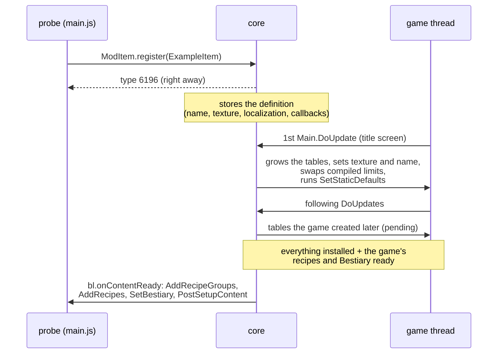

# New content under the hood

> Part of the core documentation ([overview](README.md)). To **create**
> content in a mod, see [guide 4](../mods/04-conteudo-novo.md). This page
> covers what the core does so that a new item, projectile, NPC, buff or tile
> can exist in a game that was compiled without knowing about it.

## The problem

Terraria identifies each kind of content by a number: item 98 is the
Minishark, NPC 4 is the Eye of Cthulhu. The numbers go from 0 up to a fixed
constant, and the whole game was written assuming that:

| Content | Game types | Constant | Type of the 1st mod one |
|---|---:|---|---:|
| Item | 0–6195 | `ItemID.Count` = 6196 | 6196 |
| Projectile | 0–1135 | `ProjectileID.Count` = 1136 | 1136 |
| NPC | 0–696 | `NPCID.Count` = 697 | 697 |
| Buff | 0–400 | `BuffID.Count` = 401 | 401 |
| Tile | 0–753 | `TileID.Count` = 754 | 754 |
| Wall | 0–366 | `WallID.Count` = 367 | 367 |

(Numbers from 1.4.5.8.6. Each game version changes some of them: they are in
the core's `kVanilla*Count` and in `bl.*.vanillaCount`.)

A new type needs a number above that, and every place in the game that
assumes the limit has to be found and adjusted. There are four kinds of place:

1. **Per-type tables.** Hundreds of static arrays with exactly `Count` slots:
   textures (`TextureAssets.Item`), names, the `ItemID.Sets`,
   `Main.tileSolid`... The game reads `table[type]` without checking the size:
   **this IL2CPP build does not bounds-check arrays**. Type 6196 in a table of
   6196 slots reads (and **writes**) past the end, with no error at all,
   corrupting whatever comes after.
2. **Compiled limits.** `if (type >= NPCID.Count) return;` is not an array:
   it is `cmp w8, #696` right in the machine code. `NPC.NPCLoot` bailed out
   there (mod NPCs with no drops) and `Main.DrawNPCs` skipped the NPC
   (invisible).
3. **Methods that refuse the number.** `Item.SetDefaults` zeroes an unknown
   type; `Lang.GetItemName` returns empty text above `ItemID.Count`.
4. **Save files.** The game's `.plr` and `.wld` store the number. With the mod
   turned off, the game would read a number it does not know.

## The timeline

1. **Registration (probe thread).** Each class's `register` calls the kind's
   native loader (`bl.items.register`...), which **reserves the number right
   away** (`Count` + registration order) and stores the definition: a stable
   name (`<mod uid>/<Class>`), the texture path, names per language,
   callbacks. The mod can already use the number. The game knows nothing yet.
2. **Installation (game thread).** The core has a C++ hook on
   `Main.DoUpdate`, which runs once per frame, before the game. In it, each
   loader has a `tick` (`tickModItems`, `tickModNpcs`...). On the title
   screen, with the game's tables already created, the `tick` installs
   everything at once: it grows the tables, loads the textures, registers the
   names, swaps the compiled limits and runs each class's
   `SetStaticDefaults`. Installation has to happen on the game thread: Unity
   textures can only be created there, and that is where the game swaps those
   tables.
3. **Pending (every frame).** Some tables are only created **after** the
   title screen (the game creates them on demand). Reading a static field does
   not run the static constructor, so a table that is still null stays
   **pending** and is grown on the frame it shows up. Tables the game
   **rebuilds** (changing the language rebuilds the name caches) are watched
   and get back what belongs to the mods.
4. **Content ready.** When every loader has finished and the game has already
   built its recipes, the drop database (`ItemDropsDB`) and the Bestiary
   (`BestiaryDB`), `tickContentReady` calls `bl.onContentReady`. That is when
   `AddRecipeGroups` (from every mod, before any recipe), `AddRecipes`,
   `SetBestiary`, the shops and `PostSetupContent` run.

## The tables: found, not listed

[`content/common/TypeTables.cpp`](../../app/src/main/cpp/content/common/TypeTables.cpp)
has no list of tables. For each kind of content, there is a list of
**classes** to search, and every static table in them with exactly `Count`
slots is a table of that kind. For items, the search finds ~127 (117 in
`ItemID.Sets` alone); for tiles, ~220.

The class list was checked against **every** allocation of that size in
`libil2cpp.so`: the `mov` of the constant before a `new[]` (the tool is
`tools/disasm/scan_movs.py`). Forgetting a class produces no error, it just
corrupts memory: that is how the mod item tooltip vanished once
(`ArmorSetBonuses.SetsContaining` was left out, the read picked up garbage and
the game threw `NullReferenceException` every frame).

Growing a table means creating a new array with the new size, copying and
putting the new one in the static field. The new slots start with:

- the value at slot **0** (the "nothing" for items, projectiles and buffs), or
- the **most common** value in the table (tiles): tile slot 0 is dirt, and
  copying it would make the mod block behave like dirt for grass and the
  corruption. The most common value is the default the game created the table
  with: `false` in `tileSolid`, `-1` in `tileGlowMask`. That only holds if the
  table grows **before** the game fills it in: grown afterwards, the most
  common value of `tileFrameImportant` is `true` (some 400 of the 754 types are
  furniture), and every mod block stopped being framed (it stayed on frame
  0,0). That is why tiles grow early and only `SetStaticDefaults` waits for
  `TileObjectData.Initialize`.

Two or three tables live inside **objects**, not statics (`QuickStacking`,
the inventory's "Misc" filter, each `Player`'s projectile counters). Those
grow in a hook on the object's constructor.

## The compiled limits

[`hook/CodePatch.cpp`](../../app/src/main/cpp/hook/CodePatch.cpp) swaps
constants inside the machine code, and only when the pattern matches exactly.
There are four forms, each with its own search tool in `tools/disasm/`:

| Form in the code | Example | Function | Search |
|---|---|---|---|
| `cmp wN, #limit` + an ordered branch (`b.hi`, `b.gt`...) | `if (type >= 697)` | `patchCompareLimit` | `scan_limits.py` |
| a loop in **bytes** (`cmp xN, #729`: 697 + 32 of the array header) | `for (i = 0; i < 697; i++) a[i]` | `patchLoopEnd` | `scan_loops.py` |
| a limit too large for `cmp #imm12`: `mov wB, #limit; cmp wA, wB` + an ordered branch | the item drop (`CommonCode.DropItem*`: `itemId - 1 <= Count - 2`) | `patchRegisterLimit` | `scan_reglimit.py` |
| `mov wN, #size` before `new T[size]` | a table created inside a method | `patchMovImmediate` | `scan_movs.py` |

Rules that prevent damage:

- the method is found by **name**, and the search stays inside it (from
  `methodPointer` to the class's next method);
- only the comparison **followed by the right branch** is swapped. Equality
  (`b.ne`, `b.eq`) is left out: `if (type == 696)` is a specific NPC, not a
  limit. Swapping that once left the mod slime invisible;
- if the pattern does not match (another game version), nothing is written,
  and the log says why (`describeCompareMiss`: missing, already swapped or
  write refused, with the address and the method's first 4 instructions);
- the log sums it up: `limites do codigo trocados em 19 de 19` ("code limits
  swapped in 19 of 19").

## The methods that refuse the number

Each one has a C++ hook in the kind's loader:

- **`Item.SetDefaults`** zeroes types above `Count`: for mod items, the hook
  does not call the original and fills in the item through the mod's
  `SetDefaults`.
- **`Projectile.SetDefaults`** does not zero it, but the `switch`'s `else`
  deactivates the projectile (`active = false`): the hook reactivates it after
  the mod's `SetDefaults`.
- **`Lang.GetItemName`** converts the type to `short` and returns empty text
  above `ItemID.Count`: the hook returns the name the core stored for mod
  items. `Lang.GetNPCName` has the compiled limit, swapped by `CodePatch`.
- **`ContentSamples`**: the game looks up sample dictionaries
  (`ItemsByType[type]`) for tooltips, Journey research and sorting; the mod
  samples are added.
- **`NPC.FindFrame`**: the frame height comes from the texture and the
  `npcFrameCount` of the NPC borrowed through `AnimationType`; the hook swaps
  the type and the texture during the call.

## Textures and names

[`content/common/ContentAssets.cpp`](../../app/src/main/cpp/content/common/ContentAssets.cpp):

- **Texture**: the PNG is read from disk, decoded by Unity itself
  (`ImageConversion.LoadImage` into a Unity `Texture2D`), set to *point*
  filtering (pixel art; Unity starts bilinear and the texture would come out
  blurred) and wrapped in the game's `Texture2D` and an already-loaded
  `Asset<Texture2D>`. It is the same type the game keeps in
  `TextureAssets.Item[i]`, and the same one `ModContent.Request` returns.
- **Name**: a `LocalizedText` with the current language's text, also written
  into the `LanguageManager` dictionary under the key. Parts of the game look
  up the name by key, not by table (the Bestiary blurb, for example).

## Saves: the world opens without the mod

The rule for every save: **the game's file never carries a mod type**. Mod
content goes into a side file, **by name** (`<uid>/<Class>`), and comes back by
name. That way, turning a mod off, changing the mod order or opening the save
in Terraria without Bunny Loader breaks nothing.

| What | Side file | With the mod missing |
|---|---|---|
| Items in the inventory, storage | `<character>.plr.bl` | The item becomes a "?" (from a reserve of 64 types) and comes back when the mod is turned back on. |
| Items in world chests | `<world>.wld.bl` | Same. |
| Mod tiles | `<world>.wld.tiles.bl` | The `.wld` stores air in their place; the tile comes back when the mod is turned back on. Furniture comes back whole or stays stored (a plant in its place is removed; anything else built there keeps the furniture in the file). |
| Mod walls | `<world>.wld.walls.bl` | The `.wld` stores the spot with no wall; the wall comes back when the mod is turned back on. |
| Mod town NPCs | `<world>.wld.npcs.bl` | The town NPC comes back when the mod is turned back on. |
| Active mod buffs | `<character>.plr.bl` | Stored, they come back when the mod is turned back on. |
| `ModPlayer.SaveData` | `<character>.plr.bl.json` | The data stays in the file. |

The saves follow the game 1:1: ours writes **after** the original of the
game's save method (`InternalSavePlayerFile`, `SaveWorld`...), so it saves
when and where the game saves (death, autosave, exit).

The "?" is like tModLoader's `UnloadedItem`: a type from a reserve
registered **after** the mods, so the mods' numbers do not change. A mobile
chest stores `ChestItem` (a 6-byte struct: type, stack, prefix), with no room
for metadata, so the missing item needs a real type to exist there.

## Walls: what changes

Walls are the simplest case (`content/walls/ModWalls.cpp`):

- `WallID.Count` is a `static readonly` field, not a constant: the game's code
  **reads the field** instead of comparing against 367. The scan finds no
  compiled wall limit, and the tables are created from the field.
  Installation grows the tables (`Main.wall*`, `WallID.Sets` and
  `Conversion`, `TextureAssets.Wall`, `MapHelper`) and **writes the total into
  `WallID.Count` itself**: whatever the game creates afterwards is already the
  right size;
- each cell's wall is stored **by position** (`TileData.TileWall[offset]`,
  without the `TileLookup`), not in the interned definitions like the block
  type: reading and swapping it is direct;
- the save uses the same copy of the tiles' statics block: writing reads a
  copy of `TileWall` with the mod walls zeroed, and those go to `.walls.bl`;
  on load, they come back through `Tile.set_wall` and `Framing.WallFrame`
  redoes the border;
- the JS hooks for a broken wall (`KillWall*`) use the native `wall: true`
  filter (with `tile`/`tileAt`), which reads the wall at the position instead
  of the block type;
- the map uses the same color index space as tiles (after the underworld
  color): wall entries come after the tile ones, and `.map.bl` stores them
  with the `wall:<uid>/<Class>` key;
- paint (`wallColor`, `invisibleWall`, `fullbrightWall`) goes into
  `.walls.bl`, because the game only saves wall paint with the wall in place.

## Multiplayer

Mod numbers come from the registration order. That is why **every** device
needs the same content mods: with one more mod on one side, an item's number
points to something else on the other. There is no handshake between devices
that checks this yet.

## Adding a new kind of content to the core

The recipe that worked for buffs and tiles:

1. `python tools/disasm/scan_movs.py <Count>`: where arrays of that size are
   created. Each class found goes into the `TypeTables` list; a `.ctor` of
   `Player` or `NPC` is a per-instance table (grow it in the constructor
   hook).
2. `python tools/disasm/scan_limits.py <Count-2> <Count-1> <Count>`: compiled
   comparisons. Check each one with `da.py` (the numbers collide with other
   things' IDs) and swap the right ones with `patchCompareLimit`.
3. `scan_loops.py` and `scan_reglimit.py` for the forms `scan_limits` does not
   see. The same math changes form between versions: in 1.4.5.6 the drop was
   `(x-1) >> 1 <= imm` (`scan_halved.py`); in 1.4.5.8, a `mov` + register
   `cmp`.
4. Hooks on the methods that refuse the number, and the side save.
5. A test mod in `tools/tests/` that actually uses the type.

That is how it turned up, for example, that `GUIBuffs.Draw` **zeroes** buffs
with a type ≥ `BuffID.Count` every frame.
