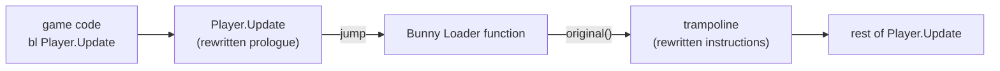
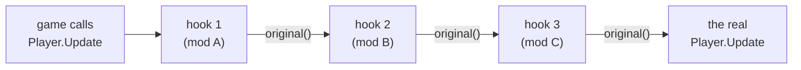
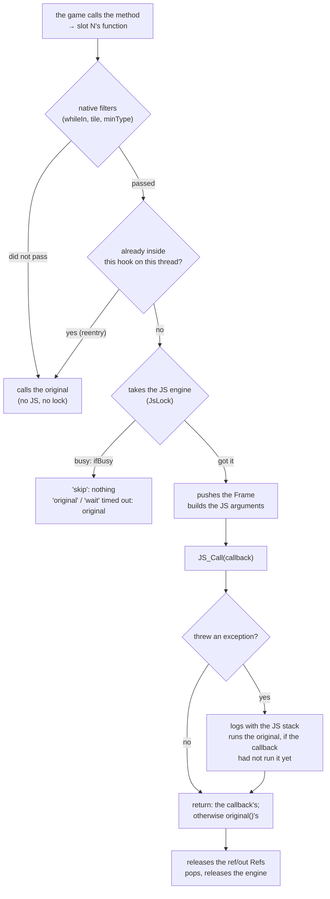

# Hooks under the hood

> Part of the core documentation ([overview](README.md)). To **use** hooks in
> a mod, see [guide 1](../mods/01-hooks-do-zero.md). This page covers what
> happens in C++ between the game calling a method and your callback running.

## What a hook is, and why it is "inline"

A hook is a detour. Every call to a game method first goes through a function
of ours, which decides what to do: call the original, change the arguments,
swap the return value or not let the original run.

In Terraria Mobile, the game's C# was compiled to ARM64 **before** it reached
the phone (IL2CPP turns C# into C++ and compiles everything, AOT). There is no
virtual machine to swap a method through reflection, and no pointer table to
redirect. A method is just a stretch of machine code inside `libil2cpp.so`,
and the code that calls it jumps straight to its address.

That is why the hook is **inline**: we rewrite the method's own first
instructions with a jump to our function. Any caller, from anywhere, enters
through the start of the method and lands in the detour. The rewritten
instructions go into a **trampoline**, which runs them and continues to the
rest of the method. The trampoline is the "original".



There are three layers, each with a job:

| Layer | File | What it does |
|---|---|---|
| ShadowHook | external library (via Gradle) | Rewrites the prologue and builds the trampoline. |
| `HookManager` | [`hook/HookManager.cpp`](../../app/src/main/cpp/hook/HookManager.cpp) | Allows **several** hooks on the same method, chained. |
| `JsHook` | [`script/bridge/JsHook.cpp`](../../app/src/main/cpp/script/bridge/JsHook.cpp) | Turns the native call into a call to the JS callback, and back. |

## Layer 1: ShadowHook

[ShadowHook](https://github.com/bytedance/android-inline-hook) (ByteDance) does
the low-level work: it figures out how many instructions it needs to move,
fixes the position-dependent ones (relative jumps, `adrp`), builds the
trampoline and swaps the prologue safely with other threads running.

We ask for a hook in two ways:

- **by address** (`shadowhook_hook_func_addr`), for game methods: the address
  comes from the `MethodInfo` IL2CPP gives us (`methodPointer`). It is the path
  for every mod hook, and it also works on MuMu, which runs ARM translated to
  x86;
- **by symbol name** (`shadowhook_hook_sym_name`), only for `il2cpp_init`
  during boot (see the [README](README.md#the-boot)).

ShadowHook runs in `UNIQUE` mode: an address accepts **one** replacement. A
second request on the same method would be refused. That is where layer 2
comes in.

## Layer 2: HookManager, the chain

The **Packages** tab lets you move mods up and down with the arrows before the
icon or by holding and dragging the card. At the edges, the list scrolls to
reach the other mods. Dragging saves on release; cancelling keeps the order.
These controls show up under **All** + **Load order**. The enablement filters
and the size or A–Z sorts only change the display. That order is saved and is
the same one sent to the core for loading; disabled mods keep their position
and new packages go at the end. With no order chosen, ascending `uid` applies.
Hooks registered during loading follow that sequence; a hook registered in a
later phase goes after the ones already installed.

Two mods want to hook `Player.Update`. ShadowHook accepts only one.
`HookManager` solves this by chaining: the second hook becomes the first one's
"original", and the second one's original is the real function.



- The **first one installed is the outermost**: it sees the call before
  everyone, and whatever it passes to `original()` is what the second one
  receives.
- Adding a new link means swapping **one pointer**: the last link's
  `original` starts pointing to the new one, and the new one points where the
  last one used to. Nothing is uninstalled, and no trampoline is freed while
  another thread might be inside it.
- The swap is atomic (`__atomic_store_n` with *release*), and whoever calls
  the original reads the pointer atomically **on every call**. That is why the
  code never keeps a copy of `original` (see the warning in
  [`HookManager.h`](../../app/src/main/cpp/hook/HookManager.h)).

Every method IL2CPP generates receives, as its **last** argument, its own
`const MethodInfo*`. A replacement function written in C++ has to declare that
extra parameter:

```cpp
using DoUpdateFn = void (*)(Il2CppObject* self, Il2CppObject* gameTime, const MethodInfo*);
DoUpdateFn g_origDoUpdate = nullptr;

void hkDoUpdate(Il2CppObject* self, Il2CppObject* gt, const MethodInfo* m) {
    // ... Bunny Loader's work, on the game thread ...
    g_origDoUpdate(self, gt, m);
}

hook::install(doUpdateMethod, hkDoUpdate, &g_origDoUpdate);
```

That is how the core itself hooks the game where there is no JS:
`Main.DoUpdate` (Bunny Loader's "tick", see [content](conteudo.md)),
`Lang.GetItemName`, saving mod items and others.

## Layer 3: JsHook, from the register to the callback

`Terraria.Player['void Update(int i)'].hook(cb)` needs a native function that
ShadowHook can install, and that function needs to know **which** hook it is,
to call the right `cb`. A generic function does not work: ShadowHook needs one
replacement function per target, and the function receives nothing but the
call's registers.

### Slots: one ready-made function per hook

The solution is **slots**: functions generated at compile time, each one
knowing its own number. `stubInt<37>` is slot 37's function; it calls the
dispatcher with `37` and the dispatcher finds everything it needs in
`g_hooks[37]`.

```cpp
template <int Slot>
static intptr_t stubInt(BL_HOOK_PARAMS) { return dispatch(BL_HOOK_ARGS, Slot).i; }
```

Installing a hook means taking the first free slot, filling in
`g_hooks[slot]` (callback, ABI plan, filters) and telling HookManager to
install `g_stubs[slot]` on the method.

The function's **return type** is part of the ARM64 ABI: integers and pointers
come back in `x0`, `float` in `s0`, `double` in `d0`, and a small struct in
several registers. A C function declared as returning `intptr_t` has no way to
put a value in `s0`. That is why there is a **family** of slots per return
shape:

| Method return | Family | Slots |
|---|---|---:|
| `void`, `int`, `bool`, object, string | `stubInt` | 1024 |
| `float` | `stubFlt` | 64 |
| `double` | `stubDbl` | 64 |
| struct up to 8 bytes (`Color`, `Point`...) | `stubStruct<S8>` | 32 |
| struct up to 16 bytes (`Rectangle`...) | `stubStruct<S16>` | 32 |
| 1 to 4 `float`s (`Vector2`, `Vector3`, `Vector4`) | `stubStruct<H1F..H4F>` | 32 each |
| 1 to 4 `double`s | `stubStruct<H1D..H4D>` | 32 each |

A slot costs ~108 bytes of code and ~240 bytes of table, and **nothing** per
call: the slot function already knows its number and goes straight to its
context. A hook installed on a method the game never calls costs nothing.

### Capturing the arguments

Every slot function has the same signature:

```cpp
#define BL_HOOK_PARAMS                                                    \
    intptr_t a0, ..., intptr_t a7,     /* x0-x7: integers and pointers */ \
    double f0, ..., double f7,         /* d0-d7: floating point        */ \
    intptr_t s0, ..., intptr_t s7      /* 8 stack slots                */
```

By the ARM64 calling convention (AAPCS64), integers and floating point go in
**separate queues**: the first 8 integers in `x0`–`x7`, the first 8 floats in
`d0`–`d7`, and the rest on the stack. Declaring the function this way makes the
compiler hand over exactly those registers, without a single line of assembly.
A method with fewer arguments leaves garbage in the registers it does not use.
We only read them, and pass them on to the original, which ignores what it did
not declare.

The limits of a hook come from here:

- up to **16 integer arguments**, counting `this` and each `ref`/`out` (which
  is a pointer): 8 in registers and 8 on the stack;
- up to **8 floating point** ones (the 9th would go interleaved on the stack,
  and that is not reproduced);
- struct returns **up to 16 bytes** (or up to 4 floats/doubles). Above that
  the value comes back through memory, via an address in `x8`, which is not an
  argument register. The hook is refused with a message.

### The ABI plan

On installation, [`Abi.cpp`](../../app/src/main/cpp/script/bridge/Abi.cpp)
builds a **plan**: for each parameter, which register (or stack slot) it
arrives in, what type it is, whether it is `ref`/`out`, whether it is a struct
by value; and where the return value travels. The same plan serves the
**direct call** (when the mod calls a game method): before, each side had its
own copy, and one of them always got some type wrong.

A detail that cost dearly: a `float` travels in the **low** 32 bits of the
register (`s0`), not the whole register. Reading the 64 bits as a `double`
gives an absurd number (`180.0f` became `5.57e-315`). That is why `Frame`
keeps the **raw bits** of `d0`–`d7`, and each parameter is interpreted by its
declared type.

## The dispatcher, step by step

`dispatch()` is the heart of the hook. It runs for **every** call to a hooked
method, so the order of the steps matters: what is cheap and discards calls
comes first.



1. **Native filters.** Before any lock or JS, the dispatcher checks the hook's
   filters (see below). Calls that do not pass go straight to the original.
   That is what makes a hook on `NPC.AI` almost free for vanilla NPCs.
2. **Reentry.** `g_depth[slot]` counts, per thread, how many times we are
   inside this hook. If the method's real body, running through
   `original()`, calls the **same** method again, the inner call goes straight
   to the original, with no callback. Without this, a recursive method would
   fire the callback in a cascade until the JS stack overflows.
3. **The engine.** `JsLock` takes the JS engine, waiting at most 3 s (or not
   at all, with `ifBusy`). See [threads and the JS engine](threads-e-motor-js.md).
4. **The Frame.** The received registers go into a `Frame`, pushed onto a
   per-thread `vector` (`g_frames`). `original()` reads from there.
5. **The JS arguments.** `argv[0]` is the `original` function (created once at
   installation, not on every call). Then comes `self`: a wrapper for the
   object or, in a struct method, a **view** of the data (so that
   `original(self)` passes the same address on). Then, each parameter
   converted by the plan; `ref`/`out` becomes a `Ref` bound to the game's
   address.
6. **The call.** `JS_Call` runs the callback.
7. **Exception.** A callback that throws must not break the game. The error
   goes to the log with the method name and the JS stack and, if the callback
   threw **before** calling the original, the dispatcher calls the original
   for it. Without this rule, a mod broken in `Item.SetDefaults` made **every**
   item in the game spawn without stats. A callback that finishes without
   calling the original, with no error, is suppressing the method on purpose,
   and that is respected. A C# exception from the **original**, on the other
   hand (the real body threw), stops at `original()`, goes to the log with the
   game's text, and `original()` returns a zeroed value: the one who called
   the method was the game, and there is nowhere to send it back to (see
   [game exceptions](ponte.md#game-exceptions)).
8. **The return.** What the callback returns becomes the method's return
   value. If it returns nothing (`undefined`) and called the original, the
   original's return value applies.
9. **The exit.** The `ref`/`out` `Ref`s come loose (they keep the last value
   and forget the address, which was on the caller's stack), the JS values are
   freed, the `Frame` is popped.

### A bug from 2026-09-24 that teaches the rule

`original()` kept `Frame& f = g_frames.back()` and, after calling the game,
wrote the result into `f`. But the game's method can fire **another** hook on
the same thread; that other hook's `push_back` reallocated the `vector`, and
the write (~200 bytes) landed in already-freed memory that IL2CPP reused for
its generics tables. The symptom was the game freezing when creating or
loading a world, "sometimes". The rule that stuck, written in the code:
**never hold a reference to a `Frame` across a call into the game; keep the
index**. The whole investigation is in [`historico/`](../historico/PONTE-OTIMIZACAO.md).

## `original()`

The function the callback receives as its first argument:

- **With no arguments**, `original()` reruns the method with the exact
  registers that arrived.
- **With arguments**, each one **replaces** its counterpart, in order (`self`
  first, for an instance method); the missing ones stay as they came. The
  hidden `const MethodInfo*` at the end also stays intact, because the starting
  point is the saved registers, not a set built from scratch.
- The `self` the hook received, passed back, **is not read**: the register
  goes as it arrived. The game calls a method that does not use `this` without
  putting it in `x0` (the compiler knows nobody reads it), and garbage stays
  there. `GUINPCDialogue.Draw` calls `Option1Clicked` with `0x1`. Asking that
  "object"'s class to see whether it was a struct crashed the game when opening
  any vanilla shop. An `x0` below `0x10000` already reaches JS as `null`.
- It is only valid **inside its own hook, during the call**. Stored in a
  variable and called later, it would run with another call's registers: the
  dispatcher refuses with `TypeError`.
- It releases the JS engine while the game's method runs (`JsSuspend`, see
  [threads](threads-e-motor-js.md)). A whole `Player.Update` can run without
  holding the engine.
- If the game's method throws a C# exception, there is no one to return it to
  (the caller was the game, not JS): it is logged (`o metodo original lancou
  excecao no jogo`, "the original method threw an exception in the game") and
  the return value is zeroed.

## Native filters

The `.hook(cb, options)` options that decide **before** JS. They exist because
the expensive part of a hook is entering the engine (see
[cost](../mods/03-custo-e-desempenho.md)): if most calls do not matter to the
mod, it is better not to enter at all.

| Option | What the dispatcher does | Who uses it |
|---|---|---|
| `{ minType: N }` | Reads `self`'s `type` field (int) straight from memory; below `N`, original with no JS. | The mod classes' `NPC.AI`, `Projectile.AI`: only mod NPCs/projectiles get in. |
| `{ minType: N, on: i }` | The same, on parameter `i` (which has to be an object). | `ItemCheck_Shoot` (the item is parameter 1). |
| `{ minType: N, on: i, field: 'shoot' }` | The same, with another int field. | The grappling hook (`item.shoot`). |
| `{ minType: N, tile: i }` | Parameter `i` is a `Tile`: the block's type is read from the world. | `ModTile` hooks: hitting dirt does not enter JS. |
| `{ minType: N, tileAt: [i, j] }` | Parameters `i` and `j` are the position; the type is read from the world. | `WorldGen.KillTile`, `CanKillTile`. |
| `{ minType: N, arg: i }` | Parameter `i` already is the type (an integer: `int`, `ushort`...). | `CallPostPlacementPlayerHook` (the placed type). |
| `{ minType: N, firstByte: i }` | Parameter `i` is a `byte[]`; the type is its first byte. | `MessageBuffer.ProcessData` (the received message number), with `marks`. |
| `{ ..., marks: 'name' }` | Together with one of the type filters: the type read also has to be marked with `bl.hookMarks.set('name', type)`. Marking after installation applies right away. | `ModTile`'s per-frame hooks (`ModifyLight`, `HitWire`...) and the ones for each method of `ModProjectile`, `ModNPC` and `ModItem`'s `GetAlpha`: only the types whose class writes that method get in. The network hooks: `ModNet.Sent(name, ...messages)` (with `arg: 0` on `NetMessage.SendData`) and `ModNet.Received(name, ...messages)` (with `firstByte: 0` on `ProcessData`) only enter JS on the marked messages. |
| `{ flag: 'name' }` | A global switch, off at the start: it only enters JS with it on (`bl.hookFlags.set('name', true)`). Applies right away to hooks already installed. | The menu theme's `DrawSunAndMoon` (on only with a mod theme in the menus) and the `PreDrawExtras` draw filters (on only during a two-part draw). |
| `{ whileIn: otherMethod }` | Only gets in if this thread is inside `otherMethod`'s JS hook (or scope) (reads its slot's `g_scopeDepth`). | `SpriteBatch.DrawString` only while drawing the tooltip; the projectile CanHitNPC's `CanNPCBeHit...`, inside `Damage_PVE`. |
| `method.scope()` | A hook with no callback (`HookFilter::scopeOnly`): increments `g_scopeDepth` and stores `self` in `g_scopeSelf` (the outer one comes back on exit), and never enters JS. `method.scopeSelf()` reads the `self` of this thread's innermost call. On a method that already has a JS hook it installs nothing: the JS hook marks it too. | `Projectile.Damage_PVE` (CombatLoader): it runs for every friendly projectile on every update; `StrikeNPC`, only on a hit, finds the projectile through it. |
| `{ ifBusy: 'original' \| 'skip' }` | What to do if the engine is held by another thread. | The mod music hooks. |

The type filters read raw memory (`std::memcpy` of 4 bytes at the field's
offset), with no wrapper and no lock. The offset is resolved once, at
installation. An impossible filter (a parameter that is not an object, a field
that does not exist, `whileIn` on a method with no JS hook, `skip` on a method
that returns a value) is refused at installation, with a message saying why.

## Who installs hooks

- **Mods**, with `.hook()`. Each call takes a slot.
- **The mod classes** (`ModItem`, `ModNPC`...), in
  [`script/js/mod/`](../../app/src/main/cpp/script/js/mod/). Each game method
  behind a class method is only hooked when **some** registered class
  overrides that method, and **once** for every mod (`Hooks.Once(...)`, in the
  `Loaders/`). Almost all of them with a native type filter.
- **The core itself**, in C++, with `hook::install` (no slot, no JS): the tick
  on `Main.DoUpdate`, the type limits, the saves.

With the Example Mod and the test mods together, the `.hook()`s written in mods
go a little over 80 slots. The stress test (`tools/tests/hookslots`) installs
more than 430 at once, and chains 55 on the same method (the limit there is the
JS engine's stack, 256 KB, not the number of slots).

## Beyond hooks: swapping compiled constants

Not every game limit sits in a method that can be hooked.
`if (type >= NPCID.Count) return;` becomes `cmp w8, #696` right in the
instruction. For those cases, [`hook/CodePatch.cpp`](../../app/src/main/cpp/hook/CodePatch.cpp)
finds the method by name, looks for the exact pattern (the comparison **and**
the conditional branch after it) and swaps only the number. If the pattern does
not match (another game version), nothing is written and the log says why. See
[content](conteudo.md).
