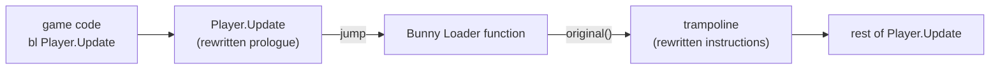
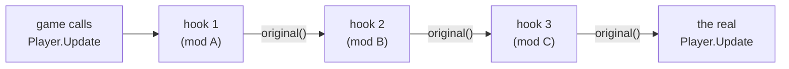

# Hooks under the hood

> Part of the core documentation ([overview](README.md)). To **use** hooks in
> a mod, see [guide 2](../mods-em-csharp/02-hooks.md). This page covers what
> happens between the game calling a method and a mod's hook running.

## What a hook is, and why it is "inline"

A hook is a detour. Every call to a game method first goes through a function
of ours, which decides what to do: call the original, change the arguments,
swap the return value or not let the original run.

In Terraria Mobile, the game's C# was compiled to ARM64 **before** it reached
the phone (IL2CPP turns C# into C++ and compiles everything, AOT). There is no
virtual machine to swap a method through reflection, and no pointer table to
redirect. A method is just a stretch of machine code inside `libil2cpp.so`,
and the code that calls it jumps straight to its address.

That is why the hook is **inline**: we rewrite the method's own first
instructions with a jump to our function. Any caller, from anywhere, enters
through the start of the method and lands in the detour. The rewritten
instructions go into a **trampoline**, which runs them and continues to the
rest of the method. The trampoline is the "original".



There are three layers, each with a job:

| Layer | File | What it does |
|---|---|---|
| ShadowHook | external library (via Gradle) | Rewrites the prologue and builds the trampoline. |
| `HookManager` | [`hook/HookManager.cpp`](../../app/src/main/cpp/hook/HookManager.cpp) | Allows **several** hooks on the same method, chained. |
| The C# trampoline | generated in `BunnyLoader.dll` (`On_<Type>`), installed through [`NativeApi`](../../app/src/main/cpp/script/dotnet/NativeApi.cpp) | Turns the native call into typed C# values, runs the mods' hooks, and back. |

## Layer 1: ShadowHook

[ShadowHook](https://github.com/bytedance/android-inline-hook) (ByteDance) does
the low-level work: it figures out how many instructions it needs to move,
fixes the position-dependent ones (relative jumps, `adrp`), builds the
trampoline and swaps the prologue safely with other threads running.

We ask for a hook in two ways:

- **by address** (`shadowhook_hook_func_addr`), for game methods: the address
  comes from the `MethodInfo` IL2CPP gives us (`methodPointer`). It is the path
  for every mod hook, and it also works on MuMu, which runs ARM translated to
  x86;
- **by symbol name** (`shadowhook_hook_sym_name`), only for `il2cpp_init`
  during boot (see the [README](README.md#the-boot)).

ShadowHook runs in `UNIQUE` mode: an address accepts **one** replacement. A
second request on the same method would be refused. That is where layer 2
comes in.

## Layer 2: HookManager, the chain

The **Packages** tab lets you move mods up and down with the arrows before the
icon or by holding and dragging the card. At the edges, the list scrolls to
reach the other mods. Dragging saves on release; cancelling keeps the order.
These controls show up under **All** + **Load order**. The enablement filters
and the size or A–Z sorts only change the display. That order is saved and is
the same one sent to the core for loading; disabled mods keep their position
and new packages go at the end. With no order chosen, ascending `uid` applies.
Hooks registered during loading follow that sequence; a hook registered in a
later phase goes after the ones already installed.

Two mods want to hook `Player.Update`. ShadowHook accepts only one.
`HookManager` solves this by chaining: the second hook becomes the first one's
"original", and the second one's original is the real function.



- The **first one installed is the outermost**: it sees the call before
  everyone, and whatever it passes to `original()` is what the second one
  receives.
- Adding a new link means swapping **one pointer**: the last link's
  `original` starts pointing to the new one, and the new one points where the
  last one used to. Nothing is uninstalled, and no trampoline is freed while
  another thread might be inside it.
- The swap is atomic (`__atomic_store_n` with *release*), and whoever calls
  the original reads the pointer atomically **on every call**. That is why the
  code never keeps a copy of `original` (see the warning in
  [`HookManager.h`](../../app/src/main/cpp/hook/HookManager.h)).

Every method IL2CPP generates receives, as its **last** argument, its own
`const MethodInfo*`. A replacement function written in C++ has to declare that
extra parameter:

```cpp
using DoUpdateFn = void (*)(Il2CppObject* self, Il2CppObject* gameTime, const MethodInfo*);
DoUpdateFn g_origDoUpdate = nullptr;

void hkDoUpdate(Il2CppObject* self, Il2CppObject* gt, const MethodInfo* m) {
    // ... Bunny Loader's work, on the game thread ...
    g_origDoUpdate(self, gt, m);
}

hook::install(doUpdateMethod, hkDoUpdate, &g_origDoUpdate);
```

That is how the core itself hooks the game:
`Main.DoUpdate` (Bunny Loader's "tick", see [content](conteudo.md)),
`Lang.GetItemName`, saving mod items and others.

## Layer 3: the C# trampoline

For every hookable game method, ProxyGen generates an `[UnmanagedCallersOnly]`
C# method with the method's exact native signature: the **trampoline**. The
first `+=` on `On_Player.Update` installs it through the native table:

```text
On_Player.Update += hook
  -> HookChain.Add: first hook on this method?
     -> NativeApi.InstallHook(method, &trampoline)
        -> hook::install(method, trampoline, slot)   (HookManager, layer 2)
        <- slot: where the "original" pointer lives
```

`installHook` gives back the address of the `original` pointer, not its
value. The trampoline reads it on every call, so a link added later by the
core or by another hook keeps the chain intact (the rule of layer 2).

On a call:

1. The game jumps into the trampoline with its registers. The arguments
   arrive already typed (a `Player`, an `int`, a `ref` that is a real C#
   reference to the game's variable), because the trampoline's signature is
   the native one.
2. If the core is not ready yet (`HookGate`: the mods are still loading on
   another thread), the trampoline calls the original and
   returns. Hooks installed during loading start running only after
   `markCoreReady`.
3. Otherwise it calls `HookChain.Chain`: the mods' hooks composed into one
   delegate, the last one added on the outside, whose innermost `orig` is the
   native original.
4. An exception in a hook is logged with the method's name; if the original
   had not run yet, it runs now, so the game's state stays consistent.
5. The return value goes back in the right register (`x0`, `s0`, `d0`, a
   register pair, or the memory `x8` points to for large structs).

Removing every hook empties the chain but leaves the trampoline installed:
calls keep passing through it and go straight to the original.

The C# loaders install their hooks the same way. For hot game methods (an
NPC's `AI`, a tile's per-frame calls), the native core adds **stages and
filters** in C++ (`content/*`) that only call into C# for mod types, so a
vanilla NPC does not pay for the crossing.

## Who installs hooks

- **Mods**, with `On_<Type>.<Method> += ...`.
- **The C# loaders** (`ItemLoader`, `NPCLoader`...), in
  `Terraria/ModLoader/Core/`. Most game methods behind a content hook are
  only hooked when some registered class overrides that hook.
- **The core itself**, in C++, with `hook::install`: the tick on
  `Main.DoUpdate`, the type limits, the saves, the native stages.

## Beyond hooks: swapping compiled constants

Not every game limit sits in a method that can be hooked.
`if (type >= NPCID.Count) return;` becomes `cmp w8, #696` right in the
instruction. For those cases, [`hook/CodePatch.cpp`](../../app/src/main/cpp/hook/CodePatch.cpp)
finds the method by name, looks for the exact pattern (the comparison **and**
the conditional branch after it) and swaps only the number. If the pattern does
not match (another game version), nothing is written and the log says why. See
[content](conteudo.md).
