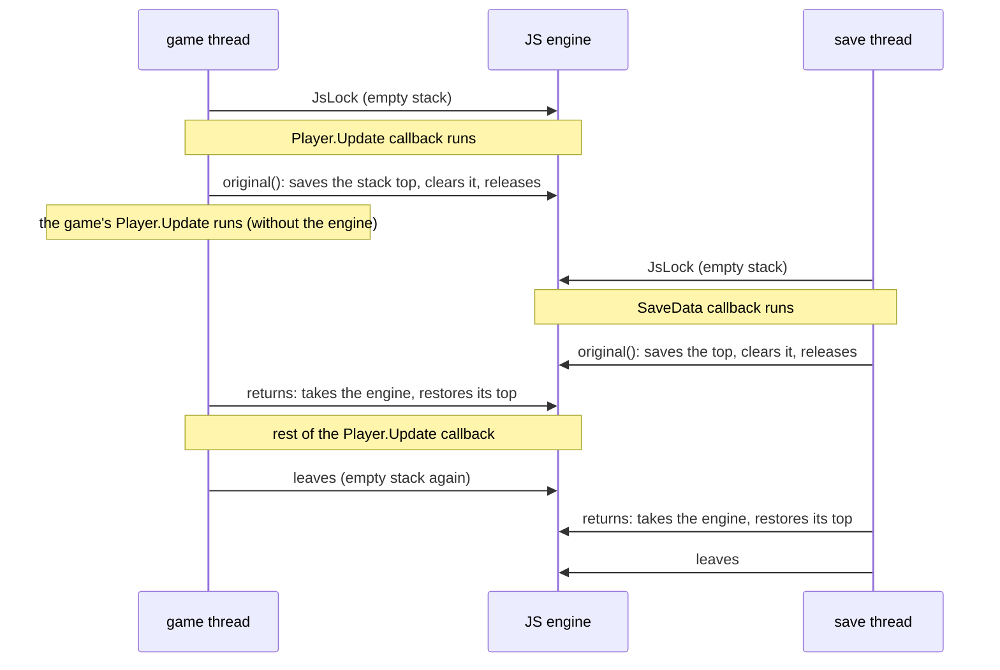

# Threads and the JS engine

> Part of the core documentation ([overview](README.md)). For the mod author's
> side, what matters from here is summarized in the [cost
> guide](../mods/03-custo-e-desempenho.md#when-the-engine-is-busy-ifbusy).

## The problem in one sentence

Terraria runs code on **several threads** at the same time, and the engine
that runs the mods (QuickJS) is **a single one** and does not accept two
threads inside it at once.

Every mod lives in the same `JSRuntime` and the same `JSContext`. That is what
lets one mod call another with a plain function call ([guide 11](../mods/11-conversa-entre-mods.md)).
But a hook can fire on any thread that calls the hooked method, and QuickJS is
not *thread-safe*: two `JS_Call`s at the same time on the same runtime corrupt
the engine's heap, and the game crashes "sometimes", with no pattern.

This document explains how the core organizes that: who can enter the engine,
when, and what happens to whoever has to wait.

## Who runs mod code

| Thread | What mod code it runs | Examples |
|---|---|---|
| **Game thread** (Unity's main one) | Almost everything: per-frame hooks, drawing, AI, the mod classes. | `Main.DoUpdate`, `Main.DoDraw`, `Player.Update`, `NPC.AI`, `ModItem.UseItem`. |
| **Probe** (Bunny Loader's thread) | Loading the mods: the top level of each file, class registration and `Load()` (with its `.hook()`s). Runs once, at boot. | `ModItem.register` (through automatic registration), `Mod.Load`. |
| **World generation** (the game's) | Hooks on the methods generation calls. | `Item.SetDefaults` for chest items. |
| **World loading** (the game's) | Hooks during loading. | `Item.SetDefaults`, the tile and town NPC saves. |
| **Save** (the game's, `ThreadPool`) | Hooks on saving the character and the world. | `Player.InternalSavePlayerFile` → `ModPlayer.SaveData`. |
| **Network** (the game's) | Hooks on the network path, in multiplayer. | Saving the character on the client. |
| JS **Editor** (Mod Menu) | The typed code, on the game thread, on the next `Main.DoUpdate` (`script/api/Console.cpp`), with an 8 s limit through QuickJS's interrupt handler. | `player.statLife = 500`. |

Android's audio threads (SoundPool, MediaPlayer) and the app's UI thread do
**not** run JS: mod audio is driven from the game thread and carries on by
itself.

The game thread is identified on the first `Main.DoUpdate`
(`runtime::noteGameThread`, in [`boot/Boot.cpp`](../../app/src/main/cpp/boot/Boot.cpp)).
Some operations only work on it, because Unity only accepts creating objects
on the main thread: `bl.loadTexture`, `bl.loadTextureAsset`,
`ModContent.Request`, and growing the content tables. Calls from elsewhere
throw an error saying so, instead of crashing Unity.

## The lock: `JsLock`

Every entry into QuickJS goes through a `JsLock`
([`script/bridge/ScriptEngine.h`](../../app/src/main/cpp/script/bridge/ScriptEngine.h)):
the hook dispatcher, mod loading, `bl.onContentReady`, the mod classes'
native callbacks.

- It is a global `std::timed_mutex`, **recursive per thread**: a per-thread
  counter (`depth`) lets the same thread enter again without locking. That is
  the normal case of callback → game method → another hooked method →
  callback, all on the same thread.
- Whoever enters from scratch records that it is the **owner** (the thread
  and, in a hook, the method). This only serves the warning for whoever waited
  too long (below).
- On taking the lock, `JS_UpdateStackTop` **realigns QuickJS's stack limit**
  with the current thread. QuickJS derives the limit from the stack pointer at
  the time it was called. Without this, mods, loaded on the probe thread, got
  `Maximum call stack size exceeded` on their first call on the game thread,
  with a 20-line script.
- Hooks wait **at most 3 s**. If another thread holds the engine that long,
  the most likely cause is a deadlock (it waiting for something of this one),
  and running the method without the mod is better than freezing the game. Mod
  loading waits as long as needed.

The engine's stack limit is **256 KB** (`JS_SetMaxStackSize`). QuickJS
assumes 1 MB, and the Android thread has exactly that: its guard only fired
**after** the real overflow, and a mod with infinite recursion killed the
process with no error and no tombstone. With headroom, the same mod gets
`Maximum call stack size exceeded` and the game carries on. It is also this
limit that fits ~55 chained hooks on the same method.

## Holding the engine during the game's method

A typical hook:

```js
Terraria.Player['void Update(int i)'].hook((original, self, i) => {
    original(self, i);          // the game's whole Player.Update runs here
    if (self.statLife < 100) self.statLife = 100;
});
```

If the engine stayed held during `original()`, it would be held during the
**whole** `Player.Update`, which is not JS at all. Worse: a hook on the save
thread would hold the engine during the whole save, and the game thread,
landing in any hook, would wait (up to 3 s, and then run without the mod, with
the "JS engine busy" warning).

That is why `original()` **releases** the engine while the game's method runs,
and takes it back afterwards (`JsSuspend`, used by
`callRaw(..., suspend = true)`).

### Why releasing is not just `unlock`

QuickJS keeps the stack of running JS frames **in the runtime**
(`rt->current_stack_frame`), not in the thread. And popping is an absolute
assignment: on leaving a function, `rt->current_stack_frame = sf->prev_frame`.

Picture two threads, each in the middle of a callback, both in `original()` at
the same time. Thread A would return and pop by setting **its own**
`prev_frame`, over B's stack. When B returned, the runtime would point to
frames that no longer exist.

The old version solved it by letting **one thread park at a time**. But the
game thread spends almost the entire frame inside some `original()`, so a hook
on the save thread could not park and held the engine for the whole method.
That is what produced the warning "JS engine busy with another thread for
3000 ms" on the music hook, on a user's device.

### The solution: each thread carries its own stack

Since 2026-09-26, on releasing the engine, the thread **saves the top of its
frame stack and leaves the runtime's empty**; on taking it back, it **restores
the top**. The stack limit follows the same idea: a thread's 256 KB are counted
from where it first **entered** the engine (`rt->stack_top`), and every nested
entry (a hook that fires from inside an `original()`) and every return from an
`original()` reuse that top.



The invariant that holds it all up: **engine free ⇒ runtime stack empty**.
Whoever enters from scratch starts on an empty stack and leaves it empty.
`JsLock`'s destructor checks this and, if a frame is left over, clears it and
logs (that would be a bug of ours).

The `current_stack_frame` and `stack_top` fields live inside the `JSRuntime`
struct, which is opaque outside `quickjs.c`. Instead of patching the QuickJS
clone, [`script/bridge/QuickJsExt.c`](../../app/src/main/cpp/script/bridge/QuickJsExt.c)
does `#include "quickjs.c"` and exposes the **address** of the frame stack and
access to the native stack top; CMake compiles that file in place of
`quickjs.c`. Saving and restoring the stack becomes a pointer read and write,
with no call. If a field is ever renamed, the build breaks there, and not the
engine, silently.

Why the native stack top too: QuickJS's `JS_UpdateStackTop` only knows how to
set the **current** stack pointer. With the engine released inside an
`original()`, the nested hook enters "from scratch", and realigning there
(deeper in the stack than when the chain started) reopened the 256 KB at every
level: a chain of hooks could overflow the native stack without
`Maximum call stack size exceeded`. It was like that for a few hours on the
same day (`hookslots` went from 53 to 120 chained hooks) until the fix: each
thread keeps its base top and a counter of `original()`s in progress. With
it, 55 fit.

With this, any number of threads can be inside an `original()` at the same
time, and the engine is held **only while JS is actually running**.

### The cost

Measured on MuMu, alternating builds: a hook that calls `original()` went from
~595 to ~750 ns; without `original()`, the same; frame time, the same. Part of
that difference comes from where the code landed in memory (MuMu translates
ARM to x86 and feels it), not from what it does. Releasing the engine costs
four atomic operations, so only the **hook** releases: a call the mod makes
into the game (`player.GetWeaponDamage(item)`) holds the engine, because the
method is short and releasing would cost more than the call (a C# property
went from 4 to 11 ms per 10 thousand calls when it always released).

The [`tools/tests/enginethreads`](../../tools/tests/enginethreads) test
reproduces the extreme case: the game thread sleeps 100 ms on every frame
inside an `original()`, and the save thread sleeps 1.5 s inside a `ModPlayer`'s
`SaveData`. With the old rule, 0 frames advanced in 1.5 s; with the new one,
the frames keep going, and after waking up each thread sees its own JS stack
(`Error.stack`) and `try`/`catch` works.

## When the engine is busy: `ifBusy`

Even with the engine held only during JS, a thread may wait: if the save runs
a heavy `SaveData`, the game thread that lands in a hook at that moment waits
for the save's JS to finish. The default is to wait up to 3 s.

For a **per-frame** hook that can go **one frame without the mod**, the mod
chooses not to wait:

| `ifBusy` | With the engine busy | What for |
|---|---|---|
| `'wait'` (default) | Waits up to 3 s. If it cannot, runs the method without the mod and warns once. | The normal case: the mod needs to run. |
| `'original'` | Runs only the game's method, right away. | An effect that can skip a frame: a fade, a color. |
| `'skip'` | Runs nothing (`void` methods only): the previous frame's result stands. | A decision the previous frame already made. |

Mod music uses both: `UpdateAudio_DecideOnNewMusic` with `'skip'` (the music
chosen on the previous frame still stands) and `UpdateAudio` with `'original'`
(the game's fade runs, the mod's skips a frame). The
[`tools/tests/ifbusy`](../../tools/tests/ifbusy) test holds the engine on a
save thread and checks all three options.

## The "JS engine busy" warning

```
hook Main.UpdateAudio_DecideOnNewMusic: motor JS ocupado ha 3000 ms por
thread 15840 (Thread-7), no hook Player.InternalSavePlayerFile; rodando o
metodo sem o mod (aviso unico por hook)
```

("JS engine busy for 3000 ms by thread ..., in hook ...; running the method
without the mod (one warning per hook)".) How to read it:

- the **first** method is the hook that waited and gave up;
- `thread 15840 (Thread-7)` is who held the engine (the Linux `tid` and the
  thread name, read from `/proc/self/task/<tid>/comm`);
- `no hook ...` is where it was. "fora de hook" ("outside a hook") means mod
  or content loading (`bl.onContentReady`);
- it is emitted **once per hook**, so as not to flood the log.

If it shows up, the owning thread is running slow JS (a big loop in a
`SaveData`, for example). Shortening what it does fixes it; `ifBusy` on the
hook that waited avoids the wait.

## Exceptions between the layers

- **An error in a hook's JS**: logged with the JS stack, and the original runs
  if the callback did not call it ([hooks](hooks.md#the-dispatcher-step-by-step)).
- **A C# exception in a method the mod called** (a `NullReferenceException`
  in there, for example): becomes an `InternalError` in JS (`'MethodName'
  lancou excecao no jogo`, "threw an exception in the game"), which the mod
  can catch with `try`/`catch`.
- **A C# exception inside a hook's `original()`**: the caller was the game,
  and there is no one to return it to. It is logged and the return value is
  zeroed.
- `JsSuspend` stays **outside** the call's `try` on purpose: on the exception
  path, the engine has to be taken back after the `catch`, not during stack
  unwinding.

## Summary of the rules

1. Every entry into QuickJS goes through `JsLock`.
2. Only the hook releases the engine during the game's method; calls made by
   the mod hold it.
3. Engine free ⇒ runtime stack empty. Each thread takes its own when
   releasing.
4. A hook waits at most 3 s (`ifBusy` changes that); mod loading waits as long
   as needed.
5. Unity objects (textures) are only created on the game thread.
6. The engine's stack is 256 KB, on any thread.
