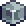
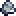
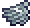
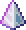
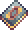
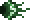

**tModLoader 的 ExampleMod** 中的一部分已为 Bunny Loader 重新制作。所有内容都是**新增**的，不会替换游戏原有内容；它们会出现在 Mod Menu 中该模组的「物品」分类下。

> [!TIP]
> 从  **示例物品**开始：在 [i:36] 工作台上用 10 个 [i:2] 泥土块可以制作 999 个示例物品。模组中的大部分物品都由它制作。配方详见「配方」标签页。

## 方块和家具

-  **示例方块**可以通过配方制作； **示例矿石**可以从 Mod Menu 中获取。
- **示例水槽**是一件 2×2 家具，制作配方会将它视为水源。
-  **示例工作台**可以制作椅子、桌子、床、门、宝箱、时钟、吊灯、火把等家具：
  - 椅子可以坐，床可以设置出生点，门可以打开，宝箱可以存放物品；
  - 篝火会提供增益效果，音乐盒会播放首领的音乐。

## 盔甲和配饰

| 装备 | 效果 |
|---|---|
| 示例头盔、胸甲和护腿 | 套装效果：[c/5FB86A:+20% 伤害] |
|  示例翅膀 | 可以飞行 |
| 示例胡须 | 随头发颜色染色 |
| 示例服装 | 靠近城镇居民时变成方块人偶 |
| 示例长袍 | 遮住双腿 |

## 前缀

示例前缀会出现在重铸和新制作的物品上：任何武器都可以获得 [c/F9E141:+20%] 或 [c/F9E141:+40%] 伤害，配饰可以获得 [c/6FA3E8:+4 防御力]。*多类别示例武器*既可以获得近战前缀，**也可以**获得魔法前缀。

## 宠物、仆从与城镇居民

- **纸飞机**和**烦人的光**分别占用宠物栏和照明宠物栏。
- 仆从法杖与哨兵法杖可以召唤为你战斗的伙伴。
-  **示例人物**会在有人持有示例物品时搬进空房子。你可以与她交谈、购买模组武器（其中一件需要用示例物品作为货币）；她还会保卫村庄。

## 屏幕效果

-  **示例终极棱镜**会射出十道汇聚成一道的光束，击中处的画面会产生波纹。
-  **示例裂隙法杖**会打开一道扭曲周围世界的裂隙，随后爆发冲击波。
- 生命值较低时，屏幕边缘会变红并脉动。

不喜欢这些效果的话，可以在「设置 > 屏幕效果」中全部关闭。

## 首领

**???之眼**可以在夜间使用  召唤物召出，并有自己的专属音乐。它可能掉落自己的面具。

> [!NOTE]
> 物品、方块和城镇居民的数据会保存在角色和世界中；即使**没有**安装这个模组，世界也仍然可以打开。
